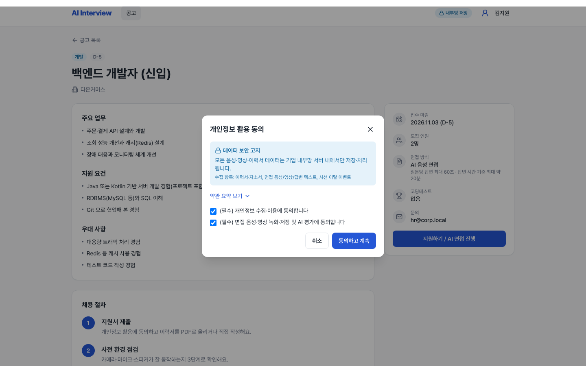
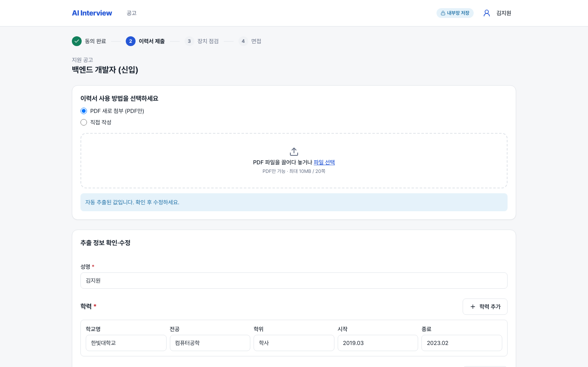
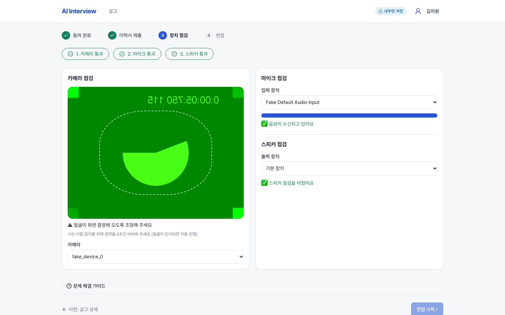
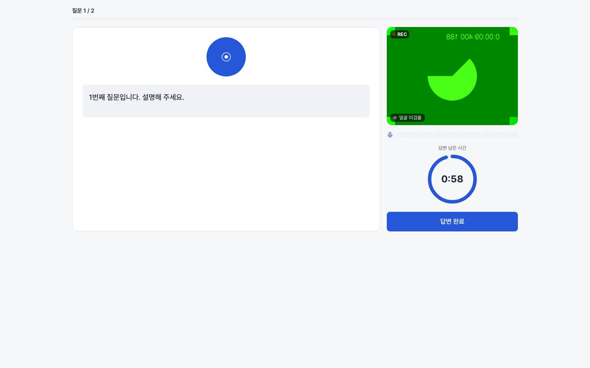
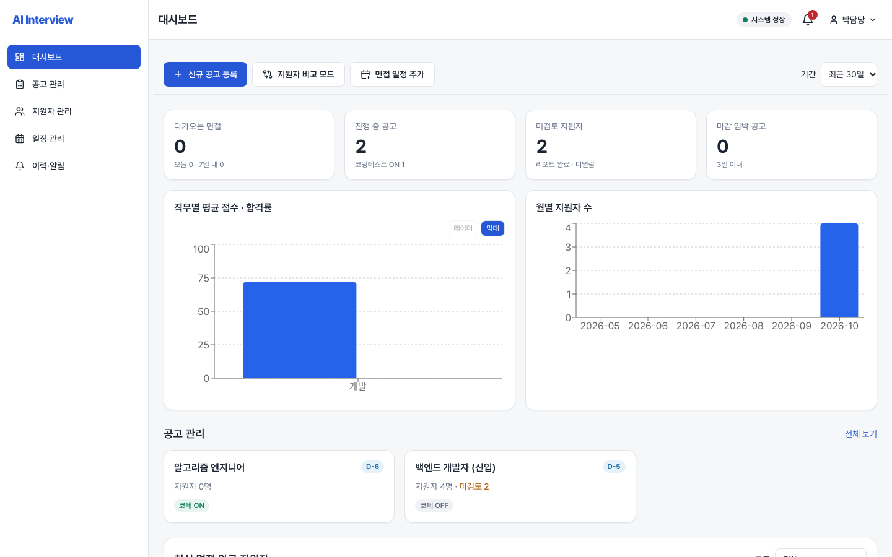
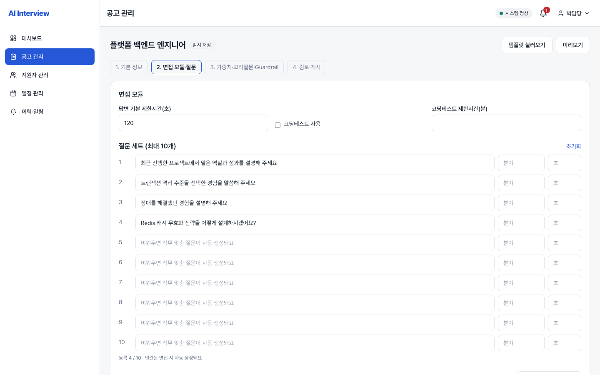
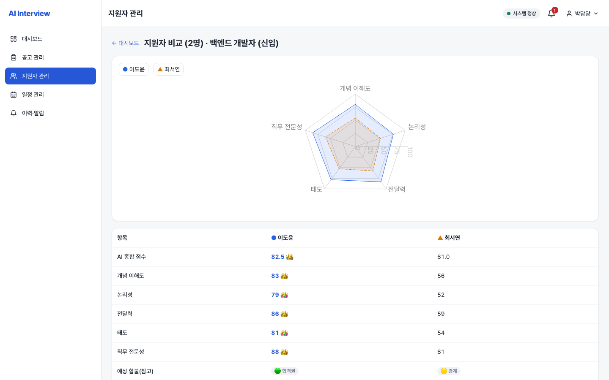
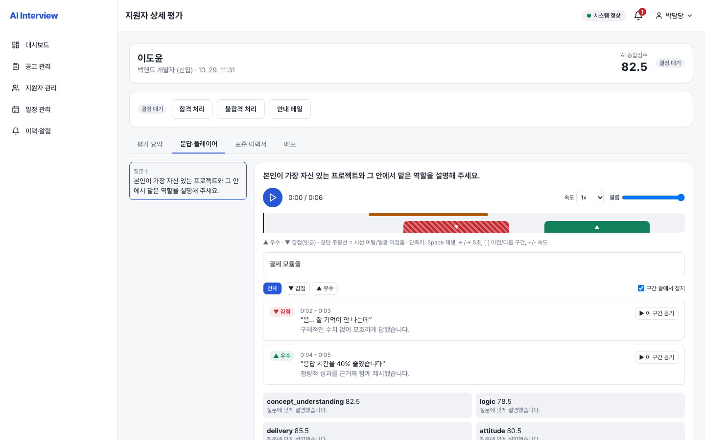

<div align="center">

# AuraEval AI

**외부 SaaS 호출 없이 한 대의 Mac에서 돌아가는 온프레미스 B2B AI 모의면접 플랫폼**


</div>

---

## 목차

1. [개요](#1-개요-overview) · 2. [주요 기능](#2-주요-기능-key-features) · 3. [화면](#3-주요-화면-screenshots) · 4. [아키텍처](#4-시스템-아키텍처--테크-스택) · 5. [빠른 시작](#5-빠른-시작-quick-start) · 6. [테스트와 성능](#6-테스트-및-검증-결과-testing--performance) · 7. [보안](#7-보안-security)

## 1. 개요 (Overview)

기업이 채용 공고를 올리면 지원자가 **음성으로 AI 면접**을 보고, 담당자가 **근거가 붙은 리포트**로 비교·결정하는 플랫폼입니다. 모든 AI 처리(LLM·STT·TTS·임베딩)가 **Mac M2 Pro 16GB 한 대 안에서** 이루어지며 외부 API를 호출하지 않아 지원자 데이터가 밖으로 나가지 않습니다. 동시 면접은 1건(`MAX_CONCURRENT_SESSIONS=1`)입니다.

| 핵심 가치 | 설명 |
|---|---|
| **환각 억제 Guardrail** | 모든 LLM 출력은 Pydantic 파서와 `ai/guardrail.py`(G2~G6)를 통과해야 합니다. 실패는 재시도 후 꼬리질문을 생략하고 기본 질문으로 대체합니다. 로그에는 고정 사유 문자열만 남깁니다. *"제로"가 아니라 검증 후 통과·폐기하는 구조입니다.* |
| **2채널 WebSocket** | control(JSON 이벤트)과 media(오디오 프레임)를 분리. 서버가 부여하는 `seq`, 재접속 시 현재 상태 자동 재전송 |
| **이력서 PDF RAG 검증** | PDF 추출 → 구조화 → ChromaDB(bge-m3) 색인. 꼬리질문은 이력서 근거(evidence)를 인용해야 통과 |
| **비동기 리포트 워커** | 면접 종료 후 별도 워커가 리포트를 생성하며, 면접이 진행 중이면 양보(preempt) |
| **기업별 데이터 격리** | 모든 관리자 API가 `company_id`로 스코프. 타사 데이터는 404 |

## 2. 주요 기능 (Key Features)

### 지원자 여정
`공고 조회·보안 동의` → `PDF 이력서 업로드·분석·스냅샷 확정` → `카메라/마이크/스피커 사전 점검` → `실시간 음성 면접(+코딩테스트)` → `대기 및 리포트 조회`

- 회원가입 모달, 마이페이지(우측 드로어: 이력서·지원 내역·계정)
- 시선 이탈 감지(MediaPipe, 브라우저 WASM)
- 코딩테스트: 내장 문제 은행, Docker 샌드박스 채점, 코드 꼬리질문

### 관리자 여정
`통합 대시보드` → `공고 작성 4단계 마법사 + AI 질문 뱅크` → `지원자 상세·음성 타임라인 하이라이트 플레이어` → `지원자 비교(Compare)` → `최종 합불 결정 + SMTP 메일 발송`

- 공고 마법사: 템플릿, 지원자 화면 실시간 미리보기, **작성 중 자동 저장**(임시저장 공고 대상, 30초)
- 지원자 목록/캘린더/알림/공고 이력, 내부 메모, 결정 이력

## 3. 주요 화면 (Screenshots)

| 화면 | 이미지 |
|---|---|
| **[지원자] APP-03** 공고 상세 및 보안 동의 모달 |  |
| **[지원자] APP-05** 이력서 PDF 업로드 및 분석 |  |
| **[지원자] APP-06** 사전 환경 점검 및 가이드 |  |
| **[지원자] APP-07** 실시간 AI 면접 |  |
| **[관리자] ADM-01** 통합 대시보드 |  |
| **[관리자] ADM-03** 공고 작성 마법사 & AI 질문 뱅크 |  |
| **[관리자] ADM-05** 지원자 다중 비교 (Compare) |  |
| **[관리자] ADM-06** 음성 타임라인 하이라이트 플레이어 |  |

## 4. 시스템 아키텍처 & 테크 스택

```
┌──────────── Browser (Next.js 14) ───────────┐
│ REST (TanStack Query) · WS control · WS media│
│ MediaPipe(WASM) 시선 · Monaco(로컬)          │
└───────────────┬─────────────────────────────┘
                │
┌───────────────▼─────────────── FastAPI ──────────────────────┐
│ REST API · SessionRuntime · Guardrail · Report Worker        │
├─────────────┬──────────────┬───────────────┬─────────────────┤
│ Ollama      │ faster-whisper│ macOS TTS     │ ChromaDB(bge-m3)│
│ Qwen2.5-7B  │ large-v3-turbo│ (say)         │ 이력서 검색     │
└─────────────┴──────────────┴───────────────┴─────────────────┘
        SQLAlchemy 2 + Alembic → PostgreSQL 16 (Prod) / SQLite (Dev·Test)
        Docker 샌드박스(코딩테스트: python/node/java)
```

| 영역 | 기술 |
|---|---|
| Frontend | Next.js 14 (App Router, TS), Tailwind CSS, TanStack Query v5, Zustand, Recharts, React Hook Form + zod |
| Backend | FastAPI (Uvicorn), SQLAlchemy 2.0, Alembic, Pydantic v2, PyMuPDF(PDF는 별도 프로세스에서 파싱), ChromaDB + BAAI/bge-m3 |
| AI | Ollama `qwen2.5:7b-instruct-q4_K_M`, faster-whisper `large-v3-turbo`(int8, CPU), macOS TTS |
| Infra | Docker Compose(PostgreSQL 16만), SQLite(개발·테스트) |

상세 설계: [`docs/PRD.md`](docs/PRD.md) · [`docs/TRD.md`](docs/TRD.md) · [`docs/UI_SPEC.md`](docs/UI_SPEC.md)

## 5. 빠른 시작 (Quick Start)

**사전 요구사항:** Apple Silicon Mac(M2 Pro 16GB 기준), Python 3.11, Node.js, [Ollama](https://ollama.com), Docker(PostgreSQL·코딩테스트 샌드박스용)

```bash
# 0) 모델 준비
ollama pull qwen2.5:7b-instruct-q4_K_M && ollama serve

# 1) PostgreSQL 16 (선택 — 개발은 SQLite 기본)
cp .env.example .env            # POSTGRES_PASSWORD 설정
docker compose up -d postgres

# 2) 백엔드
python3.11 -m venv backend/.venv
backend/.venv/bin/pip install -r backend/requirements-dev.txt
backend/.venv/bin/pip install -r backend/requirements-ai.txt   # 임베딩(bge-m3 ~2.2GB). 없으면 이력서 검색 생략
cp backend/.env.example backend/.env   # JWT_SECRET, DATA_ENCRYPTION_KEY 필수(없으면 기동 거부)
cd backend
alembic upgrade head
.venv/bin/python scripts/seed_dev.py --demo-admin
uvicorn app.main:app --reload          # http://localhost:8000

# 3) 프론트엔드 (새 터미널)
cd frontend && npm install && npm run dev   # http://localhost:3000
```

- 데모 계정: 지원자 `applicant@corp.local` · 담당자 `hr@corp.local` · 비밀번호 `Passw0rd!` (로그인 화면에서 "담당자" 탭)
- PostgreSQL 사용 시: `DATABASE_URL=postgresql+asyncpg://interview:<pw>@127.0.0.1:5432/interview alembic upgrade head`
- 리포트 워커: `python -m app.worker` (또는 `REPORT_WORKER_EMBEDDED=true`)
- 코딩테스트 샌드박스: `backend/sandbox/build.sh` 후 `SANDBOX_ENABLED=true`
- 모델 없이 UI만 보려면 가짜 엔진 스택: `backend/scripts/dev_fake_stack.py`

## 6. 테스트 및 검증 결과 (Testing & Performance)

| 항목 | 결과 (최근 실행 기준) |
|---|---|
| 백엔드 pytest (SQLite) | **459 passed, 3 skipped** (Docker 이미지가 없으면 샌드박스 테스트는 스스로 skip) |
| 백엔드 on PostgreSQL 16 | `TEST_DATABASE_URL=postgresql+asyncpg://… pytest` 로 같은 스위트를 PostgreSQL 16에서도 실행(테스트마다 임시 DB 생성 후 삭제) |
| 프론트엔드 Vitest | **151 passed** |
| Playwright E2E (가짜 카메라/마이크/엔진) | 55개 시나리오 (가짜 카메라/마이크/엔진 기반 지원자·관리자 전 여정) |
| 변이 검사 | 가드레일·런타임·자동 저장 로직을 일부러 깨뜨려 테스트가 실패함을 확인 |

### 성능 (로컬 실측, Mac M2 Pro 16GB)

| 지표 | 설계 목표 | 실측 (14회, 비공식) |
|---|---|---|
| E2E 지연 (답변 종료 → 다음 질문 음성) | p50 ≤ 9.5s, p95 ≤ 12s | p50 9.97s, p95 15.82s (본 질문 p50 5.4s, 꼬리질문 p50 12.2s) |
| 메모리 | 시스템 피크 ≤ 14.5GB | 브라우저 등 다른 앱 포함 최대 15.37GB |

- 지연은 증분 STT(면접 중 백그라운드 디코딩)와 LLM 스트리밍 중 질문 필드 완성 시점의 TTS 시작으로 줄였습니다.
- 재측정: `backend/scripts/measure_e2e_latency.py`, `backend/tests/benchmark_ai.py` (설정 근거는 TRD §9.1, §11)

## 7. 보안 (Security)

- **멀티테넌시:** 관리자 API 전부 호출자의 `company_id`로 스코프. 타사·미완료·없는 리소스는 모두 **404**로 응답해 존재 여부를 노출하지 않습니다.
- **감사 로그:** 지원자 상세·타임라인 조회, 공고 생성/삭제 등을 `audit_logs`에 기록.
- **PII 보호:** 이력서 PDF는 텍스트 추출 후 **원본 파일을 즉시 삭제**하며, 어떤 등록본·스냅샷도 원본 PDF를 참조하지 않습니다. 로그에 PII·원본 오디오·원문 전사를 남기지 않습니다(NFR-S1/S2).
- **프롬프트 안전:** 사용자 텍스트는 `<untrusted>` 로 감싸고 defang 처리. PDF 파싱은 별도 프로세스.
- **인증:** JWT 기반 인증, 역할(지원자/담당자)별 접근 제어.
