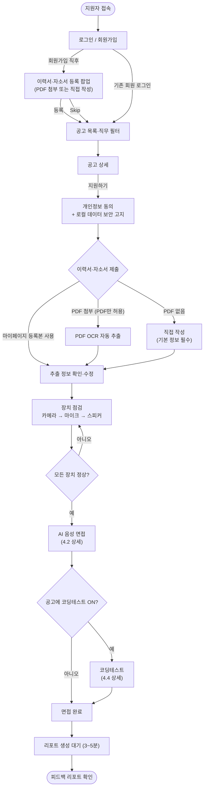
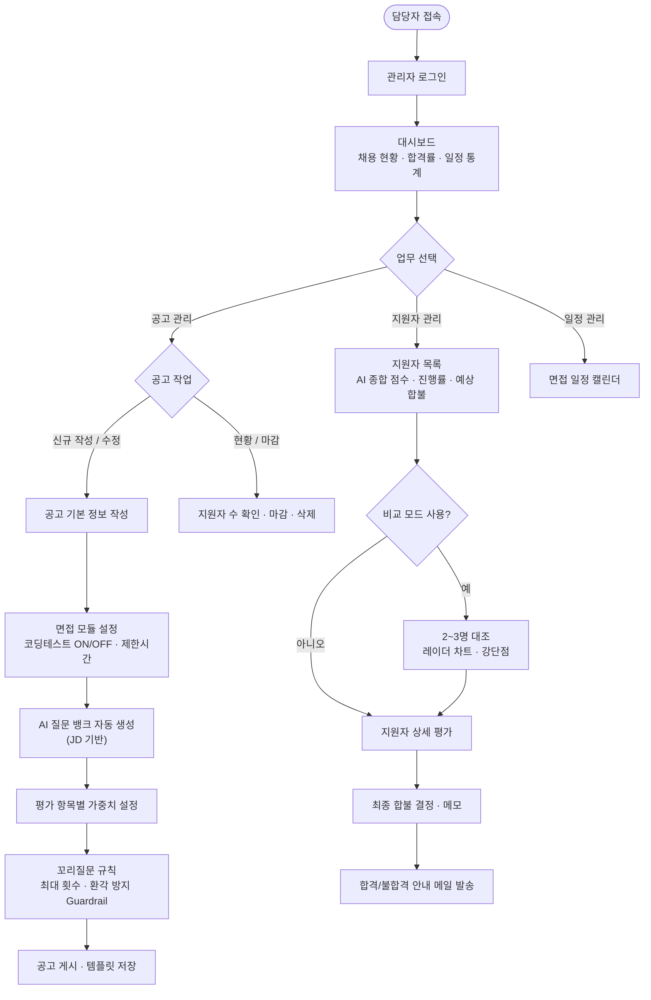
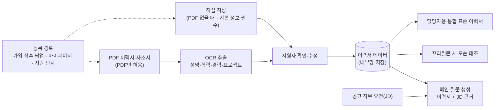
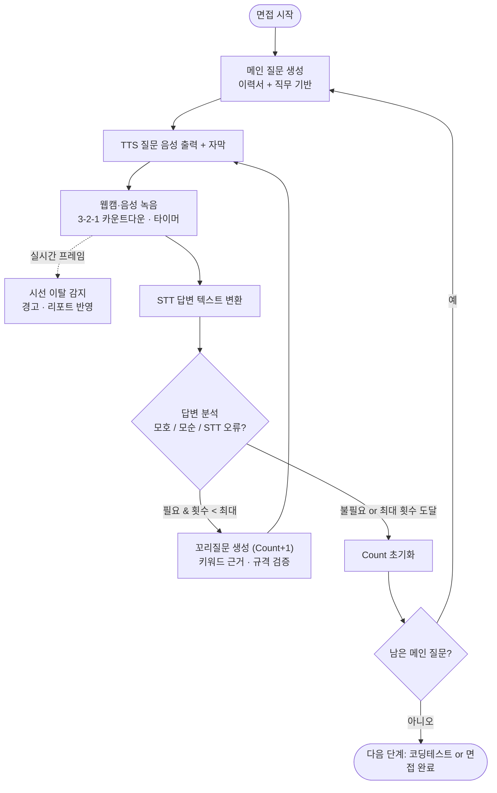
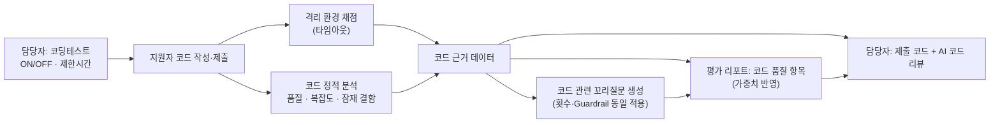
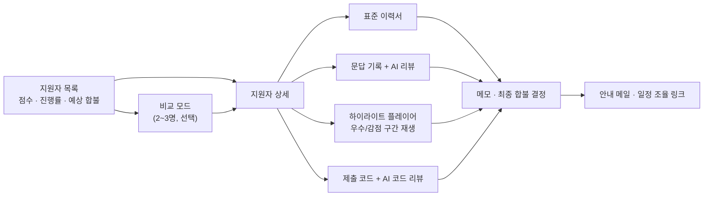

# 📘 PRD — 기업용 온프레미스 AI 모의면접 플랫폼

> **문서 범위:** 이 문서는 *무엇을(What) / 왜(Why)* 만든다를 정의하는 PRD입니다.
> 아키텍처, 모델 선정, API/DB 설계, 배포 구성 등 *어떻게(How)* 에 해당하는 내용은 별도 **TRD**에서 다룹니다.
> 근거: 최초 입력이었던 기능 요구사항 명세서·플로우차트의 내용은 본 문서에 통합되어 있으며 별도 원본 파일은 `docs/` 에 두지 않는다. **구현 기준 문서는 `PRD.md`(What/Why) · `TRD.md`(How) · `UI_SPEC.md`(화면) 세 개다.**

| 항목 | 내용 |
|---|---|
| 문서 버전 | v0.1 (초안) |
| 작성일 | 2026-10-23 |
| 상태 | Draft |
| 우선순위 표기 | High / Middle / Low (초기 기능 요구사항 명세서 기준, 본 문서에 통합) |

---

## 1. 프로젝트 개요

### 1.1 배경
- 기업 채용에서 1차 면접은 면접관 시간이 많이 들고, 평가 기준이 면접관마다 달라 일관성이 떨어진다.
- 외부 클라우드 AI 면접 서비스는 지원자의 **음성·영상·이력서** 같은 민감 정보를 사외로 반출해야 하므로, 보안·개인정보 규정이 엄격한 기업이 도입하기 어렵다.

### 1.2 제품 정의
**공고별로 맞춤 구성되는 AI 음성 면접을 기업 내부망 안에서 자동 진행하고, 평가 결과를 HR 담당자가 근거와 함께 비교·판단할 수 있게 해주는 B2B 온프레미스 AI 면접 플랫폼.**

### 1.3 비전
> *"민감한 채용 데이터는 한 줄도 사외로 나가지 않으면서, 면접관 수준의 맥락 있는 면접과 근거 있는 평가를 제공한다."*

### 1.4 핵심 가치 제안

| 가치 | 설명 |
|---|---|
| **데이터 주권** | 음성·영상·이력서·코드가 모두 기업 내부망 서버 안에서만 저장·처리된다. |
| **맥락 있는 면접** | 이력서·직무를 근거로 질문하고, 답변을 근거로 꼬리질문까지 이어간다. |
| **설명 가능한 평가** | 점수뿐 아니라 해당 발화 구간, 문답 기록, 코드 리뷰를 근거로 제시한다. |
| **HR 맞춤 운영** | 공고마다 면접 모듈·질문·가중치·꼬리질문 규칙을 직접 조정한다. |

### 1.5 목표 / 비목표

**목표**
- G1. 지원자가 공고 선택부터 면접 완료·피드백 확인까지 한 흐름으로 진행한다.
- G2. HR 담당자가 공고 등록부터 지원자 비교·합불 결정·안내 메일까지 한 곳에서 처리한다.
- G3. 모든 AI 처리를 외부 네트워크 호출 없이 로컬에서 수행한다.
- G4. 단일 개발/데모용 장비(Apple M2 Pro 16GB)에서도 면접 세션이 끊김 없이 동작한다.

**비목표 (이번 범위 제외)**
- 다국어 면접 지원, 모바일 네이티브 앱
- 외부 ATS/HRIS 연동, 결제·과금
- AI의 단독 최종 합불 확정 (최종 결정은 항상 담당자)
- 지원자 사이의 실시간 화상 면접(사람 면접관 참여)

---

## 2. 타겟 페르소나

### 2.1 지원자 (Applicant)

| 구분 | 내용 |
|---|---|
| 프로필 | 신입~경력 구직자. 이력서·자소서를 자유 양식의 **PDF**로 보유 (업로드 허용 형식은 PDF만) |
| 목표 | 부담 없이 면접을 마치고, 내 강점·약점을 구체적으로 피드백 받기 |
| 페인 포인트 | 이력서를 서식에 다시 입력하는 번거로움 / AI 면접의 어색함 / 내 영상·음성이 어디에 저장되는지 불안 |
| 제품이 주는 것 | OCR 자동 입력 + PDF가 없으면 직접 작성 / 가입 직후 팝업·마이페이지에서 미리 등록(팝업은 Skip 가능) / 이력서 기반의 자연스러운 질문과 꼬리질문 / 내부망 저장 고지 / 항목별·우선순위 피드백 리포트 |
| 성공 기준 | 사전 준비(동의→이력서→장치 점검)를 막힘 없이 마치고 면접을 끝까지 완주한다. |

### 2.2 HR 담당자 (Recruiter / Admin)

| 구분 | 내용 |
|---|---|
| 프로필 | 다수의 공고·지원자를 동시에 관리하는 채용 담당자 (개발 직군은 코딩테스트 필요) |
| 목표 | 적은 시간에 지원자를 공정하게 비교하고, 판단 근거를 확보해 합불 결정 |
| 페인 포인트 | 면접 일정·평가 편차 / 서로 다른 이력서 양식 / 면접 녹음을 처음부터 다시 들어야 하는 비용 / 외부 서비스 보안 심사 |
| 제품이 주는 것 | 공고별 모듈·질문·가중치 설정 / 표준 이력서 / 지원자 비교 모드 / 음성 하이라이트 플레이어 / 일정·알림·메일 |
| 성공 기준 | 지원자 1명당 검토 시간을 줄이면서도 결정 근거를 설명할 수 있다. |

### 2.3 핵심 유저 스토리

| # | 페르소나 | 스토리 | 관련 영역 |
|---|---|---|---|
| US-1 | 지원자 | 이력서를 다시 입력하지 않도록, PDF를 올리면 자동으로 채워지길 원한다. PDF가 없으면 직접 작성할 수 있길 원한다. | `RES_PRE` |
| US-1a | 지원자 | 가입 직후 팝업에서 바로 이력서를 등록하되, 급하면 Skip하고 나중에 마이페이지에서 등록하고 싶다. | `LGN`, `MYP` |
| US-2 | 지원자 | 내 영상·음성이 사외로 나가지 않는다는 것을 지원 전에 확인하고 싶다. | `PRE` |
| US-3 | 지원자 | 이력서 내용을 기반으로 한 질문과, 내 답변에 이어지는 꼬리질문을 받고 싶다. | `INT` |
| US-4 | 지원자 | 면접 후 강점·약점을 항목별로 구체적으로 알고 싶다. | `RPT` |
| US-5 | HR | 공고마다 질문·가중치·코딩테스트 여부를 직접 정하고 싶다. | `ADM_JOB`, `ADM_QNA` |
| US-6 | HR | AI가 근거 없는 질문을 만들어내지 않도록 규칙을 통제하고 싶다. | `ADM_QNA` |
| US-7 | HR | 후보 2~3명을 한 화면에서 비교해 결정하고 싶다. | `ADM_APP` |
| US-8 | HR | 전체 녹음을 듣지 않고, 감점/우수 구간만 골라 듣고 싶다. | `ADM_APP` |
| US-9 | HR | 서로 다른 양식의 이력서를 같은 형식으로 보고 싶다. | `ADM_APP` |
| US-10 | HR | 면접 일정과 마감 임박 공고를 놓치지 않도록 알림받고 싶다. | `ADM_CAL`, `ADM_HIS` |

### 2.4 페르소나 비교

| 관점 | 지원자 | HR 담당자 |
|---|---|---|
| 핵심 질문 | "이 면접이 나를 제대로 평가하는가?" | "이 평가를 믿고 결정해도 되는가?" |
| 주요 화면 | 공고·사전 준비·면접·리포트·마이페이지 | 대시보드·공고·질문 세팅·지원자 평가·일정·알림 |
| 신뢰 포인트 | 데이터 내부망 고지, 근거 있는 피드백 | 평가 근거 추적, 환각 방지, 로컬 격리 |

---

## 3. 사용자 여정 요약

### 3.1 지원자 여정

### 3.2 HR 담당자 여정

---

## 4. 핵심 기능 요구사항

### 4.1 RAG 기반 이력서 분석 `RES_PRE` / `INT`

지원자가 제출한 이력서·자소서를 **면접 질문 생성의 근거 자료**로 활용한다.

| ID | 요구사항 | 우선순위 |
|---|---|---|
| RAG-1 | 지원자가 이력서/자소서를 **PDF 파일로만** 드래그 앤 드롭 첨부할 수 있다. 다른 확장자는 업로드 시점에 거부하고 사유를 안내한다. | High |
| RAG-2 | 첨부된 PDF에서 성명·학력·경력·프로젝트 등을 OCR로 자동 추출한다. | High |
| RAG-3 | 추출 결과를 지원자가 확인하고 간단히 수정할 수 있다. | Middle |
| RAG-4 | PDF가 없는 지원자는 이력서 **기본 정보를 직접 작성**해야 한다. 기본 정보가 없으면 면접을 시작할 수 없다. (직접 작성은 마이페이지와 AI 면접의 이력서·자소서 제출 단계에서 가능) | High |
| RAG-4a | **가입 직후 등록 팝업:** 회원가입 완료 직후 이력서·자소서 등록(PDF 첨부 또는 직접 작성) 팝업을 띄워 바로 작성할 수 있게 한다. 팝업에는 **Skip**이 있어 당장 등록하지 않아도 된다. | Middle |
| RAG-4b | **마이페이지 사전 등록:** 지원자는 마이페이지에서 이력서·자소서를 미리 등록·수정할 수 있고, 지원 시 등록본을 불러와 사용할 수 있다. | High |
| RAG-4c | 공고 지원 시점에 등록본이 없고 PDF도 없으면, 이력서 제출 단계에서 직접 작성을 안내한다. 이 단계의 Skip은 **PDF 첨부만 건너뛰는 것**이며 기본 정보 작성은 건너뛸 수 없다. | High |
| RAG-5 | 메인 질문은 **이력서 내용 + 공고 직무 요건**을 함께 근거로 생성한다. | High |
| RAG-6 | 답변과 이력서 내용이 **모순**되면 이를 짚는 꼬리질문을 생성할 수 있다. | Middle |
| RAG-7 | 담당자가 보는 이력서는 지원자 제출 양식과 무관하게 **통합 표준 템플릿**으로 변환되어 표시된다. | Middle |

**이력서 활용 흐름**

**수용 기준 (예시)**
- 이력서를 첨부한 지원자의 메인 질문 중 일부는 이력서의 특정 경력·프로젝트를 직접 언급한다.
- PDF 이외의 파일(예: docx, hwp, 이미지)을 올리면 거부되고 PDF만 가능하다는 안내가 표시된다.
- 가입 팝업에서 Skip한 지원자도 정상 가입되며, 이후 마이페이지에서 등록할 수 있다.
- 이력서 없이 지원한 지원자는 기본 정보를 작성하기 전에는 장치 점검·면접 단계로 넘어갈 수 없다.
- 기본 정보만 작성한 지원자도 오류 없이 이력서 + 직무 기반 질문으로 면접이 진행된다.

### 4.2 실시간 STT/TTS 음성 면접 파이프라인 `INT`

AI 면접관이 **음성으로 질문하고, 지원자의 음성 답변을 실시간 텍스트로 받아 다음 질문을 결정**하는 대화형 세션.

**세션 흐름**

**질문 한 턴의 상태 (사용자 관점)**

| 단계 | 지원자가 보는 것 | 저장되는 것 |
|---|---|---|
| 질문 | AI 음성 + 자막, 진행률 | 질문 텍스트·종류(메인/꼬리) |
| 답변 | 카운트다운, 타이머, 내 웹캠, 시선 경고 | 음성·영상·시선 이탈 이벤트 |
| 변환 | (백그라운드) | STT 텍스트, 타임스탬프 |
| 판단 | 잠깐의 대기 | 꼬리질문 여부·사유·Count |

| ID | 요구사항 | 우선순위 |
|---|---|---|
| VOI-1 | AI 질문을 음성(TTS)으로 출력하고, 동일 텍스트를 화면 자막으로 병행 표시한다. | High |
| VOI-2 | 지원자 답변을 녹음하고 실시간으로 텍스트(STT)로 변환한다. | High |
| VOI-3 | 답변 타이머(3-2-1 카운트다운, 제한시간)와 전체 진행률을 표시한다. | High |
| VOI-4 | 지원자 웹캠 화면을 면접 중 지속 표시·녹화한다. | High |
| VOI-5 | 답변을 분석해 **모호함 / 이력서 모순 / STT 공백·뭉개짐** 시 꼬리질문을 생성한다. | Middle |
| VOI-6 | 꼬리질문은 담당자가 설정한 **최대 횟수(예: 1~4회)** 를 넘지 않으며, 메인 질문이 바뀌면 횟수가 초기화된다. | Middle |
| VOI-7 | 시선 이탈(치팅 의심)을 감지해 경고를 표시하고, 이탈률을 리포트에 반영한다. | Middle |
| VOI-8 | 질문별 음성·STT 텍스트·타임스탬프를 저장해 사후 리뷰(하이라이트 플레이어)에 사용한다. | High |
| VOI-9 | **환각 방지:** 꼬리질문은 지원자 STT 답변 속 키워드에 근거(Grounding)하며, 정해진 출력 규격을 벗어나지 않는다. | High |

**체감 품질 목표 (세부 수치는 TRD에서 확정)**
- 답변 종료 후 다음 질문 음성이 시작되기까지의 대기가 지원자에게 *어색하지 않은 수준*일 것.
- 일시적 STT/TTS 실패 시 세션이 중단되지 않고 재시도·안내로 복구될 것.

### 4.3 면접 사전 준비 `PRE`

| ID | 요구사항 | 우선순위 |
|---|---|---|
| PRE-1 | 카메라 → 마이크 → 스피커 순서로 점검하고, 각 장치를 선택·변경할 수 있다. | High |
| PRE-2 | 마이크 실시간 수신 테스트, 스피커 안내 음성 테스트 재생을 제공한다. | High |
| PRE-3 | 모든 장치 정상 시에만 면접을 시작할 수 있고, 문제 시 재설정 경로를 제공한다. | High |
| PRE-4 | 점검 단계에서 이전(공고 상세)으로 돌아갈 수 있다. | Middle |
| PRE-5 | 개인정보 활용 동의와 함께 *"모든 음성·영상·이력서 데이터는 기업 내부망 서버 내에만 저장·처리된다"* 를 고지한다. | High |

### 4.4 코딩테스트 연동 및 코드 정적 분석 → AI 꼬리질문 `INT` / `ADM_APP`

공고별로 코딩테스트를 켜고 끌 수 있으며, **제출 코드를 평가 및 후속 질문의 근거**로 사용한다.

| ID | 요구사항 | 우선순위 |
|---|---|---|
| COD-1 | 담당자가 공고별로 코딩테스트 **ON/OFF 및 제한시간**을 설정한다. | Low |
| COD-2 | ON인 공고는 모든 메인 질문 종료 후 면접 화면의 코딩테스트 탭으로 이어진다. | Low |
| COD-3 | 코드 에디터와 **제한시간·격리된 실행 환경**에서의 채점을 제공한다. | Low |
| COD-4 | 제출 코드에 대해 **정적 분석**(품질·가독성·복잡도·잠재 결함 등)을 수행한다. | Low |
| COD-5 | 정적 분석 결과와 채점 결과를 근거로 AI가 **코드 관련 꼬리질문**을 생성한다. (예: 특정 로직 선택 이유, 시간복잡도, 예외 처리) | Low |
| COD-6 | 코드 관련 꼬리질문도 4.2의 횟수 제한·Guardrail 규칙을 동일하게 따른다. | Low |
| COD-7 | 평가 리포트에 **코드 품질** 항목이 포함되며, 가중치(4.5)에 반영된다. | Low |
| COD-8 | 담당자는 지원자 상세에서 **제출 코드와 AI 코드 리뷰**를 확인할 수 있다. | Low |

**코딩테스트 연계 흐름**

> ⚠️ 명세서상 코딩테스트는 *Low* 우선순위이므로 MVP 이후 단계에서 구현하되, 위 연계 흐름(코드 → 정적 분석 → 꼬리질문 → 평가)은 설계 단계에서 확정해 둔다.
>
> ✅ **확정:** 코딩테스트는 모든 메인 질문 *이후* 배치된다. 코드 꼬리질문은 **코딩테스트 제출 직후, 코딩 탭 안에서 텍스트(채팅형)** 로 진행한다 (음성 구간은 v2 이후 확장). 최대 횟수·Guardrail 규칙은 4.2와 동일하다. (TRD §5.6, §7.7 `text_answer`)

### 4.5 면접 결과 리포트 `RPT`

| ID | 요구사항 | 우선순위 |
|---|---|---|
| RPT-1 | 면접 종료 후 리포트 생성 안내(3~5분)를 보여주고, 완료되면 [결과 보기]가 활성화된다. | High |
| RPT-2 | 종합 점수와 총평을 제공한다. | High |
| RPT-3 | 질문별 **개념 이해도 / 논리성 / 전달력 / 태도 / 직무 전문성** 점수를 제공한다. | High |
| RPT-4 | 강점 1~3위, 개선점 1~3위를 우선순위로 요약한다. | Middle |
| RPT-5 | 시선 이탈률 분석 결과를 포함한다. | Middle |

---

## 5. 관리자 가치 (HR 담당자 기능)

### 5.1 공고별 모듈 커스텀 `ADM_JOB`
- 공고마다 **코딩테스트 ON/OFF 및 제한시간** 등 면접 모듈을 선택한다.
- 공고 작성·수정·마감·삭제, 진행/마감 구분, 임시 저장, 이전 템플릿 불러오기, 지원자 시점 **미리보기**를 제공한다.
- 공고별 지원자 수·합격자 수·조회수를 확인한다.

### 5.2 질문 구성 및 가중치 `ADM_QNA`
- **질문 세트:** 질문 10개를 직접 등록하며, 비워두면 직무 맞춤 질문이 자동/랜덤 생성된다. 질문 분야·답변 제한시간을 지정한다.
- **JD 기반 질문 뱅크:** 공고 내용을 바탕으로 AI가 질문 후보를 자동 추출한다.
- **카테고리별 질문 가중치 (High):** 직무 특성에 맞춰 평가 항목(코드 품질, 논리성, 전달력 등) 비중을 조정한다. 대시보드의 *직무별 합격률*(공고별은 드릴다운)을 조정 판단 근거로 활용한다.
- **합격 기준 점수(cutoff) (Middle):** 공고별로 합격선 점수와 경계 폭(margin)을 설정한다. 설정하지 않은 공고는 AI 예상 합불을 "참고 불가"로 표시한다.
- **꼬리질문 규칙 (Middle):** 발동 조건(모호/모순/STT 오류)과 최대 횟수를 설정한다.
- **환각 방지 Guardrail (High):** 키워드 근거 질문 생성 및 출력 규격 강제 정책을 관리한다.

### 5.3 지원자 비교 모드 `ADM_APP`
- 목록에서 지원자별 **AI 종합 점수 · 면접 진행률 · AI 예상 합격 여부**를 확인한다.
- **2~3명을 선택**해 종합 점수, **항목별 오각형 레이더 차트**, 핵심 강·단점을 한 화면에서 대조한다 (Middle).
- AI 예상 합격 여부는 **참고 지표**이며, 최종 합불은 담당자가 결정한다. 예상 합불은 `합격권 / 경계 / 미달 / 참고 불가` 4단계로 표시하며, 공고별 합격 기준 점수(5.2) 대비 종합 점수로 산출한다. 지원자에게는 노출하지 않는다.
- **최종 합불의 단일 출처:** 합불 상태는 담당자의 최종 결정 값 하나로만 관리하며, 합격률·목록 필터·배지는 모두 이 값을 기준으로 한다. 결정은 변경(취소 포함)할 수 있고 변경 이력을 남긴다. 지원자에게는 안내 메일 발송 이후에만 결과를 보여준다.

### 5.4 음성 타임라인 하이라이트 플레이어 `ADM_APP`
- AI가 **감점 요소 / 우수 답변**으로 판정한 구간을 타임라인에 표시한다.
- 타임스탬프를 클릭하면 해당 구간 음성을 즉시 재생한다 (High).
- 질문별 문답 기록(Transcript)과 AI 리뷰를 함께 보여, 전체 녹음을 처음부터 듣지 않고도 판단 근거를 확인한다.

**평가 검토 흐름**

### 5.5 평가 후속 업무
- 표준 이력서 뷰어, 담당자 **내부 메모**, 최종 합불 처리, 합격/불합격 **안내 메일** 및 일정 조율 링크 발송.
- **리포트 재생성:** 리포트 생성이 실패한 건은 담당자가 재생성을 요청할 수 있다.

### 5.6 대시보드·일정·알림 `ADM_DB` / `ADM_CAL` / `ADM_HIS`

| 영역 | 요구사항 | 우선순위 |
|---|---|---|
| 대시보드 | 다가오는 면접 일정, 직무별 평균 점수·합격률(공고별은 드릴다운), 월별 응시자 수 | High / Middle |
| 대시보드 (통합 컨트롤 타워) | 요약 KPI(다가오는 면접 수·진행 중 공고 수·**미검토 지원자 수**·마감 임박 공고 수), 최근 공고 Quick View, 최근 면접 완료 지원자 Quick View, 신규 공고·비교 모드·일정 추가 바로가기. *미검토 지원자 = 리포트가 완료되었고 합불이 미정이며 담당자가 아직 열람하지 않은 지원자* | High / Middle |
| 일정 | 일정 추가·수정·캘린더 뷰, 공고 등록/2차 면접 시 자동 연동 | High / Middle |
| 이력 | 공고 작성·만료·삭제 이력 관리 | High |
| 알림 | 신규 지원·면접 일정 확정 알림 (High), 공고 마감 1일 전 안내 (Middle) | High / Middle |

---

## 6. 지원자 영역 기타 요구사항

| 영역 | 주요 요구사항 | 우선순위 |
|---|---|---|
| 로그인 `LGN` | 지원자/담당자 역할 선택, 이메일 ID·비밀번호 형식 검증, 모달 회원가입 | High |
| 회원가입 | 이름·이메일·비밀번호(확인)·생년월일·성별·연락처 필수 입력 | High |
| 계정 | 아이디/비밀번호 찾기·재설정 | Middle |
| 소셜 로그인 | 구글 OAuth 2.0 간편 가입·로그인 | Low |
| 공고 `JOB` | 직무 카테고리 필터, 공고 핵심 정보(제목·요건·우대·업무·정원) 표시, 지원 버튼 | High |
| 공고 검색 | 산업군·키워드 검색, 담당자 문의 이메일 표기 | Low |
| 마이페이지 `MYP` | 지원 현황·면접 상태 조회, **이력서·자소서 사전 등록/수정(PDF 첨부 또는 직접 작성)**, 프로필 수정, **계정·데이터 삭제 요청**(NFR-S7) | High |
| 가입 직후 팝업 `LGN` | 회원가입 완료 직후 이력서·자소서 등록 팝업 노출, Skip 가능 | Middle |
| 일정 | 개인 면접·서류 전형 캘린더 | Low~Middle |

---

## 7. 비기능 요구사항 (NFR)

> 구현 방식(모델·런타임·아키텍처)은 TRD에서 결정합니다. 여기서는 **충족해야 할 조건과 예산**만 정의합니다.

### 7.1 자원 예산 — Apple M2 Pro 16GB 기준

| ID | 요구사항 |
|---|---|
| NFR-R1 | 기준 장비는 **Apple M2 Pro / 통합 메모리 16GB** 이며, 면접 세션 1건이 이 장비에서 안정적으로 동작해야 한다. |
| NFR-R2 | LLM, STT, TTS, 이력서 OCR, 시선 분석, 코드 채점, 웹 서비스, DB를 합산한 **상시 메모리 사용량이 16GB(OS·브라우저 포함)를 초과하지 않아야** 한다. |
| NFR-R3 | 메모리 최적화를 위해 무거운 AI 구성요소는 **필요한 시점에만 로드하고 사용 후 해제**(또는 경량화)할 수 있어야 한다. (예: 면접 중 LLM·STT·TTS 상주, OCR·리포트 생성은 구간별 처리) |
| NFR-R4 | 면접 진행 중에는 **실시간성이 필요한 처리(STT/TTS/질문 생성/시선 분석)를 우선** 하고, 리포트 생성 등 무거운 후처리는 면접 종료 후 비동기로 수행한다. |
| NFR-R5 | 메모리 부족 시 세션이 비정상 종료되지 않고 **품질 저하(경량 모드) 또는 대기 안내**로 우아하게 대응한다. |
| NFR-R6 | 구성요소별 **메모리·지연 예산표**를 TRD 단계에서 실측으로 확정한다. *(수치 목표는 프로토타입 측정 후 본 문서에 반영)* |

**리포트 대기 안내(3~5분)** 는 위 자원 제약 하에서 후처리 시간의 사용자 약속 값이다.

### 7.2 로컬 데이터 보안 격리

| ID | 요구사항 |
|---|---|
| NFR-S1 | 음성·영상·이력서·STT 텍스트·제출 코드·평가 결과는 **기업 내부망 서버에만 저장·처리**한다. |
| NFR-S2 | 모든 AI 추론(질문 생성, STT, TTS, OCR, 시선 분석, 코드 분석)은 **외부 네트워크 호출 없이 로컬**에서 수행한다. |
| NFR-S3 | 예외적으로 허용되는 외부 연동(예: 구글 OAuth 로그인)은 **인증에 한정**하고 면접 데이터는 포함하지 않는다. *(구글 OAuth는 Low 우선순위이며, 온프레미스 정책과의 충돌 여부는 확인 필요)* |
| NFR-S4 | 코딩테스트 코드는 **서버 및 다른 세션과 격리된 실행 환경**에서만 실행하며 시간 제한을 둔다. |
| NFR-S5 | 지원자는 동의 단계에서 데이터 저장·처리 범위를 명확히 고지받고, 동의한 경우에만 면접이 시작된다. |
| NFR-S6 | 역할(지원자/담당자)별 접근 권한을 분리한다. 지원자는 본인 데이터만, 담당자는 본인 기업 공고의 지원자 데이터만 열람한다. |
| NFR-S7 | 개인정보·면접 데이터의 **보관 기간과 삭제 정책**을 정의한다. **기본값:** 음성·영상 90일 / 리포트·STT 텍스트·제출 코드 365일 / 이력서 PDF·지원용 스냅샷 365일 (기산점: 최종 결정 시각, 없으면 면접 종료 시각, 없으면 지원 시각). 고객사 설정으로 변경 가능하며 지원자의 계정 삭제 요청은 즉시 삭제한다. *(법정 보관·반환 의무는 고객사 법무 확인 필요 — 기본값은 법적 자문이 아님)* |

### 7.3 신뢰성·사용성

| ID | 요구사항 |
|---|---|
| NFR-Q1 | **AI 평가 신뢰성:** 꼬리질문·평가 코멘트는 지원자 발화 또는 이력서/코드 등 *실재하는 근거*에 연결되어야 한다 (환각 방지). |
| NFR-Q2 | **장애 복원:** 네트워크 끊김, 장치 오류, 브라우저 새로고침 시 진행 중이던 면접의 **저장된 답변이 유실되지 않아야** 한다. |
| NFR-Q3 | **사용성:** 지원자는 안내 없이도 사전 준비 단계를 완료할 수 있어야 한다. |
| NFR-Q4 | **공정성:** AI 평가는 성별·연령 등 인적 속성을 평가 근거로 사용하지 않는다. (회원가입 수집 정보는 평가 입력에서 제외) |
| NFR-Q5 | **지원 환경:** 데스크톱 최신 브라우저(웹캠·마이크 사용 가능 환경)를 우선 지원한다. |

---

## 8. 성공 지표 (KPI)

| 구분 | 지표 | 목표 |
|---|---|---|
| 지원자 | 면접 완주율 (시작 → 완료) | 설정 예정 |
| 지원자 | 사전 준비 단계 이탈률 | 설정 예정 |
| HR | 지원자 1명당 평균 검토 시간 | 기존 대비 감소 |
| HR | 하이라이트 플레이어 활용률 | 설정 예정 |
| 품질 | 꼬리질문 근거 일치율(환각 아님으로 판정된 비율) | 설정 예정 |
| 안정성 | M2 Pro 16GB 환경 면접 세션 완주 성공률 | 설정 예정 |
| 보안 | 외부 네트워크로 전송된 면접 데이터 | **0건** |

> 수치 목표는 파일럿 운영 데이터를 확보한 뒤 확정합니다.

---

## 9. 릴리스 범위 (우선순위 기반 제안)

| 단계 | 범위 |
|---|---|
| **MVP (High 중심)** | 로그인/가입, 공고 조회, 사전 준비(동의·이력서 OCR·장치 점검), RAG 기반 질문 생성, STT/TTS 음성 면접, 피드백 리포트, 공고·질문·가중치 관리, 지원자 목록·상세 평가, 하이라이트 플레이어, 로컬 보안 고지 |
| **v1.x (Middle)** | 꼬리질문 규칙, 시선 추적, 지원자 비교 모드, 표준 이력서 뷰어, 계정 찾기, 일정·알림·템플릿, 가입 직후 이력서 등록 팝업(Skip 가능) |
| **v2 (Low)** | 코딩테스트 및 코드 정적 분석 → 꼬리질문, 구글 OAuth, 공고 검색·현황 통계, 개인 캘린더 |

---

## 10. 가정·제약·결정 현황

**가정**
- 고객사는 내부망에 면접 서버를 구성할 수 있으며, 지원자는 사내 네트워크 또는 이에 접속 가능한 환경에서 응시한다.
- 면접 언어는 한국어를 기본으로 한다.

**제약**
- 개발/데모 기준 장비는 M2 Pro 16GB로 고정한다 (7.1).
- 모든 AI 처리는 로컬에서 수행한다 (7.2).

**결정 현황 (구 미결 사항)** — ✅ 확정은 구현 기준이며, 🔬 실측은 프로토타입(TRD M0) 측정 후 확정한다.

| # | 항목 | 상태 | 결정 내용 |
|---|---|---|---|
| 1 | 코드 꼬리질문의 시점·방식 (4.4) | ✅ 확정 | 코딩테스트 제출 직후 코딩 탭 안에서 **텍스트(채팅형)**. 횟수·Guardrail은 4.2와 동일. 음성 구간은 v2 이후 확장 |
| 2 | 구글 OAuth와 온프레미스 정책 충돌 (NFR-S3) | ✅ 확정 | **v2 범위, 기본 비활성.** 인증 제공자를 추상화(`AuthProvider`)해 온프레미스에서는 사내 SSO(OIDC)로 대체 가능하게 설계. MVP에서는 이메일 로그인만 |
| 3 | 데이터 보관 기간·삭제 정책 (NFR-S7) | ✅ 확정(기본값) | 음성·영상 90일 / 리포트·STT 텍스트·코드 365일 / 이력서 PDF·스냅샷 365일. 고객사별 변경 가능, 계정 삭제 요청은 즉시 삭제 (NFR-S7 참조) |
| 4 | 외부(사외) 지원자 응시 허용 여부 | ✅ 확정 | **불허.** 내부망 또는 VPN 접속자만 응시 (10장 가정과 동일) |
| 5 | "AI 예상 합격 여부"의 산출 기준 | ✅ 확정 | 공고별 합격 기준 점수(cutoff) ± 경계 폭(margin, 기본 5점)의 4단계(합격권/경계/미달/참고 불가). 미설정 공고는 "참고 불가"로 표시하고 게시 전 설정을 권고 (5.2, TRD §6.3). 기본 margin은 파일럿 후 재검토 |
| 6 | 질문 수(10개) 변동 허용 여부 | ✅ 확정 | **면접당 메인 질문 10개 고정.** 직접 등록 + AI 질문 뱅크 후보의 합이 10개 이상이어야 공고를 게시할 수 있다 |
| 7 | 성능·메모리 수치 목표 | 🔬 실측 | TRD §2·§9의 목표값(peak ≤14.5GB, E2E p50 ≤6s/p95 ≤10s)을 잠정 합격 기준으로 하고 M0 프로토타입 실측 후 확정 |
| 8 | 관리자 플로우차트의 일정 관리 노드 중복 | ✅ 해소 | 플로우차트 원본이 문서 세트에서 제외되어 해당 없음 |
| 9 | 직접 작성 시 **기본 정보 필수 항목** 범위 | ✅ 확정 | **성명 + (학력 1건 이상 또는 경력 1건 이상)**. 학력은 학교명, 경력은 회사명이 비어 있지 않아야 1건으로 인정 (TRD §6.2 `basic_info_complete`) |
| 10 | 자소서의 필수 여부 | ✅ 확정 | 선택 항목. 이력서 기본 정보만 필수 |
| 11 | 마이페이지 등록본과 지원 시 PDF가 다를 때의 우선순위·덮어쓰기 규칙 | ✅ 확정 | 지원 시점에 확정한 값을 **지원 건별 불변 스냅샷**으로 보관하고 스냅샷이 우선. 마이페이지 등록본은 자동 덮어쓰지 않으며 "마이페이지에도 저장" 체크 시에만 갱신 |
| 12 | 가입 팝업의 노출 빈도 | ✅ 확정 | 가입 직후 **최초 1회**. Skip 후에는 재노출하지 않고 이력서 미등록 시 GNB 안내 배너로 대체 |

---

## 부록 A. 용어집

| 용어 | 정의 |
|---|---|
| RAG | 이력서·공고 등 저장된 자료를 검색해 질문 생성의 근거로 사용하는 방식 |
| STT / TTS | 음성→텍스트 / 텍스트→음성 변환 |
| 꼬리질문 | 직전 답변을 근거로 이어서 묻는 추가 질문 (최대 횟수 제한) |
| Guardrail | AI 출력이 근거 없는 내용(환각)이나 규격 위반을 담지 않도록 하는 제약 |
| JD | 공고의 직무 기술 (Job Description) |
| 온프레미스 | 고객사 내부망 서버에 설치·운영하는 방식 |
| 하이라이트 플레이어 | 감점/우수 구간 타임스탬프로 음성을 바로 재생하는 담당자 기능 |
| 시선 추적 | 면접 중 시선 이탈을 감지해 치팅 의심 경고와 리포트에 반영하는 기능 |

## 부록 B. 기능 영역 코드 맵

| 코드 | 영역 | 코드 | 영역 |
|---|---|---|---|
| `LGN` | 로그인/회원가입 | `ADM_DB` | 관리자 대시보드 |
| `JOB` | 공고 조회·상세 | `ADM_JOB` | 공고 관리 |
| `PRE` / `RES_PRE` | 사전 준비·이력서 | `ADM_QNA` | 질문·AI 평가 세팅 |
| `MYP` | 마이페이지 | `ADM_APP` | 지원자 목록·평가 |
| `INT` | AI 면접 진행 | `ADM_CAL` | 일정 관리 |
| `RPT` | 면접 완료·리포트 | `ADM_HIS` | 히스토리·알림 |
