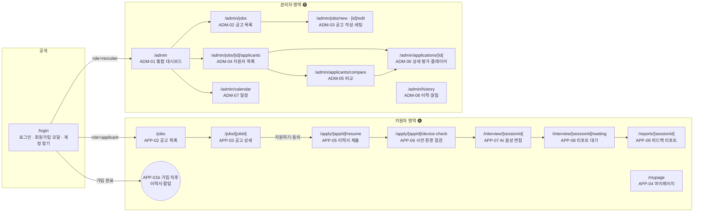
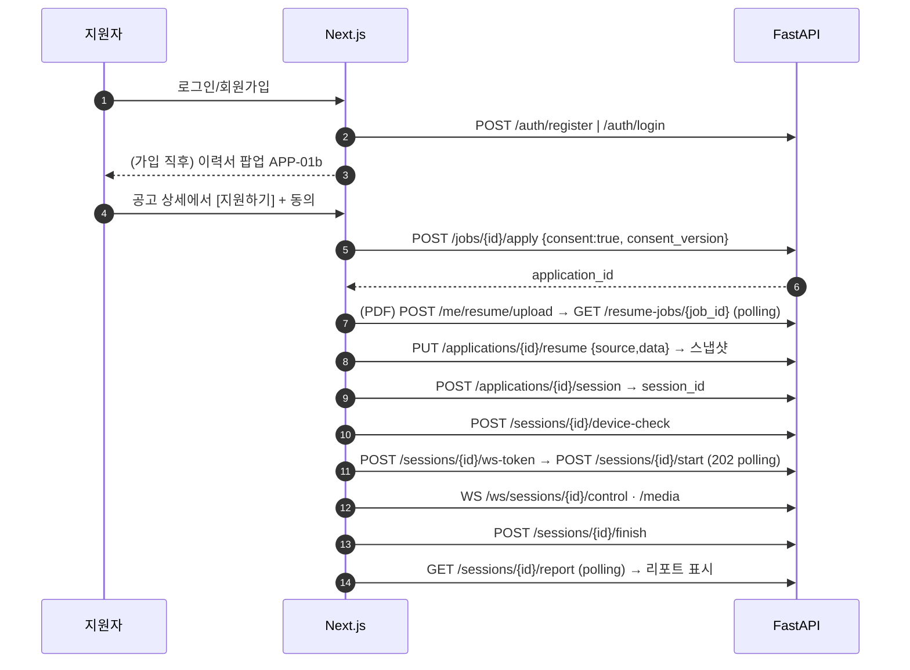
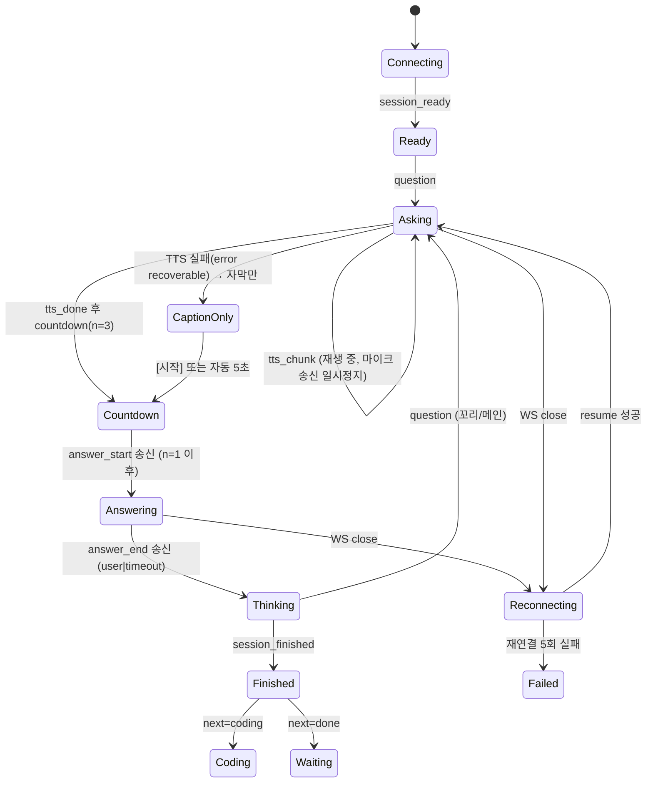
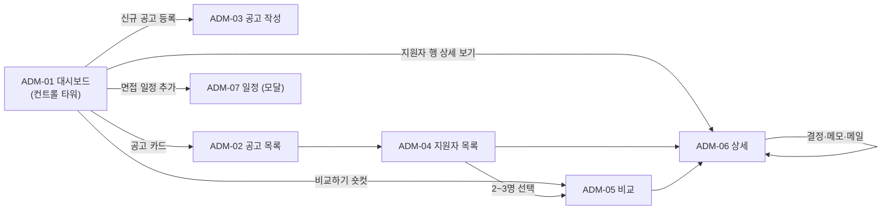

# 🖥️ UI 화면정의서 — 기업용 온프레미스 AI 모의면접 플랫폼

> **문서 범위:** PRD/TRD를 **Next.js 14 (App Router) 프론트엔드 구현 단위**로 풀어낸 화면정의서입니다.
> 화면별 와이어프레임, 컴포넌트 트리, 동작 명세, API 매핑, 예외 처리를 포함합니다.
> 근거 문서: [`PRD.md`](./PRD.md) · [`TRD.md`](./TRD.md) (구현 기준 문서는 PRD · TRD · UI_SPEC 세 개)

| 항목 | 내용 |
|---|---|
| 문서 버전 | v0.1 (초안) |
| 작성일 | 2026-10-26 |
| 대상 | 프론트엔드 개발자 (Next.js 14 + React + TypeScript) |
| 상태 | Draft |

### 표기 규칙

| 표기 | 의미 |
|---|---|
| `APP-xx` / `ADM-xx` | 지원자 / 관리자 화면 ID |
| 🅐 / 🅡 | 접근 권한: applicant / recruiter (TRD §7) |
| **P-High / P-Mid / P-Low** | PRD 우선순위. Low(v2)는 UI 자리만 확보하고 비활성 처리 가능 |
| 🔗 | 화면 구현을 위해 추가한 API/필드. **TRD v0.2에 모두 반영 완료** — 요청 추적은 §9.1, 스키마의 기준은 TRD |
| `Server` / `Client` | Next.js Server Component / Client Component (`"use client"`) |

> 이 문서의 API 경로는 모두 Base `/api/v1` 기준이며 생략해 표기합니다.

---

## 목차
1. [정보 아키텍처(IA)와 라우팅](#1-정보-아키텍처ia와-라우팅)
2. [공통 레이아웃과 공통 컴포넌트](#2-공통-레이아웃과-공통-컴포넌트)
3. [Next.js 프로젝트 구조와 API 호출 규칙](#3-nextjs-프로젝트-구조와-api-호출-규칙)
4. [지원자 영역 화면](#4-지원자-영역-화면)
5. [관리자 영역 화면](#5-관리자-영역-화면)
6. [WebSocket 이벤트 ↔ UI 매핑](#6-websocket-이벤트--ui-매핑)
7. [상태/Enum 표시 규칙](#7-상태enum-표시-규칙)
8. [접근성·반응형·보안 UI 원칙](#8-접근성반응형보안-ui-원칙)
9. [API 요청 추적 및 결정 사항](#9-api-요청-추적-및-결정-사항)

---

## 1. 정보 아키텍처(IA)와 라우팅

### 1.1 사이트맵



### 1.2 화면 목록 및 라우트 매핑

| 화면 ID | 화면명 | 라우트 (App Router) | 권한 | 우선순위 | 영역 코드 |
|---|---|---|---|---|---|
| APP-01 | 로그인 / 회원가입 모달 / 계정 찾기 | `app/(public)/login/page.tsx` | - | P-High | `LGN` |
| APP-01b | 가입 직후 이력서·자소서 등록 팝업 | (모달, `?welcome=1`) | 🅐 | P-Mid | `LGN` |
| APP-02 | 공고 목록 | `app/(applicant)/jobs/page.tsx` | 🅐 | P-High | `JOB` |
| APP-03 | 공고 상세 (+ 지원 동의 모달) | `app/(applicant)/jobs/[jobId]/page.tsx` | 🅐 | P-High | `JOB` |
| APP-04 | 마이페이지 | `app/(applicant)/mypage/page.tsx` (`?tab=`) | 🅐 | P-High | `MYP` |
| APP-05 | 이력서·자소서 제출 (지원 단계) | `app/(applicant)/apply/[applicationId]/resume/page.tsx` | 🅐 | P-High | `RES_PRE` |
| APP-06 | 사전 환경 점검 | `app/(applicant)/apply/[applicationId]/device-check/page.tsx` | 🅐 | P-High | `PRE` |
| APP-07 | AI 실시간 음성 면접 (+ 코딩테스트 탭) | `app/(interview)/interview/[sessionId]/page.tsx` | 🅐 | P-High (코테 P-Low) | `INT` |
| APP-08 | 면접 완료·리포트 생성 대기 | `app/(interview)/interview/[sessionId]/waiting/page.tsx` | 🅐 | P-High | `RPT` |
| APP-09 | 최종 피드백 리포트 | `app/(applicant)/reports/[sessionId]/page.tsx` | 🅐 | P-High | `RPT` |
| ADM-01 | 통합 대시보드 (컨트롤 타워) | `app/(admin)/admin/page.tsx` | 🅡 | P-High | `ADM_DB` |
| ADM-02 | 공고 목록·현황 | `app/(admin)/admin/jobs/page.tsx` | 🅡 | P-High | `ADM_JOB` |
| ADM-03 | 공고 작성 / 질문 뱅크 / 가중치·Guardrail | `app/(admin)/admin/jobs/new/page.tsx`, `[id]/edit/page.tsx` | 🅡 | P-High | `ADM_JOB` `ADM_QNA` |
| ADM-04 | 지원자 목록 (공고별) | `app/(admin)/admin/jobs/[id]/applicants/page.tsx` | 🅡 | P-High | `ADM_APP` |
| ADM-04b | 지원자 통합 목록 (공고 횡단, 사이드바 "지원자 관리"·대시보드 KPI 이동 대상) | `app/(admin)/admin/applicants/page.tsx` (`?review=unreviewed&job_id=`) | 🅡 | P-High | `ADM_APP` |
| ADM-03p | 공고 미리보기 (지원자 시점, 읽기 전용) | `app/(admin)/admin/jobs/[id]/preview/page.tsx` | 🅡 | P-High | `ADM_JOB` |
| ADM-05 | 지원자 비교 (Compare) | `app/(admin)/admin/applicants/compare/page.tsx` | 🅡 | P-Mid | `ADM_APP` |
| ADM-06 | 지원자 상세 평가 + 하이라이트 플레이어 | `app/(admin)/admin/applications/[id]/page.tsx` | 🅡 | P-High | `ADM_APP` |
| ADM-07 | 면접 일정 캘린더 | `app/(admin)/admin/calendar/page.tsx` | 🅡 | P-High | `ADM_CAL` |
| ADM-08 | 공고 이력 · 알림 센터 | `app/(admin)/admin/history/page.tsx` | 🅡 | P-High | `ADM_HIS` |

> 본 문서 §4~§5에서는 요청된 핵심 화면(APP-01b~09, ADM-01~06)을 상세 정의하고, APP-01/02/03, ADM-02/07/08은 필요한 범위에서 정의합니다.

### 1.3 라우트 가드 (Next.js `middleware.ts`)

| 조건 | 동작 |
|---|---|
| 토큰 없음 | `/login?next=<원래경로>` 로 redirect |
| `role=applicant` 가 `/admin/**` 접근 | `/jobs` 로 redirect + Toast "권한이 없습니다" |
| `role=recruiter` 가 지원자 전용 경로 접근 | `/admin` 으로 redirect |
| `/interview/**`, `/apply/**` | 본인 `application`/`session` 이 아니면 `404` (API가 403/404 반환, 정보 노출 방지) |
| 로그인 상태로 `/login` 접근 | role에 맞는 홈으로 redirect |
| access 토큰 만료(401) | `/auth/refresh` 1회 시도 → 실패 시 로그아웃 + `/login` |

> **구현 메모 (Phase 3):** 접근 제어의 기준은 클라이언트 `AuthGuard`(`/me` 조회)이며, `middleware.ts` 는 쿠키 유무에 따른 편의 redirect 만 한다. 쿠키가 만료된 상태에서 `/login` 을 redirect 하면 루프가 생기므로 미들웨어는 `/login` 을 redirect 하지 않는다. **대신 `/login` 만 예외로, 미들웨어가 백엔드 `GET /me` 를 호출해 200 일 때만 역할별 홈(또는 안전한 `next`)으로 redirect 한다.** 401·백엔드 불가·타임아웃이면 로그인 화면을 그대로 보여 준다(루프 방지). `next` 는 `safeNext()` 로 같은 출처 경로만 허용한다.

Route Group: `(public)`, `(applicant)`, `(interview)`, `(admin)` — 각 그룹이 자신의 `layout.tsx` 를 가진다 (§2.1).

---

## 2. 공통 레이아웃과 공통 컴포넌트

### 2.1 레이아웃 구성

| Route Group | 레이아웃 | GNB | Footer | 비고 |
|---|---|---|---|---|
| `(public)` | `PublicLayout` | 로고만 | 간략 | 로그인 |
| `(applicant)` | `ApplicantLayout` | ✅ 지원자 GNB | ✅ | 공고·마이페이지·리포트·사전 준비 |
| `(interview)` | `InterviewLayout` | ❌ **GNB 숨김** (몰입 + 실수 이탈 방지) | ❌ | 면접·대기 화면. 최소 헤더(공고명·"내부망 저장" 배지)만 |
| `(admin)` | `AdminLayout` | ✅ 사이드바 + 상단 헤더 | 간략 | 관리자 전 화면 |

### 2.2 지원자 GNB / 헤더 / 푸터 (`ApplicantLayout`)

```
┌──────────────────────────────────────────────────────────────────────────────┐
│ [로고] AI Interview   공고 │ 내 지원현황              🔒내부망 저장   👤 홍길동 ▾ │ ← GNB (sticky, h-16)
│                                                       └ 마이페이지 / 로그아웃    │
├──────────────────────────────────────────────────────────────────────────────┤
│                                                                              │
│                          {children}  (max-w 1120px, 16px gutter)             │
│                                                                              │
├──────────────────────────────────────────────────────────────────────────────┤
│ 모든 음성·영상·이력서 데이터는 기업 내부망 서버 내에서만 저장·처리됩니다.            │ ← Footer
│ 개인정보처리방침 · 문의: hr@corp.local (회사 문의 이메일)                        │
└──────────────────────────────────────────────────────────────────────────────┘
```

| 요소 | 동작 |
|---|---|
| 로고 | `/jobs` 이동 |
| 메뉴 `공고` / `내 지원현황` | `/jobs`, `/mypage?tab=applications`. 현재 경로 `aria-current="page"` |
| 🔒 내부망 저장 배지 | 호버/포커스 시 Tooltip: "음성·영상·이력서는 기업 내부망 서버에만 저장됩니다" (PRD NFR-S5) |
| **마이페이지 아이콘(상시 노출)** | `/mypage` 이동 — PRD §6 `JOB` "마이페이지 이동 아이콘 (High)" |
| 프로필 드롭다운 | 마이페이지 / 로그아웃(`POST /auth/logout` → `/login`) |
| 이력서 미등록 배너(조건부) | `GET /me/resume` 의 `basic_info_complete=false` 이고 팝업을 Skip한 경우 GNB 하단에 "이력서를 미리 등록하면 지원이 빨라져요 [등록하기]" (닫기 가능, PRD 10장 #12 확정) |
| Footer 문의 이메일 | 공고 상세에서만 해당 공고 `contact_email` 표기 (P-Low) |

### 2.3 면접 전용 헤더 (`InterviewLayout`)

```
┌──────────────────────────────────────────────────────────────────────────────┐
│ ○ [공고명] 백엔드 개발자 (신입)             🔒 내부망 저장 · ● REC     [도움말] │ ← h-12, GNB 대체
└──────────────────────────────────────────────────────────────────────────────┘
```
- 면접 중에는 이동 링크를 두지 않는다. 브라우저 뒤로가기/탭 닫기는 `beforeunload` 경고(`"진행 중인 면접이 있습니다. 새로고침하면 현재 질문부터 이어서 진행됩니다"`)를 표시한다 (NFR-Q2: 서버가 상태 보존).

### 2.4 관리자 레이아웃 (`AdminLayout`)

```
┌────────────┬─────────────────────────────────────────────────────────────────┐
│ [로고]      │  {페이지 타이틀}                      🔍  🔔(3)  🟢정상  👤 담당자 ▾ │ ← Header (h-16)
│            ├─────────────────────────────────────────────────────────────────┤
│ ▣ 대시보드   │                                                                 │
│ ▤ 공고 관리  │                                                                 │
│ ▥ 지원자 관리│                      {children}                                  │
│ ▦ 일정 관리  │                                                                 │
│ ▧ 이력·알림  │                                                                 │
│            │                                                                 │
│ ──────     │                                                                 │
│ ⚠ 외부전송   │                                                                 │
│   활성화    │                                                                 │
│ (조건부)    │                                                                 │
└────────────┴─────────────────────────────────────────────────────────────────┘
   사이드바 w-60 (lg 이상 고정 / md 이하 햄버거 Drawer)
```

| 요소 | 동작 / API |
|---|---|
| 사이드바 메뉴 | `대시보드 /admin` · `공고 관리 /admin/jobs` · `지원자 관리 /admin/applicants` (ADM-04b, 전체 공고 지원자 통합 목록) · `일정 /admin/calendar` · `이력·알림 /admin/history` |
| 🔔 알림 벨 | `GET /admin/notifications` (30초 polling + 탭 포커스 시 갱신). 배지=미읽음 수. 클릭 시 Popover(최근 10건) → 항목 클릭 `POST /admin/notifications/{id}/read` 후 `payload` 의 링크로 이동 |
| 🟢 시스템 상태 | `GET /admin/system/metrics` (60초). `pressure`: normal=🟢 / warn=🟡 / critical=🔴, 호버 시 메모리·모델 로드 상태 |
| ⚠ 외부 전송 활성화 | `metrics.external_transfer.enabled`(TTS edge / Cloud Fallback ON, 건수=`external_transfer.count`)일 때만 사이드바 하단 상시 경고 + 건수 (TRD §8.2 마지막 항목, §3.6) |
| 프로필 | 로그아웃 |

### 2.5 알림 Toast / 공통 피드백

**`ToastProvider`** (루트 `app/layout.tsx` 에 1개). 우상단 스택, 최대 3개 동시 노출.

| 유형 | 색/아이콘 | 자동 닫힘 | `aria-live` | 사용 예 |
|---|---|---|---|---|
| success | 초록 ✓ | 3초 | polite | "임시 저장되었습니다" |
| info | 파랑 ⓘ | 4초 | polite | "리포트 생성이 시작되었습니다" |
| warning | 노랑 ⚠ | 6초 | polite | "마감 1일 전 공고가 있습니다" |
| error | 빨강 ✕ | **수동 닫기** (+ 재시도 버튼 옵션) | assertive | "저장에 실패했습니다 [재시도]" |

```ts
// lib/toast.ts
toast.success(msg) | toast.info(msg) | toast.warning(msg) | toast.error(msg, { action?: { label, onClick }, requestId? })
```

- 같은 `code` 의 중복 Toast는 병합(1개만, 카운트 배지).
- 에러 Toast에는 응답 헤더 `X-Request-Id` 를 "문의 시 ID: …" 로 접어서 표시(복사 버튼).

### 2.6 공통 컴포넌트 카탈로그

| 컴포넌트 | 위치 | 설명 |
|---|---|---|
| `Modal` / `ConfirmDialog` | `components/ui/` | focus trap, ESC 닫기, 파괴적 동작은 확인 문구 입력 또는 빨간 버튼 |
| `DataTable` | `components/ui/` | 정렬·체크박스 선택·빈 상태·스켈레톤·페이지네이션 |
| `StatusBadge` | `components/ui/` | §7의 enum → 라벨/색 매핑 단일 출처 |
| `EmptyState` / `ErrorState` / `Skeleton` | `components/ui/` | 모든 목록·카드의 로딩/빈/에러 3상태 필수 |
| `FileDropzone` | `components/ui/` | PDF 전용 (아래 §4.3 상세) |
| `DDayBadge` | `components/ui/` | `deadline_at` → `D-3` / `D-DAY` / `마감` (클라이언트 계산, 로컬 TZ) |
| `RadarChart` | `components/charts/` | 5~6축 레이더(Recharts `RadarChart`). 비교 모드는 시리즈 2~3개 |
| `ScoreBar`, `Sparkline` | `components/charts/` | 항목 점수/월별 추이 |
| `AudioPlayer` | `components/player/` | Range 스트리밍 오디오 + 구간 재생 API (§5.6) |
| `ApiErrorBoundary` | `components/` | `error.tsx` 공통 사용 |

### 2.7 공통 에러 처리 규칙

TRD 에러 포맷 `{"error":{"code","message","details"}}` 기준.

| HTTP / code | UI 처리 |
|---|---|
| 400 / 422 (검증) | 필드 하단 인라인 메시지 (`details.field`). Toast 사용 안 함 |
| `422 BASIC_INFO_REQUIRED` | 이력서 기본 정보 폼으로 포커스 이동 + 누락 필드 강조 |
| 401 | 자동 refresh → 실패 시 `/login?next=` |
| 403 | 권한 없음 페이지(`ForbiddenState`) |
| 404 | `not-found.tsx` |
| 409 | 상황별 (중복 지원 → 기존 지원으로 이동 등), 각 화면 표에 명시 |
| 415 | `"PDF 파일만 업로드할 수 있습니다."` (FileDropzone 인라인) |
| 429 | Toast warning "요청이 많습니다. 잠시 후 다시 시도해주세요" + 버튼 5초 비활성 |
| 5xx / 네트워크 | 목록/카드: `ErrorState`+[다시 시도], 폼 제출: error Toast+[재시도]. 제출 데이터는 유지 |

---

## 3. Next.js 프로젝트 구조와 API 호출 규칙

### 3.1 디렉터리 구조 (`frontend/`)

```
frontend/
├─ middleware.ts                      # 라우트 가드 (§1.3)
├─ app/
│  ├─ layout.tsx                      # html, ToastProvider, QueryProvider
│  ├─ (public)/
│  │  └─ login/page.tsx               # LoginForm + SignupModal(?signup=1) + FindAccountModal
│  ├─ (applicant)/
│  │  ├─ layout.tsx                   # ApplicantLayout (GNB/Footer)
│  │  ├─ jobs/page.tsx                # APP-02
│  │  ├─ jobs/[jobId]/page.tsx        # APP-03
│  │  ├─ mypage/page.tsx              # APP-04
│  │  ├─ apply/[applicationId]/resume/page.tsx        # APP-05
│  │  ├─ apply/[applicationId]/device-check/page.tsx  # APP-06
│  │  └─ reports/[sessionId]/page.tsx # APP-09
│  ├─ (interview)/
│  │  ├─ layout.tsx                   # InterviewLayout
│  │  └─ interview/[sessionId]/
│  │     ├─ page.tsx                  # APP-07 (Client 중심)
│  │     └─ waiting/page.tsx          # APP-08
│  └─ (admin)/admin/
│     ├─ layout.tsx                   # AdminLayout
│     ├─ page.tsx                     # ADM-01
│     ├─ jobs/page.tsx                # ADM-02
│     ├─ jobs/new/page.tsx            # ADM-03
│     ├─ jobs/[id]/edit/page.tsx      # ADM-03
│     ├─ jobs/[id]/preview/page.tsx   # ADM-03p
│     ├─ applicants/page.tsx          # ADM-04b (통합 목록)
│     ├─ jobs/[id]/applicants/page.tsx# ADM-04
│     ├─ applicants/compare/page.tsx  # ADM-05
│     ├─ applications/[id]/page.tsx   # ADM-06
│     ├─ calendar/page.tsx            # ADM-07
│     └─ history/page.tsx             # ADM-08
├─ features/                          # 화면 도메인 단위 (UI + hooks + api)
│  ├─ auth/ jobs/ resume/ device-check/
│  ├─ interview/                      # useInterviewSocket, useMediaCapture, useGazeTracker, stores
│  ├─ coding/                         # MonacoPane (dynamic import, ssr:false)
│  ├─ report/
│  └─ admin/{dashboard,jobs,applicants,compare,detail,calendar}/
├─ components/{ui,charts,player,layout}/
├─ lib/
│  ├─ api/client.ts                   # fetch 래퍼 (§3.2)
│  ├─ api/endpoints.ts                # 경로 상수
│  ├─ ws/controlSocket.ts, mediaSocket.ts
│  ├─ toast.ts, format.ts, enums.ts
└─ types/api.ts                       # OpenAPI에서 생성 권장 (openapi-typescript)
```

### 3.2 데이터 패칭 규칙

| 상황 | 방식 |
|---|---|
| 초기 렌더에 필요한 읽기 전용 데이터(공고 목록·상세, 리포트) | **Server Component** 에서 `serverFetch()` (쿠키 전달, `cache: "no-store"`) |
| 필터·정렬·폴링·뮤테이션·실시간 | **Client Component** + **TanStack Query** (`useQuery`/`useMutation`) |
| 폼 | React Hook Form + Zod (스키마는 백엔드 제약과 동일: 비번 규칙, 가중치 합 100 등) |
| 실시간 면접 | 전용 훅 `useInterviewSocket` (Zustand 스토어로 상태 보관) |
| 인증 | HttpOnly 쿠키(JWT). 클라이언트에서 토큰 직접 접근 금지. `fetch(..., { credentials: "include" })` |
| 서버 상태 vs UI 상태 | 서버 상태=TanStack Query, 화면 UI 상태=`useState`/Zustand. 서버 데이터를 Zustand에 복제하지 않는다 |
| Monaco / Recharts / 플레이어 | `next/dynamic` + `ssr:false` 로 코드 분할 |
| 에러 | 공통 `ApiError(code, message, details, requestId)` 던짐 → 화면별 처리 (§2.7) |

### 3.3 프론트엔드 기술 스택 (확정)

> 모든 정적 자산(폰트·WASM·모델·워커)은 **자체 호스팅**한다. 외부 CDN 금지(§8, TRD NFR-S2). 변경 시 이 표를 먼저 수정한다.

| 영역 | 선택 | 비고 |
|---|---|---|
| 프레임워크 | Next.js 14 (App Router) + React 18 + TypeScript(strict), Node 20 LTS | TRD §1.1 |
| 스타일 | Tailwind CSS + shadcn/ui (Radix UI 기반, 소스 복사형) | 디자인 토큰은 `globals.css` 의 CSS 변수(`--color-*`, `--radius-*`, `--space-*`)로 정의. MVP는 라이트 테마만 |
| 아이콘 · 폰트 | lucide-react, Pretendard(`next/font/local` 자체 호스팅) | |
| 서버 상태 / UI 상태 | TanStack Query v5 / Zustand (면접 세션 스토어 한정) | §3.2 |
| 폼 · 검증 | React Hook Form + Zod | 스키마는 백엔드 제약과 동일하게 유지 |
| 차트 | Recharts (레이더·막대·스파크라인) | 모든 차트에 동일 데이터의 표를 병행 제공(접근성) |
| 드래그 정렬 | dnd-kit | 질문 세트 편집 |
| 코드 에디터 | `@monaco-editor/react` | 로더·워커를 로컬 번들(`loader.config({ paths })`), CDN 로더 금지 |
| 캘린더 | FullCalendar (`dayGrid`·`timeGrid`·`list`) | 로컬 번들 |
| 시선 추적 | `@mediapipe/tasks-vision` | WASM·`.task` 모델 파일을 `public/` 에 포함 |
| API 타입 | `openapi-typescript` 로 FastAPI `openapi.json` 에서 `types/api.ts` 생성 | 수기 타입 금지 |
| 테스트 | Vitest + Testing Library(단위), Playwright(E2E, Chromium fake media: `--use-fake-device-for-media-stream --use-fake-ui-for-media-stream`) | 면접·장치 점검은 fake 장치로 CI 검증 |
| 품질 | ESLint + Prettier, `tsc --noEmit` 을 CI 필수 | |

---

## 4. 지원자 영역 화면

### 4.0 지원자 전체 플로우와 API 호출 순서



---

### 4.1 APP-01 / APP-01b — 로그인·회원가입·가입 직후 이력서 팝업

#### 4.1.1 APP-01 로그인 (+ 회원가입 모달)

```
┌──────────────────────────────────────────────┐
│                [로고] AI Interview             │
│                                              │
│     ┌──────────────┬──────────────┐          │
│     │ ● 지원자      │ ○ 담당자      │ ← 역할 선택(탭)│
│     └──────────────┴──────────────┘          │
│     이메일  [ name@example.com            ]   │
│            ⚠ 이메일 형식이 올바르지 않습니다      │
│     비밀번호 [ ••••••••               👁 ]    │
│                                              │
│     [            로 그 인             ]       │
│     [ G  Google로 계속하기 ] (P-Low, 비활성 가능)│
│                                              │
│     아이디 찾기 · 비밀번호 찾기  │  [회원가입]     │
└──────────────────────────────────────────────┘

 ┌── 회원가입 모달 (Modal) ──────────────────────┐
 │ 이름 *      [            ]                    │
 │ 이메일 *    [            ]  (중복확인은 제출 시) │
 │ 비밀번호 *  [            ]  8자+ 영문·숫자·특수   │
 │ 비밀번호 확인*[           ]  ⚠ 일치하지 않음      │
 │ 생년월일 *  [YYYY/MM/DD]                       │
 │ 성별 *      (●남 ○여 ○기타)                     │
 │ 연락처 *    [010-0000-0000]                    │
 │ ※ 생년월일·성별·연락처는 평가에 사용되지 않습니다   │
 │                          [취소] [가입하기]       │
 └──────────────────────────────────────────────┘
```

**컴포넌트 트리**
```
LoginPage (Server)
└─ LoginCard (Client)
   ├─ RoleTabs               value: "applicant" | "recruiter"
   ├─ LoginForm              RHF + Zod
   ├─ SocialLoginButton      (P-Low, feature flag)
   └─ AuthLinks              → FindAccountModal
SignupModal (Client)         ?signup=1 로 열림/닫힘, 메인 이동 없음
```

**동작 명세**

| 항목 | 명세 |
|---|---|
| 역할 선택 | 선택값을 `role` 로 전송. 기본=지원자 |
| 이메일 검증 | RFC 형식 정규식, blur 시 검증 |
| 비밀번호 검증 | 8자 이상, 영문+숫자+특수문자 (회원가입 모달), 로그인은 빈 값만 검증 |
| 로그인 성공 | `role=applicant` → `next` 또는 `/jobs` / `role=recruiter` → `/admin` |
| 회원가입 성공 | 모달 닫기 → `/jobs?welcome=1` → **APP-01b 팝업 자동 오픈** + success Toast |
| 제출 버튼 | 요청 중 `disabled` + 스피너 (중복 제출 방지) |
| 로그인 실패 5회/분 | 서버 429 → 버튼 비활성 + 남은 시간 안내 |

**API 매핑**

| 동작 | API |
|---|---|
| 로그인 | `POST /auth/login {email,password,role}` |
| 회원가입 | `POST /auth/register` |
| 계정 찾기(비번 재설정) P-Mid | `POST /auth/password/reset-request` → 메일 링크 → `POST /auth/password/reset` |
| Google (P-Low) | `AuthProvider` 추상화; 온프레미스 정책 확인 전까지 숨김 (PRD 10장 #2 확정: v2·기본 비활성) |

**예외 처리**

| 케이스 | 처리 |
|---|---|
| 401 자격 불일치 | 폼 상단 에러 "이메일 또는 비밀번호가 올바르지 않습니다" (어느 쪽이 틀렸는지 노출 금지) |
| 역할 불일치 (지원자 계정으로 담당자 탭) | 동일한 401 메시지 처리 |
| 409 이메일 중복 | 이메일 필드 인라인 "이미 가입된 이메일입니다" |
| 422 형식 오류 | 해당 필드 인라인 |
| 네트워크 오류 | error Toast + [재시도], 입력값 유지 |
| 비활성 계정 (`is_active=false`) | "사용할 수 없는 계정입니다. 담당자에게 문의하세요" |

#### 4.1.2 APP-01b 가입 직후 이력서·자소서 등록 팝업 (P-Mid, RAG-4a)

```
┌─────────────────────────────────────────────────────────────┐
│  🎉 가입을 환영합니다!  이력서를 미리 등록해 둘까요?       [✕]    │
│  미리 등록하면 공고 지원 시 바로 불러와 사용할 수 있어요.          │
│  🔒 업로드한 파일은 기업 내부망 서버에만 저장됩니다.              │
│ ─────────────────────────────────────────────────────────── │
│  ┌─────────────────────┐   ┌─────────────────────┐          │
│  │  📄 PDF 첨부         │   │  ✍ 직접 작성          │          │
│  │  OCR로 자동 입력      │   │  PDF가 없다면 여기서    │          │
│  │  (PDF만 · 10MB 이하) │   │  기본 정보를 입력       │          │
│  └─────────────────────┘   └─────────────────────┘          │
│                                                             │
│                                  [ Skip, 나중에 할게요 ]       │
└─────────────────────────────────────────────────────────────┘
```

**컴포넌트 트리**
```
ResumeWelcomeDialog (Client)           /jobs?welcome=1 일 때 마운트
├─ ChoiceStep                          [PDF 첨부] [직접 작성] [Skip]
├─ ResumeUploadStep  ─ FileDropzone, OcrProgress      (재사용: features/resume/)
├─ ResumeFormStep    ─ ResumeForm                     (재사용: APP-04/05와 동일)
└─ DoneStep
```
> `ResumeUploadStep`, `ResumeForm` 은 **APP-04(마이페이지)·APP-05(지원 단계)와 동일 컴포넌트**를 재사용한다 (`features/resume/`).

**동작 명세**

| 항목 | 명세 |
|---|---|
| 노출 조건 | 회원가입 직후 1회(`?welcome=1`). 이후 로그인에서는 `resume_popup_dismissed_at` 이 있거나 이력서가 있으면 재노출 안 함 (PRD 10장 #12 확정: 최초 1회 + 이후 GNB 배너) |
| PDF 첨부 | 업로드 → OCR 진행 → 추출 결과 폼(수정 가능) → [저장] |
| 직접 작성 | 기본 정보 폼(§4.3.2) → [저장] |
| **Skip** | `POST /me/resume-popup/dismiss` → 팝업 닫기 → info Toast "마이페이지에서 언제든 등록할 수 있어요" |
| ✕ 닫기 | Skip과 동일 처리 |
| 저장 성공 | `basic_info_complete` 갱신 → success Toast → 닫기 |

**API 매핑**

| 동작 | API |
|---|---|
| PDF 업로드 | `POST /me/resume/upload` (multipart) → `202 {job_id}` |
| OCR 진행/결과 | `GET /resume-jobs/{job_id}` (1.5초 간격 polling, 최대 60초) |
| 저장 | `PUT /me/resume` |
| Skip | `POST /me/resume-popup/dismiss` |

**예외 처리**: §4.3 FileDropzone/OCR 예외와 동일. Skip 요청 실패 시에도 팝업은 닫고 (UX 우선) 다음 로그인 시 재노출될 수 있음을 허용.

---

### 4.2 APP-02 / APP-03 — 메인(공고 목록) 및 공고 상세

#### 4.2.1 APP-02 공고 목록

```
┌──────────────────────────────────────────────────────────────────────────────┐
│ [GNB]                                                      마이페이지 👤        │
├──────────────────────────────────────────────────────────────────────────────┤
│  🔍 [산업군·키워드 검색 (P-Low)                         ]  [검색]                │
│  직무  (●전체) (○개발) (○디자인) (○기획) (○마케팅) (○영업) ...   ← 직무 카테고리 필터 │
├──────────────────────────────────────────────────────────────────────────────┤
│  총 24건                                         정렬 [마감임박순 ▾]             │
│ ┌────────────────────────────┐ ┌────────────────────────────┐               │
│ │ [개발]      D-3 🔴          │ │ [개발]      D-12           │               │
│ │ 백엔드 개발자 (신입)          │ │ 프론트엔드 개발자 (경력)      │               │
│ │ 정원 3명 · 코딩테스트 포함     │ │ 정원 2명                    │               │
│ │ ~ 2026.11.02               │ │ ~ 2026.11.11               │               │
│ │ [지원 완료 ✓] (해당 시)       │ │ [상세 보기]                  │               │
│ └────────────────────────────┘ └────────────────────────────┘               │
│                         ‹ 1 2 3 4 ›                                          │
└──────────────────────────────────────────────────────────────────────────────┘
```

**컴포넌트 트리**
```
JobsPage (Server: 초기 목록 prefetch)
├─ JobSearchBar (Client)      P-Low: q 입력, Enter/버튼 → URL ?q=
├─ CategoryFilter (Client)    URL ?category=  (router.replace, 스크롤 유지)
├─ JobList
│  └─ JobCard × N             제목, 직무배지, DDayBadge, 정원, 마감일, 코테 포함 배지, 지원 완료 배지
└─ Pagination                 URL ?page=
```

| 항목 | 명세 |
|---|---|
| 상태 필터 | 항상 `status=open` (마감 공고는 목록에서 제외) |
| 필터/검색/페이지 | **URL 쿼리가 단일 진실 원천** → 새로고침·공유 시 유지 |
| 카드 클릭 | `/jobs/[jobId]` |
| 지원 완료 배지 | 내 `applications` 에 해당 공고가 있으면 표시 (`GET /me/applications`, 또는 마이페이지용 API 재사용) |
| D-Day | `deadline_at` 기준. D-3 이하는 강조색 |

| API | `GET /jobs?category=&q=&status=open&page=` |
|---|---|

| 예외 | 처리 |
|---|---|
| 0건 | `EmptyState` "조건에 맞는 공고가 없습니다 [필터 초기화]" |
| 로딩 | 카드 스켈레톤 6개 |
| 5xx | `ErrorState` + [다시 시도] |

#### 4.2.2 APP-03 공고 상세

> **구현 메모:** 상세는 `JobBody`(지원자 상세·담당자 미리보기·공고 작성 1단계의 실시간 미리보기가 공용) 한 컴포넌트다. 구성: 헤더(분류·**코딩테스트 배지**·D-day(마감일이 없으면 "상시 모집")·공고명·회사) → 본문 카드(주요 업무/지원 요건/우대 사항/**복리후생**을 항목 목록으로; 줄 앞 `-`·`•` 는 떼고 한 줄 입력도 목록) → **채용 절차**(지원서 제출 → 사전 환경 점검 → AI 음성 면접 → *코딩테스트(있는 공고만)* → 결과 확인) → **전형 안내·유의 사항**(`notice`, 있을 때만) → 면접 전 안내 → 오른쪽 요약 카드(접수 마감·모집 인원·**고용 형태·근무지·급여**(값이 있을 때만)·면접 방식·코딩테스트 여부와 제한시간·문의 메일·지원 버튼). 모바일에서는 요약 카드가 본문 위에 오고 지원 버튼은 화면 아래에 고정되며, 지원 버튼 DOM 은 하나뿐이다. 코딩테스트는 공고명이 아니라 배지·요약·절차에 표시한다(공고 작성 화면도 제목에 넣지 않도록 안내한다). 면접 시간은 예측하지 않고 "답변 시간 기준 최대"(질문 수 × (1+꼬리질문) × 답변 제한)만 보여 준다. 표기 항목은 모두 DB 입력값이며(TRD §6.2 `job_postings`), 없는 값은 줄 자체를 숨긴다.

```
┌──────────────────────────────────────────────────────────────────────────────┐
│ ← 공고 목록                                                                    │
│  [개발]  백엔드 개발자 (신입)                                  D-3 · ~11.02       │
│  정원 3명 · 코딩테스트 포함(제한 60분) · 면접 질문 10개 · 예상 소요 약 30분         │
│ ──────────────────────────────────────────────────────────────────────────── │
│  ■ 주요 업무      • …                                                          │
│  ■ 지원 요건      • …                                                          │
│  ■ 우대 사항      • …                                                          │
│  ■ 문의          hr@corp.local   (담당자 문의 이메일 표기만, P-Low)               │
│ ──────────────────────────────────────────────────────────────────────────── │
│  🔒 AI 면접은 기업 내부망 서버에서만 처리됩니다.                                   │
│                                          [   지원하기 / AI 면접 진행   ]        │ ← sticky bottom (모바일)
└──────────────────────────────────────────────────────────────────────────────┘

 ┌── 개인정보 활용 동의 모달 (ConsentDialog) ───────────────────────────────────┐
 │ 🔒 데이터 보안 고지                                                           │
 │  모든 음성·영상·이력서 데이터는 기업 내부망 서버 내에서만 저장·처리됩니다.         │
 │  (수집 항목: 이력서·자소서, 면접 음성/영상/답변 텍스트, 시선 이탈 이벤트)          │
 │  [약관 전문 보기 ▾]                                                           │
 │  ☐ (필수) 개인정보 수집·이용에 동의합니다                                        │
 │  ☐ (필수) 면접 음성·영상 녹화·저장 및 AI 평가에 동의합니다                        │
 │                                           [취소]  [동의하고 계속]  ← 둘 다 체크 시 활성 │
 └──────────────────────────────────────────────────────────────────────────────┘
```

**컴포넌트 트리**
```
JobDetailPage (Server)            generateMetadata(공고명)
├─ JobHeader                      제목·DDay·정원·코테 정보
├─ JobSections                    업무/요건/우대/문의 (줄바꿈 보존, XSS 방지 위해 텍스트 렌더)
└─ ApplyCta (Client)
   └─ ConsentDialog (Client)
```

**동작 명세**

| 항목 | 명세 |
|---|---|
| 지원 버튼 상태 | 마감(`status=closed` 또는 `deadline_at` 경과) → `disabled` "모집이 마감되었습니다". 이미 지원 → "이어서 진행하기" (아래 표) |
| 동의 모달 | **두 체크 모두 필수**(NFR-S5). 미체크 시 [동의하고 계속] 비활성 |
| 동의 후 | `POST /jobs/{id}/apply` → `application_id` → `/apply/[applicationId]/resume` |
| 조회수 | 상세 진입 시 서버가 +1 (Server Component fetch 시 자동) |

**기존 지원 건 이어하기**: `application.status` 에 따라 버튼 라벨/목적지가 달라진다.

| status | 버튼 | 이동 |
|---|---|---|
| (없음) | 지원하기 / AI 면접 진행 | 동의 모달 |
| `applied` | 이어서 진행하기 | `/apply/[id]/resume` |
| `prepared` | 장치 점검으로 이동 | `/apply/[id]/device-check` |
| `interviewing` | 면접 이어하기 | `/interview/[sessionId]` (상태 복구, §4.6) |
| `interview_done` | 리포트 생성 중 | `/interview/[sessionId]/waiting` |
| `report_ready` | 리포트 보기 (+ `result` 가 있으면 합격/불합격 배지) | `/reports/[sessionId]` |

**API 매핑**

| 동작 | API |
|---|---|
| 상세 조회 | `GET /jobs/{id}` |
| 지원 + 동의 | `POST /jobs/{id}/apply {consent:true, consent_version}` |
| 내 지원 상태 | `GET /me/applications` (공고 상세/마이페이지 공용) |

**예외 처리**

| 케이스 | 처리 |
|---|---|
| 404 (삭제/비공개) | `not-found` + [공고 목록으로] |
| 409 이미 지원 | 응답의 기존 `application_id` 로 "이어서 진행하기" 안내 Toast 후 이동 |
| 422/409 마감 | Toast error "이미 마감된 공고입니다" + 버튼 비활성 갱신 |
| 동의 요청 실패 | 모달 유지, error Toast+[재시도] |

---

### 4.3 APP-05 — 이력서·자소서 제출 (지원 단계) / `RES_PRE`

> 마이페이지(APP-04)의 이력서 탭과 **동일한 `ResumeEditor`** 를 사용하며, 차이는 상단 안내와 Skip 정책, 하단 CTA뿐이다.

#### 4.3.1 와이어프레임

```
┌──────────────────────────────────────────────────────────────────────────────┐
│  ① 동의 완료  ─  ② 이력서 제출  ─  ③ 장치 점검  ─  ④ 면접      (Stepper, 현재 ②)    │
│ ──────────────────────────────────────────────────────────────────────────── │
│  지원 공고: 백엔드 개발자 (신입)                                                  │
│                                                                              │
│  이력서 사용 방법을 선택하세요                                                    │
│  (●) 마이페이지 등록본 사용  — 최종 수정 2026.10.20  [미리보기]    ← 등록본 있을 때만  │
│  (○) PDF 새로 첨부 (PDF만)                                                     │
│  (○) 직접 작성                                                                 │
│ ──────────────────────────────────────────────────────────────────────────── │
│  ┌─ PDF 첨부 ────────────────────────────────────────────────────────────┐   │
│  │        ⬆  PDF 파일을 끌어다 놓거나 [파일 선택]                              │   │
│  │        PDF만 가능 · 최대 10MB / 20쪽                                      │   │
│  └─────────────────────────────────────────────────────────────────────┘   │
│   resume.pdf  ▓▓▓▓▓▓▓▓░░ 80%  OCR 추출 중…                          [취소]     │
│                                                                              │
│  ┌─ 추출 정보 확인·수정 ─────────────────────────────────────────────────┐    │
│  │ 성명 *      [홍길동        ]                                            │    │
│  │ 학력 *      [○○대학교 / 컴퓨터공학 / 학사 / 2019.03~2023.02]   [+ 추가]    │    │
│  │ 경력        [㈜○○ / 백엔드 / 2023.03~현재 / 요약…]              [+ 추가]    │    │
│  │ 프로젝트    [제목 / 역할 / 기간 / 기술스택 / 설명]               [+ 추가]    │    │
│  │ 기술·자격   [Python ✕][Redis ✕] [+]                                      │    │
│  │ 자기소개서  [ textarea … ]                                              │    │
│  │ ⚠ 필수 항목(성명, 학력 또는 경력 1건 이상)을 입력해야 다음 단계로 갈 수 있어요     │    │
│  └─────────────────────────────────────────────────────────────────────┘    │
│  ☐ 이 이력서를 마이페이지에도 저장                                                │
│                                                                              │
│  [‹ 이전: 공고 상세]                      [PDF 첨부 건너뛰기*]    [ 다음: 장치 점검 › ] │
│  * Skip은 PDF 첨부만 건너뜁니다. 기본 정보 작성은 건너뛸 수 없습니다.                 │
└──────────────────────────────────────────────────────────────────────────────┘
```

#### 4.3.2 컴포넌트 트리

```
ResumeStepPage (Server: application·등록본 prefetch)
└─ ResumeStepClient (Client)
   ├─ Stepper
   ├─ ResumeSourceRadio            "mypage" | "upload" | "manual"
   ├─ FileDropzone                 accept: application/pdf, .pdf
   │  └─ OcrProgress               polling 상태 (pending|running|done|failed)
   ├─ ResumeEditor (RHF)           ← APP-01b, APP-04와 공용
   │  ├─ BasicInfoSection          name*, education[], experience[]
   │  ├─ ProjectSection
   │  ├─ SkillChips
   │  └─ SelfIntroTextarea
   ├─ SaveToMypageCheckbox
   └─ StepFooter                   [이전] [PDF 첨부 건너뛰기] [다음]
```

**기본 정보 필수 항목 (확정 — PRD 10장 #9, TRD §11 #9)**: `성명` + (`학력` 또는 `경력` 1건 이상). 판정은 **서버 응답(`basic_info_complete`, `422 BASIC_INFO_REQUIRED`)이 기준**이며, 클라이언트 검증은 UX 보조용이다. 규칙이 바뀌어도 한 곳(`features/resume/schema.ts`)만 수정하도록 분리한다. 학력은 학교명, 경력은 회사명이 있어야 1건으로 인정한다(TRD §6.2). 자소서는 필수 아님(PRD 10장 #10 확정).

#### 4.3.3 FileDropzone 동작 (RAG-1)

| 항목 | 명세 |
|---|---|
| 허용 | `application/pdf` + `.pdf`. 최대 **10MB / 20쪽** (페이지 수는 서버 검증) |
| 클라이언트 1차 검증 | 확장자·MIME·크기. 위반 시 **업로드 요청을 보내지 않고** 인라인 에러 |
| 거부 메시지 | `"PDF 파일만 업로드할 수 있습니다."` (docx/hwp/이미지 포함 모든 비PDF) |
| 다중 파일 | 1개만 허용. 두 번째 드롭은 교체 확인 |
| 드래그 상태 | `dragover` 시 테두리 강조 + `aria-live` 안내 |
| 키보드 | Dropzone 전체가 버튼 역할(Enter/Space → 파일 선택) |
| 진행 | 업로드 % → 서버 `202 {job_id}` → OCR polling 1.5초, 최대 60초 |
| 완료 | 추출 `ResumeSchema` 를 폼에 채움. **추출 불가 필드는 빈 값**(추측 금지, TRD §3.1) + "자동 추출된 값입니다. 확인 후 수정하세요" 배너 |

#### 4.3.4 동작 명세

| 항목 | 명세 |
|---|---|
| 초기 선택 | 등록본 있음 → "마이페이지 등록본 사용" 기본. 없음 → "PDF 새로 첨부" |
| 등록본 선택 시 | 폼에 등록본 데이터를 읽기 전용 미리보기로 표시, [수정] 시 편집 모드 |
| **[PDF 첨부 건너뛰기]** | 직접 작성 라디오로 전환 + 폼 포커스. **기본 정보 미충족이면 [다음] 비활성** (RAG-4c) |
| [다음] 클릭 | `PUT /applications/{id}/resume` → 성공 시 `POST /applications/{id}/session` → `/apply/[id]/device-check` |
| 우선순위 (PRD 10장 #11 확정) | 지원 시 새 PDF를 첨부하면 **스냅샷이 우선**, 마이페이지 등록본은 자동 덮어쓰지 않음. "마이페이지에도 저장" 체크 시에만 `PUT /me/resume` 추가 호출 |
| 이탈 | 입력 중 이전/새로고침 시 미저장 경고(`beforeunload`) |

#### 4.3.5 API 매핑

| 동작 | API |
|---|---|
| 등록본 조회 | `GET /me/resume` |
| PDF 업로드 | `POST /me/resume/upload` → `202 {job_id}` |
| OCR 결과 | `GET /resume-jobs/{job_id}` |
| 지원용 확정(스냅샷) | `PUT /applications/{id}/resume {source:"mypage"\|"upload"\|"manual", data}` |
| 마이페이지에도 저장 | `PUT /me/resume` |
| 세션 생성 | `POST /applications/{id}/session` |

#### 4.3.6 예외 처리

| 케이스 | 처리 |
|---|---|
| 비PDF / 10MB 초과 | 클라이언트 즉시 차단 + 인라인 에러. 서버 `415`/`413` 도 동일 문구 |
| 20쪽 초과 | 서버 `422` → "20쪽 이하의 PDF만 가능합니다" |
| 손상/암호화 PDF | OCR job `failed` → "파일을 읽을 수 없습니다. 다른 파일을 올리거나 직접 작성해 주세요" + [직접 작성으로 전환] |
| OCR 60초 초과 | "추출이 오래 걸리고 있어요" + [계속 기다리기] [직접 작성으로 전환] |
| 텍스트 레이어 없음(스캔본) | 진행 시간 안내 문구 "스캔 문서는 최대 30초 걸릴 수 있어요" |
| `422 BASIC_INFO_REQUIRED` | 누락 필드 강조 + 스크롤 이동 |
| `409` 세션 생성 조건 불충족 | 동의/이력서 단계로 되돌림 + Toast |
| 이미 세션이 있음 | 기존 `session_id` 로 이어가기 (멱등 처리) |
| 동시 세션 제한 (`MAX_CONCURRENT_SESSIONS=1`) | 장치 점검 단계에서 `start` 시 안내 (§4.5) |

---

### 4.4 APP-04 — 마이페이지 (`MYP`)

> **구현 메모:** 마이페이지는 별도 페이지가 아니라 지원자 GNB 의 **사람 아이콘을 누르면 오른쪽에서 열리는 사이드 패널**(`MyPageDrawer`)이다. 열림·탭 상태는 현재 주소의 `?mypage=applications|resume|profile` 로 유지한다(뒤로가기·새로고침·딥링크 동작). 예전 `/mypage?tab=` 은 `/jobs?mypage=` 로 리다이렉트한다. 로그아웃은 패널 하단에 있다. '일정' 탭(P-Low)은 비활성 탭을 두지 않고 뺐다. 지원 현황은 좁은 패널에 맞게 표 대신 카드 목록이다.

#### 4.4.1 와이어프레임

```
┌──────────────────────────────────────────────────────────────────────────────┐
│  마이페이지                                                                    │
│  ┌──────────┬────────────┬───────────┬─────────────────┐                     │
│  │ 지원 현황  │ 이력서·자소서 │ 프로필 정보 │ 일정 (P-Low)      │  ← Tabs (?tab=)     │
│  └──────────┴────────────┴───────────┴─────────────────┘                     │
│                                                                              │
│  ■ 지원 현황 탭                                                                │
│  ┌──────────────────────────────────────────────────────────────────────┐   │
│  │ 공고명            지원일       상태              다음 액션                   │   │
│  │ 백엔드 개발자      10.20   [장치 점검 대기]       [이어서 진행]                │   │
│  │ 프론트엔드 개발자   10.12   [리포트 생성 중]       [대기 화면]                  │   │
│  │ 데이터 엔지니어     10.01   [리포트 완료]         [리포트 보기]                │   │
│  └──────────────────────────────────────────────────────────────────────┘   │
│                                                                              │
│  ■ 이력서·자소서 탭                                                             │
│   등록 상태: ● 등록됨 (PDF 기반, 최종 수정 2026.10.20)    [PDF 교체] [직접 수정]   │
│   (ResumeEditor — APP-05와 동일 폼)                                            │
│   ⓘ 마이페이지 수정은 이미 지원한 건의 이력서에 영향을 주지 않습니다.               │
│                                              [ 저장 ]                         │
│  ■ 프로필 정보 탭                                                               │
│   이름 [   ] 연락처 [   ] 비밀번호 변경 [ 현재 / 새 / 확인 ]        [저장]       │
│   [회원 탈퇴 · 데이터 삭제 요청] (확인 모달)                                      │
└──────────────────────────────────────────────────────────────────────────────┘
```

**컴포넌트 트리**
```
MyPage (Server)                       ?tab=applications|resume|profile|calendar
├─ MyPageTabs (Client)
├─ ApplicationsTab                    ApplicationTable → StatusBadge, NextActionButton
├─ ResumeTab (Client)                 ResumeStatusCard + ResumeEditor (features/resume 공용)
├─ ProfileTab (Client)                ProfileForm, PasswordForm, DeleteAccountDialog
└─ CalendarTab                        (P-Low, 비활성: "준비 중")
```

**동작 명세**

| 항목 | 명세 |
|---|---|
| 지원 현황 `다음 액션` | `application.status` → §4.2.2 표의 이동 규칙과 동일 (`NextActionButton` 공용) |
| 이력서 탭 | 최초 등록 / 수정 모두 `PUT /me/resume`. PDF 교체 시 OCR 플로우 동일 |
| 저장 성공 | success Toast, `basic_info_complete` 갱신 시 GNB 배너 제거 |
| 프로필 수정 | `PATCH /me` (생년월일·성별은 수정 불가/표시만, 평가 미사용 안내) |
| 탈퇴/삭제 요청 | 확인 모달(비밀번호 재입력) → 삭제 API (NFR-S7) |
| 탭 상태 | URL `?tab=` 유지 |

**API 매핑**

| 동작 | API |
|---|---|
| 지원 현황 | `GET /me/applications` (공고명·상태·session_id·report 여부) |
| 이력서 조회/저장 | `GET/PUT /me/resume`, `POST /me/resume/upload`, `GET /resume-jobs/{id}` |
| 프로필 | `GET/PATCH /me` |
| 계정/데이터 삭제 | `DELETE /me` (TRD §8.3 "즉시 삭제 API 제공") |

**예외 처리**

| 케이스 | 처리 |
|---|---|
| 지원 이력 없음 | `EmptyState` "아직 지원한 공고가 없어요 [공고 보러가기]" |
| 이력서 미등록 | 안내 카드 + [PDF 첨부]/[직접 작성] |
| 저장 중 이탈 | 미저장 경고 |
| 비밀번호 변경 실패 | 현재 비밀번호 불일치 인라인 에러 |
| 면접 진행 중(`interviewing`)인 건의 이력서 | 수정 불가 안내 (스냅샷 불변) |

---

### 4.5 APP-06 — 사전 환경 점검 (`PRE`)

카메라 → 마이크 → 스피커 **순서 고정**. 이전 단계가 통과해야 다음 단계 활성(PRE-1, PRE-3).

#### 4.5.1 와이어프레임

```
┌──────────────────────────────────────────────────────────────────────────────┐
│  ① 동의 ─ ② 이력서 ─ ③ 장치 점검 ─ ④ 면접          (Stepper, 현재 ③)              │
│ ──────────────────────────────────────────────────────────────────────────── │
│  ① 카메라 ✅   ② 마이크 ●진행중   ③ 스피커 ○                       (Check Stepper) │
│                                                                              │
│  ┌──────────────────────────────┐   ┌────────────────────────────────────┐  │
│  │                              │   │ ■ 마이크 점검                         │  │
│  │      (카메라 미리보기 video)    │   │ 입력 장치 [MacBook Pro 마이크     ▾]  │  │
│  │      ┌ ─ ─ ─ ─ ─ ─ ┐         │   │                                    │  │
│  │      │  얼굴 가이드   │         │   │ 소리 크기  ▮▮▮▮▮▮▯▯▯▯  (실시간 미터)   │  │
│  │      └ ─ ─ ─ ─ ─ ─ ┘         │   │ "안녕하세요"라고 말해보세요              │  │
│  │  ✅ 얼굴이 잘 보입니다           │   │  ✅ 음성이 수신되고 있어요              │  │
│  │                              │   │  ⚠ 소리가 너무 작아요 (조건부)          │  │
│  └──────────────────────────────┘   │                                    │  │
│   카메라 [FaceTime HD 카메라     ▾]   │ ■ 스피커 점검 (마이크 통과 후 활성)       │  │
│                                     │ 출력 장치 [MacBook Pro 스피커    ▾]   │  │
│                                     │ [▶ 안내 음성 재생]  소리가 들렸나요?     │  │
│                                     │ [들렸어요]  [안 들려요]                │  │
│                                     └────────────────────────────────────┘  │
│  ⓘ 시선 이탈 감지를 위해 정면 응시 2초 보정이 진행됩니다 (카메라 단계, P-Mid)         │
│                                                                              │
│  [‹ 이전: 공고 상세]                         [ 문제 해결 가이드 ]  [ 면접 시작 › ]    │
│                                              └ 3개 모두 ✅일 때만 활성            │
└──────────────────────────────────────────────────────────────────────────────┘
```

#### 4.5.2 컴포넌트 트리

```
DeviceCheckPage (Server → session 확보)
└─ DeviceCheckClient (Client)
   ├─ Stepper / CheckStepper            status: idle|checking|pass|fail
   ├─ CameraCheck
   │  ├─ DeviceSelect (videoinput)
   │  ├─ VideoPreview                   <video muted playsInline>
   │  ├─ FaceGuideOverlay               얼굴 검출 상태(✅/⚠)
   │  └─ GazeCalibration (P-Mid)        정면 2초 샘플 → 기준값 저장 (sessionStorage)
   ├─ MicCheck
   │  ├─ DeviceSelect (audioinput)
   │  └─ LevelMeter                     AudioContext + AnalyserNode (rAF, RMS→dB)
   ├─ SpeakerCheck
   │  ├─ DeviceSelect (audiooutput)     setSinkId 지원 브라우저만 노출
   │  └─ TestTonePlayer                 안내 음성 재생 + [들렸어요/안 들려요]
   ├─ TroubleshootDrawer                권한/장치 문제 해결 가이드
   └─ StartInterviewButton
```

#### 4.5.3 점검 로직

| 단계 | 통과 조건 | 실패/경고 |
|---|---|---|
| 카메라 | `getUserMedia({video})` 성공 + 영상 프레임 수신 + (P-Mid) 얼굴 1명 검출 | 권한 거부 / 장치 없음 / 얼굴 미검출 / 다중 얼굴 |
| 마이크 | 레벨 미터에서 임계(-50dBFS 가정) 이상 입력이 **0.5초 이상** 감지 | 무음 5초 → "마이크가 음소거되었거나 소리가 작아요" |
| 스피커 | 사용자가 [들렸어요] 선택 (재생 성공 포함) | [안 들려요] → 출력 장치 변경 안내 + 재생 재시도 |
| 장치 변경 | 선택 즉시 스트림 재획득, 해당 단계 `pass` 초기화 후 재점검 | |

- 단계 간 이동: 앞 단계가 `pass` 일 때만 다음 단계 탭 활성. 이미 통과한 단계는 다시 눌러 재점검 가능(재설정 → 카메라부터 다시).
- 선택한 `deviceId` 는 `sessionStorage` 에 저장하여 면접 화면(APP-07)에서 **동일 장치로 스트림 획득**.
- 브라우저 환경: HTTPS 또는 localhost 필수(TRD §8.1). 미충족 시 점검 불가 안내.

#### 4.5.4 동작 명세

| 항목 | 명세 |
|---|---|
| 진입 시 | 마이크 단계 도달 시점에 서버가 STT 모델 백그라운드 로드(TRD §2.2) — UI는 영향 없음 |
| 점검 결과 저장 | 3단계 모두 통과 시 `POST /sessions/{id}/device-check {camera,mic,speaker,devices}` |
| **[면접 시작]** | 활성 조건: 3단계 `pass` + 서버 저장 성공. 클릭 → `POST /sessions/{id}/ws-token` → `POST /sessions/{id}/start` |
| 시작 대기 (`202`) | 전체 화면 `StartingOverlay` "AI 면접관을 준비하고 있어요…(모델 로딩)" + 단계 문구, `GET /sessions/{id}/state` polling 1초, 최대 60초 |
| 시작 완료 | `state=in_progress` → `/interview/[sessionId]` |
| [이전] | 공고 상세로 (PRE-4). 진행 입력은 서버에 저장되어 있으므로 확인 모달 불필요 |

#### 4.5.5 API 매핑

| 동작 | API |
|---|---|
| 점검 결과 저장 | `POST /sessions/{id}/device-check` |
| WS 토큰 | `POST /sessions/{id}/ws-token` (60초 유효, 1회용 → **면접 화면 진입 직전에 재발급**하는 것이 안전) |
| 면접 시작 | `POST /sessions/{id}/start` → `202` → `GET /sessions/{id}/state` |

#### 4.5.6 예외 처리

| 케이스 | 처리 |
|---|---|
| 카메라/마이크 권한 거부 (`NotAllowedError`) | 브라우저별 권한 허용 방법 안내 + [다시 시도] |
| 장치 없음 (`NotFoundError`) | "카메라(마이크)를 찾을 수 없어요. 연결 후 [다시 검색]" + `devicechange` 이벤트로 자동 갱신 |
| 장치 사용 중 (`NotReadableError`) | "다른 앱이 장치를 사용 중입니다. 닫고 다시 시도하세요" |
| 얼굴 미검출 / 다중 얼굴 | 경고(진행은 허용, P-Mid): "얼굴이 화면 중앙에 오도록 조정해 주세요" |
| `setSinkId` 미지원 | 스피커 장치 선택 숨김, 기본 출력으로 테스트 |
| `start` 409 (동시 세션 1개 초과) | **대기열 안내 화면** "현재 다른 지원자가 면접 중입니다. 잠시 후 다시 시도해 주세요" + 30초 자동 재시도 (TRD §2.5) |
| `start` 지연 60초 초과 | "준비가 지연되고 있어요" + [다시 시도] |
| `degraded`(메모리 부족) 응답 | "시스템이 혼잡해 경량 모드로 진행될 수 있어요" 사전 고지 후 진행/대기 선택 |
| 비-HTTPS 접속 | 점검 불가 + 관리자 문의 안내 |

---

### 4.6 APP-07 — AI 실시간 음성 면접 화면 (`INT`)

> 가장 복잡한 화면이다. **세션 상태머신(서버가 단일 진실 원천)** 을 UI 상태로 투영하는 구조로 설계한다. 화면은 서버 이벤트를 렌더링하고, 사용자 입력은 `answer_start/answer_end/tts_done/gaze_event` 만 서버로 보낸다.

#### 4.6.1 와이어프레임

```
┌──────────────────────────────────────────────────────────────────────────────┐
│ ○ 백엔드 개발자 (신입)                🔒 내부망 저장 · ● REC          [도움말]    │ ← InterviewHeader
├──────────────────────────────────────────────────────────────────────────────┤
│ ⚠ 화면 밖을 응시하고 있어요. 화면을 바라봐 주세요. (1/3)                  [✕]     │ ← GazeWarningBanner (조건부)
├──────────────────────────────────────────────────────────────────────────────┤
│ [ 🎙 음성 면접 ]  [ </> 코딩테스트 🔒 ]                            ← Tabs (코테 ON일 때) │
│ ──────────────────────────────────────────────────────────────────────────── │
│  진행률  ▓▓▓▓▓▓░░░░░░░░░░░░  질문 4 / 10  (꼬리질문 1/2)                         │ ← ProgressBar
│                                                                              │
│  ┌────────────────────────────────────────┐  ┌─────────────────────────┐   │
│  │                                        │  │ ┌───────────────────┐   │   │
│  │            ◉  AI 면접관                  │  │ │ (내 웹캠 overlay)   │   │   │
│  │         (아바타 / 음파 애니메이션)          │  │ │  ● 시선 정상        │   │   │
│  │                                        │  │ └───────────────────┘   │   │
│  │  ┌──────────────────────────────────┐  │  │                         │   │
│  │  │ Redis 캐시를 도입했다고 하셨는데,     │  │  │  답변 남은 시간            │   │
│  │  │ 캐시 무효화는 어떻게 처리하셨나요?     │  │  │      01:23              │   │
│  │  └──────────────────────────────────┘  │  │  ▓▓▓▓▓▓░░░░ (원형/바)     │   │
│  │         ← AI 자막 (TTS 동기)             │  │                         │   │
│  │                                        │  │  🎙 ▮▮▮▮▯▯  입력 레벨     │   │
│  └────────────────────────────────────────┘  └─────────────────────────┘   │
│                                                                              │
│  ┌── 상태 영역 (state별 전환) ────────────────────────────────────────────┐  │
│  │ [AI가 질문하는 중…🔊]  →  [3 … 2 … 1]  →  [🎙 답변 중]  →  [생각 중…]     │  │
│  └────────────────────────────────────────────────────────────────────┘  │
│  내 답변(실시간 자막, 선택):  "그냥 TTL로 해결했고요, 그래서…"      [자막 숨기기]      │
│                                                                              │
│                              [ 답변 완료 ✓ ]            (답변 중에만 활성)        │
└──────────────────────────────────────────────────────────────────────────────┘
  ※ 모바일/좁은 화면(<1024px): 웹캠 overlay를 우하단 플로팅(드래그 가능, 160×120)으로 축소
```

**카운트다운 오버레이 상태**
```
        ┌─────────────────────────┐
        │                         │
        │            2            │  ← 3-2-1 큰 숫자 (answer_start 전)
        │      곧 답변이 시작돼요     │
        └─────────────────────────┘
```

**재연결 오버레이**
```
        ┌───────────────────────────────────────┐
        │  ⟳ 연결이 끊겼어요. 다시 연결하는 중…(2/5)    │
        │  답변은 안전하게 저장되어 있어요.             │
        └───────────────────────────────────────┘
```

#### 4.6.2 컴포넌트 트리

```
InterviewPage (Client 중심, 최상단만 Server로 session 확인)
└─ InterviewProvider                       Zustand store + control/media WS 생명주기
   ├─ InterviewHeader
   ├─ GazeWarningBanner                    gaze_warning 수신 시 표시 (최대 3회)
   ├─ DegradedBanner                       degraded 수신 시 (경량 모드/대기 안내)
   ├─ InterviewTabs                        voice | coding   (코테 ON일 때만 coding 노출)
   ├─ VoiceInterviewPane
   │  ├─ InterviewProgressBar              progress {main,total} + 꼬리질문 카운트
   │  ├─ InterviewerPanel
   │  │  ├─ InterviewerAvatar              speaking 애니메이션 (state=asking)
   │  │  └─ CaptionBox                     question.text 자막 (TTS와 동기, 접근성 필수)
   │  ├─ WebcamOverlay                      <video muted>, REC 표시, GazeStatusDot
   │  ├─ AnswerTimer                        원형/바, 남은 시간, 10초 이하 경고색
   │  ├─ CountdownOverlay                   countdown n=3,2,1
   │  ├─ MicLevelMeter
   │  ├─ ThinkingIndicator                  thinking.stage: stt|analysis|generation
   │  ├─ LiveTranscript                     stt_partial (토글)
   │  └─ AnswerDoneButton                   answer_end{reason:"user"}
   ├─ CodingPane  (dynamic import)          §4.7
   ├─ ReconnectOverlay
   └─ LeaveGuard                            beforeunload + 내부 링크 차단
hooks:
  useInterviewSocket   control WS (재연결·seq·ping/pong)
  useMediaCapture      getUserMedia, AudioWorklet(16k PCM16 500ms), MediaRecorder(webm 5s) → media WS
  useGazeTracker       MediaPipe FaceLandmarker (10fps) → gaze_event
  useTtsPlayer         tts_chunk 조립/재생, 재생 종료 시 tts_done
```

#### 4.6.3 UI 상태머신

서버 이벤트(§6)로만 전이한다. 클라이언트가 임의로 다음 질문으로 넘어가지 않는다.



#### 4.6.4 영역별 동작 명세

**① 질문 출력 + 자막 (VOI-1)**

| 항목 | 명세 |
|---|---|
| 자막 | `question.text` 를 즉시 `CaptionBox` 에 표시 (TTS 시작과 무관하게 먼저 보임 → TTS 실패 시에도 질문 전달 가능) |
| 질문 종류 표시 | `kind=followup` 이면 "꼬리질문" 칩. `main` 은 "질문 n/10" |
| TTS 재생 | `tts_chunk` 순차 조립·재생, `last=true` 재생 종료 후 `tts_done` 송신 |
| TTS 재생 중 | 마이크 송신 일시정지 (자기 음성 유입 방지, TRD §4.2), 마이크 아이콘 "AI 질문 중" |
| 반복 듣기 | [다시 듣기] 버튼은 **제공하지 않는다**(공정성·시간 일관성). 자막으로 재확인 가능 |

**② 카운트다운 + 답변 타이머 (VOI-3)**

| 항목 | 명세 |
|---|---|
| 카운트다운 | `countdown{n}` 수신 시 3→2→1 큰 숫자 오버레이 + 비프음(옵션). n=1 종료 직후 클라이언트가 `answer_start` 송신, 마이크 송신 재개 |
| 타이머 | `question.time_limit_sec` 에서 감산. **서버 기준 시각 동기**: `answer_start` 수신 시각 기준으로 표시하되 로컬 `requestAnimationFrame` 보간. 탭 비활성 시에도 서버 타임아웃이 우선 |
| 임박 경고 | 남은 10초 이하: 숫자 빨간색+진동 애니메이션(스크린리더는 `aria-live="polite"` 로 "10초 남았습니다" 1회) |
| 시간 초과 | 0초 도달 → 클라이언트 `answer_end{reason:"timeout"}` 자동 송신 (서버도 독자적으로 종료) |
| [답변 완료] | 최소 1초 이상 발화 후 활성. 클릭 → `answer_end{reason:"user"}`. 오조작 방지로 **2초 이내 재클릭 무시** |
| 침묵 종료 | 서버 VAD 침묵 2.0초 → 서버가 종료 처리하고 `thinking` 송신 → UI는 Thinking 전환 (사용자에게 "답변이 끝난 것으로 인식했어요" 1회 안내) |
| 1초 미만 답변 | 서버 재요청 → "다시 말씀해 주세요" Toast + 같은 질문 카운트다운 재시작 |

**③ 진행률 (VOI-3)**

| 항목 | 명세 |
|---|---|
| 값 | `question.progress {main, total}` → `main/total` |
| 꼬리질문 | 진행률 분모에 포함하지 않고 보조 텍스트 "(꼬리질문 1/최대 N)" — 최대값은 `session_ready` 확장 필드 `max_followups` |
| 코테 ON | 진행률 바 끝에 마지막 구간 "코딩테스트" 세그먼트 표시 |

**④ 웹캠 overlay (VOI-4)**

| 항목 | 명세 |
|---|---|
| 표시 | 우측 패널(데스크톱) / 플로팅(좁은 화면). 거울 모드(좌우 반전)는 표시용만, 녹화 원본은 비반전 |
| REC 표시 | 헤더 `● REC` 상시 (녹화 중임을 항상 인지) |
| 녹화 | MediaRecorder 5초 청크 → media WS (type `0x02`), 오디오 PCM 500ms 청크 (type `0x01`) |
| 스트림 끊김 | 카메라 트랙 `ended` → ReconnectOverlay가 아닌 **장치 오류 모달** (§4.6.6) |

**⑤ 시선 경고 배너 (VOI-7, P-Mid)**

| 항목 | 명세 |
|---|---|
| 감지 | 클라이언트 MediaPipe(TRD §4.4). 판정되면 `gaze_event` 송신 |
| 경고 표시 | 서버 `gaze_warning{count,message}` 수신 시 상단 배너 (**세션당 최대 3회**, 서버가 제한). 5초 후 자동 숨김 또는 ✕ |
| 문구 원칙 | **부정행위 단정 금지.** 예: "화면 밖을 응시하고 있어요. 화면을 바라봐 주세요." 사용 금지어: "부정행위", "치팅" |
| 웹캠 옆 상태점 | 🟢 정상 / 🟡 이탈 감지 중 / ⚪ 얼굴 미검출 |
| 배너 위치 | 레이아웃을 밀지 않도록 `position: sticky` 오버레이(콘텐츠 점프 방지), `role="alert"` |
| 얼굴 미검출 2초+ | `face_lost` 이벤트 + 배너 "얼굴이 보이지 않아요" |

**⑥ Thinking 상태 (E2E 목표 p50 ≤9.5s, p95 ≤12s — TRD §2.4)**

| `thinking.stage` | 표시 문구 |
|---|---|
| `stt` | "답변을 정리하고 있어요…" |
| `analysis` | "답변을 살펴보고 있어요…" |
| `generation` | "다음 질문을 준비하고 있어요…" |

- 10초 초과 시 보조 문구 "조금만 기다려 주세요", 20초 초과 시 `degraded` 안내 연동. **무한 로딩 금지**: 45초 초과 시 [상태 확인] 버튼(→ `GET /sessions/{id}/state`).

**⑦ 실시간 STT 자막 (선택)**: `stt_partial` 을 "내 답변" 영역에 표시(기본 ON, 토글 가능). `stt_final.low_confidence=true` 면 "음성이 잘 인식되지 않았어요" 보조 안내.

#### 4.6.5 API / WebSocket 매핑

| 동작 | 호출 |
|---|---|
| 페이지 진입 | `GET /sessions/{id}/state` (복구/권한 확인) → `POST /sessions/{id}/ws-token` → `WS control`, `WS media` 연결 |
| 질문 수신 | WS `question`, `tts_chunk`, `countdown` |
| 답변 | WS `answer_start`, `answer_end` + media 바이너리 |
| 시선 | WS `gaze_event` ↔ `gaze_warning` |
| 종료 | WS `session_finished` → (`next=done`) `POST /sessions/{id}/finish` → `/waiting` / (`next=coding`) 코딩 탭 |
| 재연결 | WS `resume{last_turn_id}` |

> 이벤트별 UI 반응 전체 표는 §6.

#### 4.6.6 예외 처리 (NFR-Q2 복구 포함)

| 케이스 | 처리 |
|---|---|
| **WS 끊김** | `ReconnectOverlay`. 지수 백오프 1→2→4s, **최대 5회**. 재접속마다 **`ws-token` 을 새로 발급**(1회용)받아 control 먼저, media 는 그 다음에 연결한다. 성공하면 서버가 현재 질문·남은 시간을 자동 재전송 → 원래 상태로 복귀(답변 중이었다면 낭독·카운트다운 없이 녹음 이어서). 오디오 청크는 로컬 큐에 최대 N초 버퍼 후 재전송(`ack_seq` 기준) |
| 재연결 5회 실패 | `Failed` 화면 "연결할 수 없어요. 답변은 저장되어 있습니다. [다시 연결] / 나중에 이어서 하기" — 세션은 서버에서 30분 `paused` 유지 |
| **브라우저 새로고침** | 진입 시 `GET /sessions/{id}/state` 로 상태 복원 → 해당 턴 처음부터 재개(질문 재낭독 + 카운트다운). 이미 완료된 턴은 재진행 안 함 |
| 탭 닫기/뒤로가기 | `beforeunload` 경고. 내부 네비게이션은 `LeaveGuard` 가 차단 |
| TTS 실패 | 서버 `error{code:"TTS_FAILED", recoverable:true}` → Toast warning + **자막만 표시**, [답변 시작] 버튼(또는 5초 후 자동 카운트다운) |
| STT 실패/지연 | `error{recoverable:true}` → "음성 인식이 잠시 지연되고 있어요" 배너, 세션 지속 |
| 마이크 트랙 종료 | 모달 "마이크 연결이 끊어졌어요. 장치를 확인하세요 [재연결]" — 재연결 성공 시 현재 턴 카운트다운부터 재개 |
| 카메라 트랙 종료 | 모달 "카메라 연결이 끊어졌어요" — 재연결될 때까지 타이머 일시정지는 **하지 않음**(공정성); 단 서버가 `paused` 로 전환하면 UI도 동기 |
| `degraded` 수신 | `DegradedBanner` "시스템이 혼잡해 일부 기능이 간소화되어 진행됩니다" (꼬리질문 생략 가능). critical 시 "잠시 대기" 오버레이 + 자동 재개 |
| `error` `recoverable=false` | 중단 화면: "문제가 발생했어요. [상태 확인] [관리자에게 문의]" + `requestId` 표시 |
| 권한(403/404) | `not-found` |
| 이미 종료된 세션 | `state=finished` → `/waiting` 또는 리포트로 redirect |
| 중복 접속(다른 탭) | WS 토큰 1회용 → 두 번째 탭은 "다른 창에서 면접이 진행 중입니다" 차단 화면 |

---

### 4.7 APP-07 (탭) — 코딩테스트 Monaco Editor (`INT`, **P-Low / v2**)

면접 화면 내 `코딩테스트` 탭. 모든 메인 질문 종료 후(`session_finished{next:"coding"}`) **활성화**되며 그 전에는 🔒 잠금 상태.

```
┌──────────────────────────────────────────────────────────────────────────────┐
│ [ 🎙 음성 면접 ✓완료 ]  [ </> 코딩테스트 ● ]                        남은 시간 42:10  │
│ ┌─────────────────────────┬──────────────────────────────────────────────┐   │
│ │ 문제                      │ 언어 [Python 3.11 ▾]        [▶ 실행] [제출 ✓]   │   │
│ │ ───────                  │ ┌──────────────────────────────────────────┐ │   │
│ │ 두 수의 합 …              │ │ 1  def solve(nums, target):               │ │   │
│ │ 입력/출력 형식             │ │ 2      ...                                │ │   │
│ │ 제약 조건                  │ │            (Monaco Editor)                │ │   │
│ │ 예시 1 / 예시 2            │ └──────────────────────────────────────────┘ │   │
│ │                          │ ■ 실행 결과                                    │   │
│ │ ※ 실행 제한: 3초 · 메모리   │  케이스1 ✅ AC 0.02s   케이스2 ❌ WA            │   │
│ │   128MB · 네트워크 없음     │  stdout / stderr (최대 64KB 잘림 표시)          │   │
│ └─────────────────────────┴──────────────────────────────────────────────┘   │
│  ⓘ 케이스 수에 비례해 채점 시간이 걸립니다 (케이스당 약 1초)                           │
└──────────────────────────────────────────────────────────────────────────────┘
```

**컴포넌트**: `CodingPane` > `ProblemPanel`, `LanguageSelect`, `MonacoEditor`(dynamic, ssr:false), `RunSubmitBar`, `ResultPanel`, `CodingTimer`.

| 항목 | 명세 |
|---|---|
| 잠금 | 질문 종료 전 탭 비활성(🔒, 툴팁 "모든 질문이 끝나면 열립니다") |
| 문제 로드 | `GET /sessions/{id}/code/problem` (문제·언어 목록·제한시간) |
| 에디터 | 언어별 시작 템플릿, 자동 저장(로컬 디바운스 2초 → `sessionStorage`; 서버 저장은 제출 시). 붙여넣기 허용 여부는 정책 미정 |
| 실행 | `POST /sessions/{id}/code/run` (샘플 케이스, 3초 제한). 버튼 연타 방지 + 실행 중 스피너 |
| 제출 | 확인 모달 후 `POST /sessions/{id}/code/submit` → `202` → `GET /sessions/{id}/code/result` polling 1초 |
| 판정 표시 | AC/WA/TLE/MLE/RE/CE/OLE 배지(§7) + 케이스별 결과 |
| 시간 종료 | 현재 코드 자동 제출 후 완료 처리 |
| 코드 꼬리질문 (확정) | 제출 직후 **텍스트(채팅형)**: control WS 로 `question{kind:"code_followup", tts:false}` 수신 → `ResultPanel` 아래 `CodeFollowupChat` 에 질문 표시 → 텍스트 입력(최대 2,000자) 후 `text_answer{turn_id,text}` 송신. 카운트다운·녹음·STT 없음. 최대 횟수는 `followup_rules.max_followups`, 답변 제한시간은 질문별 `time_limit_sec`(남은 시간 표시), 시간 초과 시 빈 답변으로 처리하고 다음으로 진행 |
| 완료 | [코딩테스트 종료] → `POST /sessions/{id}/finish` → `/waiting` |

| 예외 | 처리 |
|---|---|
| TLE/MLE/RE/CE | 판정 배지 + 오류 메시지(컴파일 로그 일부), 재제출 가능 여부는 정책 |
| 샌드박스 비활성(`SANDBOX_ENABLED=false`) | 코딩 탭 숨김 + 공고 단계에서 코테 ON 불가 |
| 채점 큐 지연 | "채점 중입니다…" 최대 30초 후 [상태 새로고침] |
| 새로고침 | 문제·마지막 제출 결과 복원, 에디터는 `sessionStorage` 복원 |
| 네트워크 오류 | 에디터 내용 유지 + error Toast+[재시도] |

---

### 4.8 APP-08 — 면접 완료 및 리포트 생성 대기 (`RPT-1`)

```
┌──────────────────────────────────────────────────────────────────────────────┐
│                         ✅ 면접이 모두 끝났어요. 수고하셨습니다!                       │
│                                                                              │
│         AI가 내 답변을 꼼꼼히 분석하고 있어요. (예상 소요 3~5분)                      │
│                                                                              │
│         ▓▓▓▓▓▓▓▓▓▓▓▓░░░░░░░░░░░░  58%                                        │
│         ✔ 답변 텍스트 정리       ✔ 항목별 채점       ● 총평·피드백 작성       ○ 완료    │
│                                                                              │
│         ⓘ 이 화면을 닫아도 분석은 계속돼요. 마이페이지에서 언제든 확인할 수 있어요.      │
│                                                                              │
│              [ 결과 보기 ]  ← 완료 전 비활성(회색), 완료 시 활성 + 자동 안내 Toast    │
│              [ 마이페이지로 이동 ]                                                │
└──────────────────────────────────────────────────────────────────────────────┘
```

**컴포넌트**: `WaitingPage` > `ReportProgress`(진행률 바 + 단계 체크리스트), `ViewResultButton`, `LeaveInfoNote`.

| 항목 | 명세 |
|---|---|
| 진입 | `session_finished{next:"done"}` 후 `POST /sessions/{id}/finish`(멱등) → 이 페이지 |
| 진행률 | 서버가 단계 정보를 주면 그 값 사용 (`GET /sessions/{id}/report` → `{status, stage, progress}`). 없으면 **경과 시간 기반 추정 바**(0~90%는 5분 곡선, 완료 시 100%) — 정확한 진행률로 오인되지 않도록 "예상 소요 3~5분" 문구 유지 |
| polling | 3초 간격(탭 비활성 시 10초). `status=done` 되면 중지 |
| 완료 | [결과 보기] 활성 + success Toast "리포트가 완성되었어요" + (선택) 브라우저 알림 권한 시 알림. **자동 이동하지 않음**(사용자가 클릭) — 단 PRD "자동 활성화" 준수 |
| 5분 초과 | 문구 "평소보다 오래 걸리고 있어요. 계속 기다리거나 나중에 마이페이지에서 확인하세요" |
| `failed` | "리포트 생성에 실패했어요. 담당자에게 자동으로 알림이 전달됐어요" + [다시 확인] (재생성 트리거는 관리자 몫) |
| 새로고침 | 상태 복원(polling 재개). 이미 `done` 이면 즉시 버튼 활성 |

| API | `POST /sessions/{id}/finish`, `GET /sessions/{id}/report` (polling) |
|---|---|

| 예외 | 처리 |
|---|---|
| 세션이 아직 `in_progress` | `/interview/[sessionId]` 로 redirect |
| 403/404 | `not-found` |
| 네트워크 단절 | 조용히 재시도(백오프), 5회 실패 시 배너 "연결을 확인해 주세요" |

---

### 4.9 APP-09 — 최종 피드백 리포트 (`RPT-2~5`)

#### 4.9.1 와이어프레임

```
┌──────────────────────────────────────────────────────────────────────────────┐
│ ← 마이페이지   [공고명] 백엔드 개발자 (신입) · 2026.10.25 응시                       │
│ ──────────────────────────────────────────────────────────────────────────── │
│ ┌─ 종합 ─────────────────────────────────┐ ┌─ 항목별 레이더 ─────────────────┐  │
│ │   종합 점수      78.5 / 100               │ │       개념 이해도                │  │
│ │   ▓▓▓▓▓▓▓▓░░                            │ │   직무 전문성 ◇─────◇ 논리성       │  │
│ │ 총평: 전반적으로 …                        │ │        ╲   ╱╲   ╱             │  │
│ │ (summary)                              │ │       태도 ──── 전달력           │  │
│ └────────────────────────────────────────┘ └──────────────────────────────┘  │
│ ┌─ 💪 강점 TOP 3 ──────────────┐ ┌─ 🛠 개선점 TOP 3 ──────────────┐             │
│ │ 1. 구체적 사례 제시   [근거 ▾]  │ │ 1. 캐시 무효화 설명 부족 [근거 ▾]│             │
│ │ 2. …                        │ │ 2. …                        │             │
│ └─────────────────────────────┘ └─────────────────────────────┘             │
│ ┌─ 항목별 세부 점수 ────────────────────────────────────────────────────┐    │
│ │ 개념 이해도 ▓▓▓▓▓▓▓▓░░ 80   논리성 ▓▓▓▓▓▓▓░░░ 72   전달력 ▓▓▓▓▓▓▓▓▓░ 88 …   │    │
│ │ (코딩테스트 있음) 코드 품질 ▓▓▓▓▓▓░░░░ 65                                │    │
│ └──────────────────────────────────────────────────────────────────┘    │
│ ┌─ 질문별 피드백 (Accordion) ─────────────────────────────────────────┐     │
│ │ ▸ Q1 자기소개 … 점수 82   ▾ Q4 Redis 캐시 …  점수 70                     │     │
│ │     내 답변(STT): "…"   AI 코멘트: "…"   항목별 점수 칩                   │     │
│ │     근거: "Redis로 캐시를 붙여서…"                                       │     │
│ └──────────────────────────────────────────────────────────────────┘     │
│ ┌─ 👁 시선 분석 (P-Mid) ────────────────────────────────────────────────┐    │
│ │ 시선 이탈 비율 4.2%  ▓░░░░░░░░░  (참고 지표입니다)                        │    │
│ │ ⓘ 이 수치는 면접 환경에 따라 달라질 수 있으며 부정행위 판단 기준이 아닙니다.    │    │
│ └──────────────────────────────────────────────────────────────────┘    │
│                                              [인쇄/PDF 저장]  [마이페이지로]   │
└──────────────────────────────────────────────────────────────────────────────┘
```

#### 4.9.2 컴포넌트 트리

```
ReportPage (Server: GET report, 초기 렌더)
├─ ReportHeader
├─ ScoreSummaryCard              total_score, summary
├─ CriteriaRadar (Client)        criterion 5개 (+code_quality 있으면 6축)
├─ PriorityFeedback              StrengthList(rank 1~3), ImprovementList(rank 1~3), EvidenceToggle
├─ CriteriaScoreList             ScoreBar × N
├─ TurnFeedbackAccordion         turn별 answer_text, 코멘트, 항목 점수, evidence
├─ GazeSummaryCard               gaze_away_ratio (+고지 문구)
└─ ReportActions                 window.print() 스타일 지원
```

| 항목 | 명세 |
|---|---|
| 노출 조건 | `report.status=done` 만. 아니면 `/waiting` 으로 redirect |
| 점수 | `total_score`(가중 합산, 소수 1자리), 항목별 `report_scores` (turn 평균). **가중치 비율은 지원자에게 노출하지 않음**(공고 세팅 정보). 항목명·점수만 표시 |
| `code_quality` | 코딩테스트가 없는 공고는 축/행 자체를 숨김 (6축→5축) |
| 근거 표시 | 모든 코멘트의 `evidence`(발화 인용)를 [근거 ▾] 로 펼침 (NFR-Q1: 근거 없는 코멘트 비표시) |
| 시선 | `gaze_penalty_enabled` 여부와 무관하게 비율만 표시 + 고지 문구. 단정적 표현 금지 |
| 합격 여부 | **지원자 리포트에는 AI 예상 합불을 표시하지 않는다** (최종 결정은 담당자, PRD 비목표) |
| 프린트 | `@media print` 스타일 제공(아코디언 전체 펼침) |

| API | `GET /sessions/{id}/report` |
|---|---|

| 예외 | 처리 |
|---|---|
| `status!=done` | `/waiting` redirect |
| 특정 질문 점수 누락 | 해당 행 "평가 정보 없음" (전체 리포트 실패로 취급하지 않음) |
| 경량 모드(`degraded_mode=true`)로 진행됨 | 상단 안내 "일부 구간이 간소화된 방식으로 진행되었어요" |
| 데이터 열람 불가(보관기간 경과 삭제) | "보관 기간이 지나 삭제되었습니다" 안내 |
| 404/403 | `not-found` |

---

## 5. 관리자 영역 화면

### 5.0 관리자 업무 플로우와 API 개요



---

### 5.1 ADM-01 — 업무 통합 관리자 대시보드 (`ADM_DB`) ★

> 단순 통계 화면이 아닌 **공고 관리 + 지원자 관리를 한눈에 파악하고 즉시 이동하는 통합 컨트롤 타워.** 위에서 아래로 *요약 → 공고 → 지원자* 순으로 정보 밀도가 점진적으로 구체화되고, 상단 **Quick Action Bar** 가 모든 주요 업무로의 단일 진입점이 된다.

#### 5.1.1 와이어프레임 (데스크톱 ≥1280px)

```
┌────────────┬─────────────────────────────────────────────────────────────────────────────┐
│ [로고]      │ 대시보드                                         🔍  🔔(3)  🟢정상  👤 담당자 ▾ │
│ ▣ 대시보드  ●├─────────────────────────────────────────────────────────────────────────────┤
│ ▤ 공고 관리  │ ┌─ ⚡ Quick Action Bar (sticky, 헤더 하단) ───────────────────────────────────┐ │
│ ▥ 지원자 관리│ │ [＋ 신규 공고 등록]   [⇄ 지원자 비교 모드]   [🗓 면접 일정 추가]        기간 [최근 30일 ▾] │ │
│ ▦ 일정 관리  │ └───────────────────────────────────────────────────────────────────────────┘ │
│ ▧ 이력·알림  │                                                                             │
│            │ ╔═ UPPER ─ 핵심 요약 & 통계 ═══════════════════════════════════════════════════╗ │
│            │ ║ ┌──────────────┐┌──────────────┐┌──────────────┐┌──────────────┐          ║ │
│            │ ║ │🗓 다가오는 면접 ││📢 진행 중 공고 ││📥 미검토 지원자 ││⏰ 마감 임박 공고 │ ← KPI 4 ║ │
│            │ ║ │   5 건        ││   8 건       ││   12 명       ││   2 건        │          ║ │
│            │ ║ │ 오늘 2 · 7일내 5││ 코테 ON 3     ││ 리포트 완료·미열람 ││ D-1 이내       │          ║ │
│            │ ║ │ [일정 보기 ›]  ││ [공고 관리 ›]  ││ [검토하러 가기 ›]││ [확인 ›]       │          ║ │
│            │ ║ └──────────────┘└──────────────┘└──────────────┘└──────────────┘          ║ │
│            │ ║ ┌─ 직무별 평균 점수 · 합격률 ──────────────────────────┐ ┌─ 월별 응시자 ─────┐ ║ │
│            │ ║ │  [레이더 | 막대] 토글        기준: 공고 직무 카테고리 │ │  ▂▃▅▆▇  (추이)     │ ║ │
│            │ ║ │   개발 ▓▓▓▓▓▓▓░ 76 / 합격률 42%                   │ │  6월 … 10월        │ ║ │
│            │ ║ │   디자인 ▓▓▓▓▓▓░░ 68 / 합격률 35%                  │ │                   │ ║ │
│            │ ║ │   기획  ▓▓▓▓▓▓▓▓ 81 / 합격률 55%                  │ │                   │ ║ │
│            │ ║ │  ⓘ 합격률은 가중치 조정 판단 근거로 활용 (공고 클릭→세팅)│ │                   │ ║ │
│            │ ║ └──────────────────────────────────────────────┘ └──────────────────┘ ║ │
│            │ ╚═════════════════════════════════════════════════════════════════════════╝ │
│            │                                                                             │
│            │ ╔═ MIDDLE ─ 공고 관리 Quick View ═══════════════════════ [전체 공고 보기 ›] ═══╗ │
│            │ ║  최근 작성/게시된 공고                                  [＋ 신규 공고 작성]    ║ │
│            │ ║ ┌──────────────────────┐┌──────────────────────┐┌──────────────────────┐   ║ │
│            │ ║ │ 백엔드 개발자 (신입)    ││ 프론트엔드 개발자      ││ UX 디자이너 (경력)     │ → ║ │
│            │ ║ │ [게시중]     D-3 🔴   ││ [게시중]    D-12      ││ [임시저장]   —        │   ║ │
│            │ ║ │ 지원자 24명 (미검토 7)  ││ 지원자 11명 (미검토 3)  ││ 지원자 0명            │   ║ │
│            │ ║ │ 코딩테스트 [● ON]      ││ 코딩테스트 [○ OFF]     ││ 코딩테스트 [○ OFF]     │   ║ │
│            │ ║ │ [지원자 보기][수정]     ││ [지원자 보기][수정]     ││ [이어서 작성]          │   ║ │
│            │ ║ └──────────────────────┘└──────────────────────┘└──────────────────────┘   ║ │
│            │ ╚═════════════════════════════════════════════════════════════════════════╝ │
│            │                                                                             │
│            │ ╔═ LOWER ─ 지원자 관리 Quick View ═══════════════════ [전체 지원자 보기 ›] ═════╗ │
│            │ ║  최신 면접 완료 지원자                        공고 [전체 ▾]  (비교할 2~3명 선택) ║ │
│            │ ║ ┌──┬────────┬──────────────┬──────────┬────────┬──────────┬───────────────┐║ │
│            │ ║ │☐ │지원자   │공고명          │AI 종합점수 │예상 합불│리포트 상태 │ 숏컷           │║ │
│            │ ║ ├──┼────────┼──────────────┼──────────┼────────┼──────────┼───────────────┤║ │
│            │ ║ │☑ │김○○    │백엔드 개발자    │ 82.5     │🟢합격권 │✅ 완료    │[상세 보기][비교하기]│║ │
│            │ ║ │☑ │이○○    │백엔드 개발자    │ 76.0     │🟡경계   │✅ 완료    │[상세 보기][비교하기]│║ │
│            │ ║ │☐ │박○○    │프론트엔드       │ —        │ —       │⏳ 생성 중  │[상세 보기] (비교 ✕)│║ │
│            │ ║ │☐ │최○○    │백엔드 개발자    │ 58.0     │🔴미달   │✅ 완료    │[상세 보기][비교하기]│║ │
│            │ ║ └──┴────────┴──────────────┴──────────┴────────┴──────────┴───────────────┘║ │
│            │ ║  선택 2명  [⇄ 선택한 지원자 비교하기]                                       ║ │
│            │ ╚═════════════════════════════════════════════════════════════════════════╝ │
└────────────┴─────────────────────────────────────────────────────────────────────────────┘
```

**반응형**: `≥1280` 위 레이아웃 / `768~1279` KPI 2×2, 공고 카드 2열, 차트 세로 스택 / `<768` 모든 섹션 1열, Quick Action Bar는 가로 스크롤 칩 또는 하단 FAB 메뉴.

#### 5.1.2 컴포넌트 트리

```
AdminDashboardPage (Server)
│   - Promise.all 로 4개 블록 prefetch 후 각 Client 섹션에 initialData 전달
│   - 각 섹션은 <Suspense fallback={Skeleton}> + <ErrorBoundary> 로 독립 (한 섹션 실패가 전체를 막지 않음)
├─ QuickActionBar (Client)
│  ├─ QuickActionButton "신규 공고 등록"      → router.push("/admin/jobs/new")
│  ├─ QuickActionButton "지원자 비교 모드"    → 비교 모드 진입 (아래 동작)
│  ├─ QuickActionButton "면접 일정 추가"      → <ScheduleFormDialog/> 오픈
│  └─ PeriodSelect                           7일 | 30일 | 90일  (?range=)
├─ UpperSection
│  ├─ KpiCardGrid
│  │  └─ KpiCard × 4        (upcomingInterviews, openJobs, unreviewedApplicants, closingSoonJobs)
│  ├─ JobScorePanel (Client)
│  │  ├─ ViewToggle         "radar" | "bar"
│  │  ├─ RadarChart | BarChart    직무별 평균점수 + 합격률
│  │  └─ JobScoreLegend/Tooltip
│  └─ MonthlyApplicantsChart (Sparkline/Bar)
├─ MiddleSection  "공고 관리 Quick View"
│  ├─ SectionHeader         [전체 공고 보기 ›] [＋ 신규 공고 작성]
│  └─ JobQuickCardList
│     └─ JobQuickCard × ≤6   제목, StatusBadge, DDayBadge, 지원자 수(미검토), CodingTestToggleBadge, 액션
├─ LowerSection  "지원자 관리 Quick View"
│  ├─ SectionHeader         [전체 지원자 보기 ›]  JobFilterSelect
│  ├─ ApplicantQuickTable (Client)
│  │  ├─ Row: 체크박스, 지원자명, 공고명, ScoreCell, PassPredictionBadge, ReportStatusBadge,
│  │  │        [상세 보기] [비교하기]
│  │  └─ CompareSelectionBar  선택 수(2~3) · [선택한 지원자 비교하기]
│  └─ EmptyState/Skeleton
└─ ScheduleFormDialog (Client, 공용)  → features/admin/calendar
```

#### 5.1.3 섹션별 데이터·동작 명세

**A. Quick Action Bar**

| 버튼 | 동작 |
|---|---|
| **＋ 신규 공고 등록** | `/admin/jobs/new` 로 이동 (ADM-03) |
| **⇄ 지원자 비교 모드** | 대시보드 안에서 Lower Section을 **비교 선택 모드**로 전환: 체크박스 강조 + 하단 `CompareSelectionBar` 고정 + 스크롤 이동. 이미 2~3명 선택되어 있으면 바로 `/admin/applicants/compare?ids=a,b,c`. 선택 전에는 "비교할 지원자를 2~3명 선택하세요" 안내. (비교 가능 대상 = 리포트 `done` 인 지원자) |
| **🗓 면접 일정 추가** | `ScheduleFormDialog` 모달: 제목, 유형(`interview1`/`interview2`/`doc_screen`/`deadline`), 공고(선택), 지원자(선택), 시작/종료 일시. 저장 → `POST /admin/schedules` → success Toast + KPI "다가오는 면접" 갱신(invalidate) |
| 기간 선택 | `?range=7d\|30d\|90d` — 통계 차트/합격률 집계 기간 (KPI 카드는 기간 무관 현재 시점) |
| 고정 | `position: sticky; top: header-height` 로 스크롤해도 노출 |

**B. Upper Section — 핵심 요약 & 통계**

| 요소 | 정의 | 데이터 필드 | 클릭 동작 |
|---|---|---|---|
| KPI 다가오는 면접 일정 수 | `starts_at ≥ now` 이고 `type ∈ {interview1, interview2}` 인 일정 수, 보조: 오늘 N · 7일 내 N | `summary.upcoming_interviews {total, today, within_7d}` | `/admin/calendar` |
| KPI 진행 중 공고 수 | `status=open` 공고 수, 보조: 코테 ON N | `summary.open_jobs {total, coding_on}` | `/admin/jobs?status=open` |
| KPI 미검토 지원자 수 | **리포트 완료(`report_ready`)이면서 `final_decision=pending` 이고 `first_reviewed_at` 이 비어 있는 지원자** (TRD §6.2, §7.8.1), 보조: "리포트 완료·미열람" | `summary.unreviewed_applicants` | Lower Section으로 스크롤 + 필터 "미검토" 적용 (또는 `/admin/applicants?review=unreviewed`) |
| KPI 마감 임박 공고 | 마감 D-1 이내 공고 수 (알림과 연동, P-Mid). **요청서의 3개 KPI에 더한 4번째 카드로 유지 확정** — PRD `ADM_HIS` 마감 1일 전 알림과 같은 데이터원이라 추가 비용이 작음 | `summary.closing_soon_jobs` | `/admin/jobs?filter=closing` |
| 직무별 평균 점수 / 합격률 | 직무 카테고리 축 **레이더**(축=직무, 값=평균 점수) ↔ **막대**(점수 막대 + 합격률 보조 막대/라벨) 토글. 직무 수가 3 미만이면 레이더 대신 **막대만** 제공(레이더는 3축 이상 필요) | `stats.by_job_category[] {category, avg_score, pass_rate, applicants}` | 항목 클릭 시 해당 직무 공고 목록으로 이동 (`/admin/jobs?category=`). 합격률 옆 [가중치 조정 ›] 링크 → 해당 공고 세팅(ADM-03 step 3) |
| 월별 응시자 | 최근 6개월 막대/스파크라인 | `stats.monthly_applicants[] {month, count}` | 툴팁 |
| 데이터 부족 | 표본 < 5명인 직무는 막대에 "표본 적음" 표시(평균 점수 신뢰도 보호) | `applicants` | |

**C. Middle Section — 공고 관리 Quick View**

| 요소 | 명세 |
|---|---|
| 목록 기준 | **최근 작성/게시된 공고** `updated_at desc` 상위 6개(전체 상태: draft/open/closed). `status=deleted` 제외 |
| 카드 필드 | 공고명, 상태 배지(임시저장/게시중/마감), **지원자 수**(총, 괄호 안 미검토 수), **마감 D-Day** (`DDayBadge`), **코테 ON/OFF 상태**(읽기 전용 배지), 액션 |
| D-Day 규칙 | `D-n` (n≥2) / `D-1`(주황) / `D-DAY`(빨강) / `마감`(회색), draft는 "—" |
| 코테 배지 | `coding_test_enabled` ON=`● ON`(강조색+제한시간 툴팁) / OFF=`○ OFF`. 카드에서는 토글하지 않고 **상태 표시만** (변경은 공고 수정 화면 — 실수 변경 방지) |
| 카드 액션 | open/closed: [지원자 보기]→`/admin/jobs/{id}/applicants`, [수정]→`/admin/jobs/{id}/edit` / draft: [이어서 작성]→`/admin/jobs/{id}/edit` |
| 카드 본문 클릭 | 공고 지원자 목록으로 이동 |
| [＋ 신규 공고 작성] | Quick Action의 [신규 공고 등록]과 동일 목적지 (섹션 맥락상 중복 배치) |
| [전체 공고 보기 ›] | `/admin/jobs` |
| 빈 상태 | "아직 등록된 공고가 없어요" + 큰 [＋ 신규 공고 작성] CTA |

**D. Lower Section — 지원자 관리 Quick View**

| 요소 | 명세 |
|---|---|
| 목록 기준 | **면접 완료(`interview_done` 이후) 지원자를 `ended_at desc`** 상위 8명. 공고 필터 Select(전체/공고별) |
| 컬럼 | ☐선택 / 지원자명 / 공고명 / **AI 종합 점수**(0~100, 미생성 시 `—`) / **예상 합불**(🟢합격권·🟡경계·🔴미달, cutoff 미설정 시 `참고 불가`) / **리포트 상태**(`queued`·`running`=⏳생성 중, `done`=✅완료, `failed`=⚠실패) / 숏컷 |
| 예상 합불 | `ai_pass_prediction` 기반. **참고 지표 문구** 툴팁: "AI 예상은 참고용이며 최종 결정은 담당자가 합니다" (PRD 5.3). `final_decision` 이 `pass`/`fail` 로 확정된 건은 최종 배지(합격/불합격)로 대체 (합불 단일 출처 = `final_decision`) |
| [상세 보기] | `/admin/applications/{id}` (ADM-06). 리포트 생성 중이어도 이력서/문답 일부 열람 가능, 점수 영역은 "생성 중" |
| [비교하기] | 해당 행을 비교 대상으로 **선택/해제 토글**하고 2명 이상이면 비교 바 활성. 한 번에 3명까지, 4번째 선택 시 Toast "최대 3명까지 비교할 수 있어요". **리포트 미완료 행은 비활성(툴팁 "리포트 완료 후 비교 가능")** |
| 비교 이동 | `CompareSelectionBar` [선택한 지원자 비교하기] (선택 2~3명일 때만 활성) → `/admin/applicants/compare?ids=a,b,c` |
| 선택 유지 | 필터 변경 시에도 선택 유지(최대 3), 페이지 이탈 시 초기화 |
| 서로 다른 공고 지원자 비교 | **허용하지 않음**(가중치·질문 세트가 달라 비교 부적절): 다른 공고 선택 시 Toast "같은 공고의 지원자만 비교할 수 있어요" — 비교 모드 진입 시 첫 선택 공고로 고정 |
| 정렬 | 기본 최신 완료순, 헤더 클릭으로 점수순 |
| 빈 상태 | "아직 면접을 완료한 지원자가 없어요" |

#### 5.1.4 API 매핑

| 섹션 | API | 비고 |
|---|---|---|
| Upper (KPI·차트) | `GET /admin/dashboard?range=` | TRD 정의: 다가오는 일정, 직무별 평균 점수, 공고별 합격률, 월별 응시자. 응답에 KPI(진행 중 공고 수·미검토 지원자 수·마감 임박)와 합격률 포함 (스키마: TRD §7.8.1, 예시 아래) |
| Middle | `GET /admin/jobs?sort=recent&limit=6&include_counts=true` | `include_counts=true` 이면 `applicant_count`, `unreviewed_count` 포함 (TRD §7.6) |
| Lower | `GET /admin/applications?stage=interview_done&sort=ended_at_desc&limit=8&job_id=` | **공고 횡단** 지원자 목록 (TRD §7.6, §7.8.2). 첫 렌더는 `GET /admin/dashboard` 응답의 `recent_completed_applicants[]` 로 대체 가능하며, 공고 필터·폴링 갱신 시 이 엔드포인트를 사용 |
| 일정 추가 | `POST /admin/schedules` | |
| 비교 이동 | (페이지 이동) `GET /admin/applicants/compare?ids=` | ADM-05에서 호출 |
| 알림/상태 | `GET /admin/notifications`, `GET /admin/system/metrics` | 레이아웃 공통 |

**`GET /admin/dashboard` 응답 (스키마 기준: TRD §7.8.1)**
```jsonc
{
  "range": "30d",
  "summary": {
    "upcoming_interviews": { "total": 5, "today": 2, "within_7d": 5 },
    "open_jobs":           { "total": 8, "coding_on": 3 },
    "unreviewed_applicants": 12,
    "closing_soon_jobs": 2
  },
  "stats": {
    "by_job_category": [
      { "category": "개발", "avg_score": 76.2, "pass_rate": 0.42, "applicants": 31 }
    ],
    "monthly_applicants": [ { "month": "2026-10", "count": 48 } ]
  },
  "recent_jobs": [
    { "id": "…", "title": "백엔드 개발자 (신입)", "status": "open", "deadline_at": "2026-11-02T14:59:59Z",
      "applicant_count": 24, "unreviewed_count": 7, "coding_test_enabled": true, "coding_test_time_limit_sec": 3600,
      "updated_at": "…" }
  ],
  "recent_completed_applicants": [
    { "application_id": "…", "name": "김○○", "job_id": "…", "job_title": "백엔드 개발자 (신입)",
      "ai_total_score": 82.5, "ai_pass_prediction": "likely_pass | borderline | unlikely | unavailable",
      "report_status": "done", "final_decision": "pending", "interview_ended_at": "…", "reviewed": false }
  ]
}
```
> 한 번의 호출로 첫 렌더를 끝내는 것이 이상적이나, 섹션별 독립 실패 처리를 위해 **Middle/Lower는 별도 엔드포인트로 분리**해도 무방하다. 어느 쪽이든 프론트는 `features/admin/dashboard/api.ts` 의 훅(`useDashboardSummary`, `useRecentJobs`, `useRecentApplicants`) 뒤에 숨겨 교체 비용을 최소화한다.

#### 5.1.5 갱신·상태 관리

| 항목 | 명세 |
|---|---|
| 초기 로딩 | Server Component에서 prefetch → 섹션별 Suspense 스켈레톤 |
| 폴링 | 리포트 `queued/running` 행이 1개 이상이면 Lower 영역만 15초 간격 refetch (모두 완료되면 중단) |
| 무효화 | 일정 추가/공고 상태 변경/결정 처리 후 관련 query key invalidate (`["admin","dashboard"]`) |
| 비교 선택 상태 | `useState`(Set of application_id) — 대시보드 한정, URL 비동기화 |
| 접근 | 담당자 `company_id` 스코프 데이터만 (서버 강제) |

#### 5.1.6 예외 처리

| 케이스 | 처리 |
|---|---|
| 섹션 API 실패 | **해당 섹션만** `ErrorState` + [다시 시도]. 다른 섹션은 정상 표시 |
| 데이터 0건 (신규 계정) | KPI 0 표시, 차트 영역 "데이터가 쌓이면 표시됩니다", Middle에 첫 공고 작성 CTA 강조(온보딩) |
| 공고 1~2개 (레이더 불가) | 막대 차트로 자동 전환 + 토글의 레이더 비활성(툴팁 사유) |
| 표본 부족 | "표본 적음" 라벨 |
| 비교 선택 4명 초과 / 서로 다른 공고 | Toast warning (위 표) |
| 비교 대상 리포트 미완료 | 선택 비활성 |
| 합격률 분모 0 | `—` 표시 (0%와 구분) |
| 권한 만료 | 공통 401 처리 |
| 시스템 `critical` | 헤더 🔴 + 대시보드 상단 경고 배너 "서버 메모리가 부족합니다. 진행 중 면접에 영향이 있을 수 있어요" |
| 외부 전송 활성화 | 사이드바 경고(§2.4) |

---

### 5.2 ADM-02 — 공고 목록·현황 (`ADM_JOB`)

```
┌──────────────────────────────────────────────────────────────────────────────┐
│ 공고 관리                                                  [＋ 신규 공고 작성]   │
│ [진행 중 (8)] [마감 (14)] [임시저장 (2)]                🔍 [공고명]   [템플릿 ▾]  │
│ ┌────┬──────────────┬─────┬────────┬────────┬────┬────┬─────┬────────────┐  │
│ │상태 │공고명          │직무  │마감     │지원자   │합격자│조회수│코테  │ 액션          │  │
│ │게시 │백엔드 개발자    │개발  │D-3     │24      │—   │310  │ON   │[지원자][미리보기][수정][마감][⋯] │
│ └────┴──────────────┴─────┴────────┴────────┴────┴────┴─────┴────────────┘  │
└──────────────────────────────────────────────────────────────────────────────┘
```

| 항목 | 명세 |
|---|---|
| 탭 | 진행 중(`open`) / 마감(`closed`) / 임시저장(`draft`) — URL `?status=` |
| 현황(P-Low) | 지원자 수·합격자 수·조회수 → `GET /admin/jobs/{id}/stats` (목록은 `include_counts`) |
| [미리보기] | `/admin/jobs/{id}/preview` — 지원자 시점 화면을 새 탭/드로어로 표시 (`GET /admin/jobs/{id}/preview`), "미리보기" 워터마크 |
| [마감] | ConfirmDialog → `POST /admin/jobs/{id}/close`. 진행 중 면접이 있으면 "진행 중인 면접은 계속 진행됩니다" 안내 |
| [삭제] | ConfirmDialog(공고명 입력) → `DELETE /admin/jobs/{id}` (소프트 삭제). **지원자가 있는 공고는 경고 강화** |
| 템플릿 | `GET/POST /admin/job-templates`, 불러오기 `POST /admin/jobs/{id}/from-template/{tid}` |
| 예외 | 마감 후 재오픈 불가 안내 / 삭제 실패 409(진행 중 면접 존재) / 빈 상태 CTA |

> **구현 메모(ADM-02):** 표 대신 **공고 카드 목록**이다. 탭 3개(진행 중·마감·임시저장, 개수 표시, URL `?status=`)와 공고명 검색(부분 일치)이 있고, 진행 중은 마감 임박순·그 외는 최근 수정순이다. 카드에는 상태·직무·**코딩테스트 ON/OFF**·D-day 배지, 지원자 수(+미검토 배지)·조회수·마감·수정 일시, 액션(지원자(지원자가 있을 때)·미리보기(새 탭)·수정(마감 공고 제외)·마감(진행 중만, 확인 모달 — "다시 열 수 없어요"·"진행 중 면접은 계속")·삭제(공고명을 입력해야 활성화, 지원자가 있으면 경고 강화))가 있다. 목록은 최대 100건을 한 번에 받아 탭 개수를 센다. **미구현:** 합격자 열, 템플릿 드롭다운(템플릿은 공고 작성 화면에서 불러온다), 공고별 통계 API(`/stats`).

---

### 5.3 ADM-03 — 공고 작성 · AI 질문 뱅크 추출 · 가중치 & Guardrail 세팅 (`ADM_JOB` + `ADM_QNA`)

하나의 **4단계 마법사(Stepper)** 로 구성한다. 단계 이동은 자유(저장된 단계는 ✔), 각 단계는 독립 저장(`PUT`)되며 **임시 저장**으로 언제든 중단할 수 있다.

#### 5.3.1 공통 프레임

```
┌──────────────────────────────────────────────────────────────────────────────┐
│ ← 공고 목록        신규 공고 작성                [템플릿 불러오기] [임시 저장] [미리보기] │
│ ① 기본 정보 ──── ② 면접 모듈·질문 ──── ③ 가중치·꼬리질문·Guardrail ──── ④ 검토·게시    │
│   (현재 단계 강조, 완료 ✔, 미저장 변경 ●)                                         │
│ ──────────────────────────────────────────────────────────────────────────── │
│                              {Step Content}                                  │
│ ──────────────────────────────────────────────────────────────────────────── │
│ [‹ 이전]                                          (임시 저장됨 14:02)   [다음 ›]   │
└──────────────────────────────────────────────────────────────────────────────┘
```

#### 5.3.2 Step ① 기본 정보

```
 공고 제목 *     [                                      ]
 직무 카테고리 *  [개발 ▾]     산업군 [IT/소프트웨어 ▾] (P-Low)
 모집 정원 *     [ 3 ] 명      마감일 * [2026-11-02 18:00] 📅
 주요 업무 *     [ textarea (줄바꿈=항목)                  ]
 지원 요건 *     [ textarea                               ]
 우대 사항       [ textarea                               ]
 담당자 문의 이메일 [hr@corp.local]
 ※ 주요 업무·지원 요건은 AI 질문 생성의 근거(JD)로 사용됩니다.
```

| 항목 | 명세 |
|---|---|
| 필수 | 제목, 카테고리, 정원(≥1), 마감일(미래), 주요 업무, 지원 요건. (게시 시 필수 검증, **임시 저장은 제목만 있으면 가능**) |
| 저장 | 최초 `POST /admin/jobs {status:"draft"}` → 이후 `PUT /admin/jobs/{id}`. 이후 URL을 `/admin/jobs/{id}/edit?step=1` 로 교체 |
| 자동 저장 | 30초 + 단계 이동 시 자동 임시 저장 (저장 시각 표시) |
| 변경 주의 | **게시 후 JD 수정 시** 질문 뱅크/인덱싱이 재생성될 수 있음 → 저장 전 확인 모달 (JD 인덱싱 대상, TRD §3.2) |

> **구현 메모(1단계 확장):** 입력을 "기본 정보"(제목·카테고리·정원·마감일·**고용 형태(정규직/계약직/인턴/파트타임)·근무지·급여(자유 입력)**·문의 메일)와 "공고 내용"(주요 업무·지원 요건·우대 사항·**복리후생**·**전형 안내·유의 사항**)으로 나눴다. 여러 줄 입력은 글자 수(주요 업무 등 5000자, 복리후생·유의 사항 3000자)와 "한 줄에 한 항목, 줄 앞 `-` 는 선택" 안내를 보여 준다. 각 항목에 **"AI 질문 근거"**(주요 업무·지원 요건·우대 사항) 또는 **"표시용"**(복리후생·유의 사항·근무지·급여 — 지원자 화면에만 보이고 AI 질문 생성에는 쓰이지 않음) 배지를 붙였다. 화면 오른쪽(xl 이상)에는 **지원자 화면 실시간 미리보기**(저장 전 입력값 반영, 지원 버튼 비활성)가 따라오고, 좁은 화면에서는 [지원자 화면 미리보기] 버튼으로 연다. 제목 입력 칸에 "코딩테스트 여부는 2단계 설정이 자동 표시하므로 공고명에 넣지 않아도 된다"고 안내한다. 
>
> **구현 메모(자동 저장):** 공고 작성 헤더에 상태를 한 줄로 보여 준다 — "저장되지 않은 변경 사항이 있어요 · 곧 자동 저장" → "자동 저장 중…" → "자동 저장됨 HH:MM". 규칙: ① **임시저장(draft) 공고만** 서버에 자동 저장한다(게시된 공고는 말없이 바꾸지 않으며 "저장되지 않은 변경 사항"으로만 표시). ② 주기는 **처음 저장되지 않은 변경 시점부터 30초**(계속 입력해도 30초마다 저장, `NEXT_PUBLIC_AUTOSAVE_MS` 로 조정 — E2E 는 1.5초). ③ **단계 이동 시** 저장되지 않은 변경이 있으면 먼저 저장하고, 실패하면 이동하지 않는다. ④ 필수 입력을 못 채운 상태(1단계 제목 없음, 2단계 코딩 제한시간 누락·금칙 질문, 3단계 가중치 합 ≠ 100)에서는 저장을 보류하고 그 이유를 표시한다. ⑤ 실패하면 같은 주기로 재시도하며 [지금 저장] 버튼을 보여 준다. ⑥ 다른 곳에서 먼저 수정된 경우(`409 STALE_UPDATE`)는 **자동 저장을 멈추고 덮어쓰지 않으며** 새로고침을 안내한다. ⑦ 아직 서버에 없는 **새 공고**는 입력을 이 브라우저(`localStorage`)에 백업했다가 새로고침 후 복원 안내("작성 중이던 내용을 복원했어요 · 지우고 새로 작성")를 보여 주고, 첫 저장 시 백업을 지운다(서버에 만들면 주소가 바뀌어 입력 중 포커스가 끊기므로). ⑧ 저장되지 않은 변경이 있을 때 창을 닫으면 브라우저 확인을 받는다. 2·3단계 저장 후에는 서버의 최신 공고를 다시 받아 `updated_at` 을 갱신한다(질문·가중치 저장이 `updated_at` 을 올리므로, 그대로 두면 이후 1단계 저장이 409 로 막힌다).

#### 5.3.3 Step ② 면접 모듈 · 질문 세트 · **AI 질문 뱅크 추출**

```
 ■ 면접 모듈
   답변 기본 제한시간  [ 120 ] 초 (질문별 개별 지정 가능)
   코딩테스트   [ ON ● ──○ OFF ]   제한시간 [ 60 ] 분   언어 [Python][Java][JS] (v2)
   ⚠ 코딩테스트는 v2 기능입니다 (SANDBOX_ENABLED=false 일 때 비활성)

 ■ 질문 세트 (최대 10개)                                  [초기화] [뱅크에서 채우기]
 ┌────┬─────────────────────────────────────────┬──────────┬────────┬────┐
 │ #  │ 질문                                     │ 분야      │ 제한(초)│    │
 │ 1  │ 자기소개를 해주세요                         │ 인성      │ 90     │ ⠿ ✕│
 │ 2  │ [비워두면 직무 맞춤 질문이 자동 생성돼요]       │ [분야 ▾]  │ [120]  │ ⠿ ✕│
 │ …  │                                          │          │        │    │
 │ 10 │                                          │          │        │    │
 └────┴─────────────────────────────────────────┴──────────┴────────┴────┘
   등록 4 / 10  ·  빈칸 6개는 질문 뱅크에서 분야 균형에 맞춰 자동 채워집니다

 ■ AI 질문 뱅크 (JD 기반 후보)                          [✨ JD 기반 질문 추출]
 ┌ 상태: ⏳ 추출 중… (최대 1분) ──────────────────────────────────────────────┐
 │ 필터 [전체 분야 ▾]                                  선택 3개  [세트에 추가 ›] │
 │ ☐ Redis 캐시 전략을 선택한 기준은 무엇인가요?        [분야: 기술] [✎][✕]       │
 │ ☐ 장애 대응 경험을 말씀해 주세요                     [분야: 문제해결] [✎][✕]     │
 │ …  (후보 20개)                                                              │
 └──────────────────────────────────────────────────────────────────────────┘
```

**컴포넌트 트리**
```
JobFormStep2 (Client)
├─ InterviewModuleForm       answer_time_limit_sec, CodingTestToggle(+time limit)
├─ QuestionSetEditor         10행 고정 슬롯, drag&drop 재정렬(dnd-kit), 행: text(≤200자), category, time_limit_sec
│  └─ AutoFillHint
└─ QuestionBankPanel
   ├─ GenerateBankButton     → 비동기 job 상태 표시
   ├─ BankFilter(category)
   ├─ BankCandidateList      체크 선택, 인라인 수정(120자 이내), 삭제
   └─ AddToSetButton
```

| 항목 | 명세 |
|---|---|
| 질문 세트 | 최대 10행. 비어 있는 행은 저장 시 `order_no` 부여 없이 "자동 생성" 처리. 질문 길이 ≤ 120자 권장(생성 규격)·UI 입력 ≤ 200자 |
| 인적 속성 질문 방지 | 입력 질문에 성별·나이·결혼·가족·출신 등 금칙어 포함 시 **인라인 경고** "채용 공정성 정책에 따라 사용할 수 없는 질문입니다" (서버 G4 금칙어와 동일 사전, 서버가 최종 검증) |
| **AI 질문 뱅크 추출** | [✨ JD 기반 질문 추출] → `POST /admin/jobs/{id}/question-bank/generate` → `202` → 진행 중 스피너/문구 → 완료 시 후보 20개 표시. **JD(Step①)가 저장되어 있어야 활성** (미저장 변경 있으면 먼저 저장 유도) |
| 뱅크 후보 | 체크 후 [세트에 추가] → 빈 슬롯에 순서대로 삽입(10개 초과 불가). 후보 인라인 수정·삭제 가능. 생성 근거(JD 항목 인용)를 ⓘ 툴팁으로 표시 가능 시 표시 |
| 재생성 | 이미 후보가 있으면 확인 모달 "기존 후보를 대체합니다 (세트에 추가한 질문은 유지)" |
| 저장/초기화 | [저장] `PUT /admin/jobs/{id}/questions`, [초기화] 확인 모달 후 비우기 |
| 코테 | OFF 시 시간 필드 비활성. ON 시 제한시간 필수(분 단위 입력→초 변환) |

**API 매핑**

| 동작 | API |
|---|---|
| 모듈 설정 저장 | `PUT /admin/jobs/{id}` (`coding_test_enabled`, `coding_test_time_limit_sec`, `answer_time_limit_sec`) |
| 질문 세트 저장 | `PUT /admin/jobs/{id}/questions` |
| 뱅크 추출 | `POST /admin/jobs/{id}/question-bank/generate` → `202` → 상태 조회 `GET /admin/jobs/{id}/question-bank` (후보 조회 + 생성 상태) |

**예외 처리**

| 케이스 | 처리 |
|---|---|
| 추출 실패(LLM 타임아웃/메모리 압력) | error Toast + [재시도] + "직접 질문을 입력하거나 나중에 다시 시도하세요" |
| 면접 진행 중 시스템 혼잡 | 추출 요청 429/503 → "지금은 면접이 진행 중이라 잠시 후 시도해 주세요" (면접 중 후처리 일시중지 정책, TRD §2.5) |
| 추출 결과 0건 | "JD가 너무 짧아요. 주요 업무·요건을 더 구체적으로 작성해 주세요" |
| 10개 초과 추가 시도 | Toast "질문은 최대 10개까지 등록할 수 있어요" |
| 중복 질문 | 유사도 높은 질문 경고 배지(참고) |
| 이미 지원자가 있는 공고의 질문 수정 | 경고 모달 "이미 지원한 사람이 있어요. 변경 사항은 아직 면접을 시작하지 않은 지원자부터 적용됩니다" |

#### 5.3.4 Step ③ 평가 가중치 · 꼬리질문 규칙 · Guardrail

```
 ■ 평가 항목 가중치 (합계 100)                             [기본값으로] 현재 합계 100 ✔
   개념 이해도  [──●────────] 25 %
   논리성      [────●──────] 20 %
   전달력      [──●────────] 15 %
   태도        [●──────────] 10 %
   직무 전문성  [─────●─────] 30 %
   코드 품질    [  비활성: 코딩테스트 OFF ]   0 %   (코테 ON 시 활성)
   ☐ 시선 이탈 감점 적용 (최대 5점)      ⓘ 참고 지표로만 사용하며 부정행위 판단 기준이 아닙니다
   📊 참고: 이 직무 카테고리의 최근 합격률 42% · 평균 점수 76   [대시보드에서 보기 ›]

 ■ 합격 기준 점수 (AI 예상 합불용, 선택)
   합격선(cutoff)  [ 70 ] 점  (0~100)     경계 폭(margin) [ 5 ] 점  (0~20)
   → 75점 이상 🟢합격권 · 65~74.9점 🟡경계 · 65점 미만 🔴미달     (미입력 시 "참고 불가")
   ⓘ 참고 지표이며 지원자에게는 보이지 않습니다. 최종 합불은 담당자가 결정합니다.

 ■ AI 꼬리질문 규칙
   발동 조건   ☑ 답변이 모호할 때   ☑ 이력서와 모순될 때   ☑ 음성 인식이 불분명할 때
   최대 횟수   [ 2 ▾ ]  (1~4회)     ※ 메인 질문이 바뀌면 횟수는 초기화됩니다

 ■ 환각 방지 Guardrail
   ☑ 답변 키워드 기반 근거(Grounding) 질문만 생성   (권장 · 기본 ON)
   ☑ 출력 규격(JSON) 강제  [고정]
   ⓘ 3회 검증에 실패하면 꼬리질문은 생략하고 다음 질문으로 진행됩니다.
   ⚠ Grounding을 끄면 근거 없는 질문이 생성될 수 있습니다. [끄기]
```

| 항목 | 명세 |
|---|---|
| 가중치 UI | 슬라이더+숫자 입력 병행(step 5 또는 1). **합계 100 실시간 검증**: ≠100이면 합계 배지 빨간색+[다음]/[저장] 비활성+남은 값 안내 ("+5 필요"). [자동 균등 분배] 보조 버튼 |
| 코드 품질 | 코테 OFF면 비활성·0%로 고정하고 나머지 합 100 유지 |
| 합격률 참고 패널 | 대시보드 통계(`by_job_category`)를 요약 표시 — 가중치 조정 판단 근거 (PRD 5.2). 데이터 없으면 숨김 |
| 꼬리질문 규칙 | 3개 조건 체크박스(전부 해제 시 "꼬리질문 사용 안 함"으로 간주+안내), 최대 횟수 1~4 Select |
| Guardrail | `guardrail_strict`(Grounding 필수, 기본 ON). OFF 시 **확인 모달**로 리스크 고지. "출력 규격 강제"는 항상 ON(읽기 전용 표시) |
| 합격 기준 점수 | `cutoff_score`(0~100)·`cutoff_margin`(0~20, 기본 5). 입력 즉시 하단에 구간(합격권/경계/미달) 미리보기. 미입력 허용(→ "참고 불가"). 변경 시 이미 리포트가 완료된 지원자의 예상 합불이 **재계산**된다는 확인 모달 (점수 자체는 불변) |
| 저장 | `PUT /admin/jobs/{id}/weights`(가중치+`gaze_penalty_enabled`+`cutoff_*` 한 번에), `PUT /admin/jobs/{id}/followup-rules` (순차 호출, 한쪽 실패 시 해당 카드에만 오류) |

| 예외 | 처리 |
|---|---|
| 합계 ≠ 100 | 저장 차단 + 서버 `422`(CHECK) 시 동일 메시지 |
| 이미 지원자 있는 공고의 가중치 변경 | 경고 모달: "리포트는 생성 시점의 가중치로 고정되며, 변경은 이후 응시자부터 적용됩니다" (`weights_snapshot`) |
| 꼬리질문 최대 횟수 범위 밖 | Select로 원천 차단, 서버 CHECK(1~4) |

#### 5.3.5 Step ④ 검토 및 게시

```
 ■ 요약 체크리스트
   ✔ 기본 정보 완료     ✔ 질문 풀 충분 (직접 4 + AI 뱅크 20 ≥ 10)   ✔ 가중치 합계 100
   ✔ 꼬리질문 규칙      ⚠ 코딩테스트 ON — 샌드박스 상태 확인
   ⚠ 합격 기준 점수 미설정 — AI 예상 합불이 "참고 불가"로 표시됩니다 [설정하러 가기]  (권고, 게시는 가능)
 ■ 지원자 시점 미리보기 [열기]
 ■ 템플릿으로 저장  ☐ 이 설정을 템플릿으로 저장  이름 [            ]
 [임시 저장]                                       [ 공고 게시 ]
```

| 항목 | 명세 |
|---|---|
| 게시 조건 | Step①~③ 필수값 충족 + 가중치 100 + **질문 풀(직접 등록 + 뱅크 후보) ≥ 10**. 미충족 항목은 체크리스트에서 ✕와 해당 단계 이동 링크. 질문 풀 부족 시 서버 `422 QUESTION_POOL_INSUFFICIENT`(`details.manual`, `details.bank`) → "질문이 {n}개 더 필요해요. [JD 기반 질문 추출] 또는 직접 입력" + Step② 이동 링크 |
| 게시 | `POST /admin/jobs/{id}/publish` → success Toast → `/admin/jobs` (또는 대시보드). 템플릿 체크 시 `POST /admin/job-templates` |
| 미리보기 | `GET /admin/jobs/{id}/preview` (APP-03 컴포넌트 재사용, `readOnly`) |
| 템플릿 불러오기 | 상단 버튼 → 템플릿 목록 Dialog → `POST /admin/jobs/{id}/from-template/{tid}` (현재 입력 덮어쓰기 확인) |

| 예외 | 처리 |
|---|---|
| 게시 실패 422 | 서버 `details` 의 누락 필드를 체크리스트에 매핑 |
| 마감일이 과거 | 인라인 에러 |
| 동시 편집(다른 탭) | 저장 시 `updated_at` 불일치 409 → "다른 곳에서 수정되었습니다 [새로고침]" |
| 이탈 | 미저장 경고 |

---

### 5.4 ADM-04 — 지원자 목록 (`ADM_APP`)

```
┌──────────────────────────────────────────────────────────────────────────────┐
│ 백엔드 개발자 (신입) · 지원자 24명                      [⇄ 비교 모드 켜기]  [CSV(P-Low)]│
│ 상태 [전체 ▾]  리포트 [전체 ▾]  결정 [전체 ▾]   🔍 [이름]        정렬 [AI 점수 ↓ ▾]    │
│ ┌──┬────────┬──────────┬─────────┬────────┬───────────┬────────┬───────────┐ │
│ │☐ │지원자   │AI 종합점수 │면접 진행률│예상 합불 │리포트       │최종 결정 │ 액션       │ │
│ │☐ │김○○    │ 82.5      │ 100%    │🟢합격권  │✅ [리포트 보기]│ 미정    │[상세][메모]│ │
│ │☐ │이○○    │ 76.0      │ 100%    │🟡경계   │✅           │ 합격    │[상세]      │ │
│ │☐ │박○○    │ —         │  60%    │ —       │— (진행 중)   │ 미정    │[상세]      │ │
│ └──┴────────┴──────────┴─────────┴────────┴───────────┴────────┴───────────┘ │
│ ▸ 비교 모드 ON: 체크박스 활성 · 선택 2명  [선택한 지원자 비교하기 (2~3명)]  [해제]    │
└──────────────────────────────────────────────────────────────────────────────┘
```

| 항목 | 명세 |
|---|---|
| 컬럼 | AI 종합 점수, **면접 진행률**(`answered_main/total_main`), AI 예상 합불(참고), 리포트 바로 보기, 최종 결정 |
| API | `GET /admin/jobs/{id}/applicants?sort=&status=` (페이지네이션 `page`, `q`) |
| 비교 모드 | 토글 ON 시 체크박스 노출. **2~3명 선택** 시 [비교하기] 활성 → `/admin/applicants/compare?ids=` . 리포트 미완료 지원자는 선택 불가(툴팁) |
| [리포트 보기] | `/admin/applications/{id}#report` |
| 빠른 결정 | 행 액션에서 합격/불합격 즉시 처리는 **제공하지 않음**(상세에서 근거 확인 후 결정 유도) |
| 예외 | 빈 목록 EmptyState / 진행 중 면접 행은 진행률만 / 4명째 선택 시 Toast / 서버 오류 ErrorState |

---

### 5.5 ADM-05 — 지원자 비교하기 Compare (`ADM_APP`, P-Mid)

#### 5.5.1 와이어프레임

```
┌──────────────────────────────────────────────────────────────────────────────┐
│ ← 지원자 목록    지원자 비교 (3명) · 백엔드 개발자 (신입)    [지원자 추가/교체 ▾] [결정 저장] │
│ ──────────────────────────────────────────────────────────────────────────── │
│ ┌────────────────────── 항목별 레이더 차트 (오각형/육각형) ──────────────────────┐ │
│ │               개념 이해도                                                   │ │
│ │       직무 전문성  ╱╲╱╲  논리성          ■ 김○○ (파랑)                       │ │
│ │         ╲  ╱  ╲╱  ╲  ╱                ■ 이○○ (주황)                       │ │
│ │          태도 ─────── 전달력             ■ 박○○ (초록)                       │ │
│ │  범례 클릭=시리즈 표시/숨김 · 점 호버=점수 툴팁                                  │ │
│ └──────────────────────────────────────────────────────────────────────────┘ │
│ ┌─ 요약 비교 표 ───────────────────────────────────────────────────────────┐   │
│ │              │ 김○○        │ 이○○        │ 박○○                          │   │
│ │ AI 종합 점수   │ 82.5 👑      │ 76.0       │ 71.2                         │   │
│ │ 예상 합불(참고) │ 🟢합격권      │ 🟡경계      │ 🟡경계                        │   │
│ │ 개념 이해도    │ 85          │ 80 …                                      │   │
│ │ …(항목별, 최고점 강조) …                                                    │   │
│ │ 시선 이탈률    │ 2.1%        │ 4.2%       │ 9.8%  (참고)                  │   │
│ │ 코드 품질      │ 78          │ —          │ 65                           │   │
│ │ 핵심 강점 TOP3 │ • …         │ • …        │ • …                          │   │
│ │ 핵심 단점 TOP3 │ • …         │ • …        │ • …                          │   │
│ │ 상세           │ [상세 보기]   │ [상세 보기]  │ [상세 보기]                    │   │
│ └──────────────────────────────────────────────────────────────────────────┘   │
│ ⓘ AI 예상 합불과 점수는 참고 지표이며 최종 결정은 담당자가 합니다.                    │
└──────────────────────────────────────────────────────────────────────────────┘
```

**컴포넌트 트리**
```
ComparePage (Server: ids 파싱·검증 → GET compare)
├─ CompareHeader                 선택 지원자 칩(✕로 제외, 2명 미만이면 목록으로)
├─ CompareRadarChart (Client)    series=지원자별 criterion 점수 배열, 축=평가 항목
├─ CompareSummaryTable           항목별 행, 최고점 셀 강조(동점 모두 강조)
├─ StrengthWeaknessCompare       강점/단점 3개씩, 근거 토글
└─ DecisionQuickBar (선택)       ※ 비교 화면에서 직접 확정하지 않고 [상세 보기]로 유도 권장
```

| 항목 | 명세 |
|---|---|
| 진입 | `?ids=a,b,c` (2~3개). 1개 또는 4개 이상, 중복이면 목록으로 redirect+Toast |
| 데이터 | `GET /admin/applicants/compare?ids=a,b,c` — 레이더 데이터: 항목별 점수 배열 |
| 색상 | 지원자별 색 고정(색각 이상 대응: **색 + 선 스타일/마커 형태 병행**, 표에도 동일 색 점) |
| 축 | 기본 5축(개념 이해도·논리성·전달력·태도·직무 전문성). **세 명 모두 코드 품질이 있을 때만 6축**, 일부만 있으면 5축+표에만 코드 품질 표시 |
| 가중치 | 같은 공고의 가중치로 산출된 총점이므로 비교 유효. **다른 공고 ID가 섞이면 서버 400** → 목록으로 |
| 접근성 | 차트는 시각 전용이 아니라 **동일 데이터의 표**를 항상 함께 제공 (스크린리더용) |
| 모바일 | 레이더 → 상단, 표는 가로 스크롤(첫 열 sticky) |
| 지원자 교체 | [지원자 추가/교체]: 같은 공고의 리포트 완료 지원자 목록 드롭다운, 최대 3명 |

| 예외 | 처리 |
|---|---|
| ids 일부 접근 불가/없음(403/404) | 해당 지원자만 제외하고 계속, 2명 미만이면 목록으로 + Toast |
| 리포트 미완료 지원자 포함 | 서버 `409` → 해당 지원자 제외 안내 |
| 서로 다른 공고 | `400` → "같은 공고의 지원자만 비교할 수 있어요" 후 목록 이동 |
| 데이터 일부 누락(항목 점수 null) | 해당 셀 `—`, 레이더에서는 해당 축을 0이 아닌 **끊김 처리 불가 시 해당 축 제외** + 안내 |

---

### 5.6 ADM-06 — 지원자 상세 평가 & 음성 타임라인 하이라이트 플레이어 (`ADM_APP`)

#### 5.6.1 와이어프레임

```
┌──────────────────────────────────────────────────────────────────────────────┐
│ ← 지원자 목록   김○○ · 백엔드 개발자 (신입)         AI 82.5 🟢합격권(참고) [메일 ▾]    │
│ 최종 결정: [미정]                                 [합격 처리] [불합격 처리]            │
│ ──────────────────────────────────────────────────────────────────────────── │
│ [ 평가 요약 ] [ 문답·플레이어 ] [ 표준 이력서 ] [ 제출 코드 (v2) ] [ 메모 ]  ← Tabs   │
│ ──────────────────────────────────────────────────────────────────────────── │
│ ■ 문답·플레이어 탭                                                             │
│ ┌ 질문 목록 ─────────┐ ┌ 선택한 질문 ─────────────────────────────────────────┐ │
│ │ ● Q1 자기소개       │ │ Q3 [꼬리질문] Redis 캐시 무효화는 어떻게 처리하셨나요?        │ │
│ │ ● Q2 프로젝트       │ │ 근거: "Redis로 캐시를 붙여서 속도를 올렸어요" (turn:42)      │ │
│ │ ▶ Q3 꼬리 (감점 2)  │ │                                                      │ │
│ │ ● Q4 …             │ │ ┌─ 하이라이트 플레이어 ────────────────────────────────┐ │ │
│ │ (🔴감점 n · 🟢우수 n)│ │ │ ▶ ⏸  00:12 / 00:58     속도 [1.0x ▾]  🔊 ▬▬▬▬     │ │ │
│ └───────────────────┘ │ │ ┌────────────────────────────────────────────────┐ │ │ │
│                       │ │ │ ░░░░░░▓▓▓▓░░░░░░░░░░▒▒▒▒▒▒░░░░░░░░ (파형/타임라인) │ │ │ │
│                       │ │ │       🔴감점      ▲현재        🟢우수          │ │ │ │
│                       │ │ │    ┈ ┈ 시선 이탈 구간(점선 밑줄) ┈               │ │ │ │
│                       │ │ └────────────────────────────────────────────────┘ │ │ │
│                       │ │ 구간 목록                                           │ │ │
│                       │ │ 🔴 00:12~00:21 [▶ 이 구간 듣기] 감점 ★★               │ │ │
│                       │ │    "그냥 TTL로 해결했고요…"                          │ │ │
│                       │ │    AI: 무효화 전략 설명 없이 TTL만 언급 (근거: STT 인용)  │ │ │
│                       │ │ 🟢 00:30~00:44 [▶ 이 구간 듣기]                       │ │ │
│                       │ │    "write-through 방식으로…" AI: 근거와 트레이드오프 구체적│ │ │
│                       │ │ [🔴 감점만] [🟢 우수만] [전체]     (필터)              │ │ │
│                       │ │ └──────────────────────────────────────────────────┘ │ │
│                       │ │ 전체 문답 기록 (Transcript, 현재 재생 위치 단어 강조)      │ │
│                       │ │  AI: …   지원자: "그냥 TTL로 해결했고요…"                │ │
│                       │ │ AI 리뷰: 항목별 점수 칩 [논리성 70][전달력 80] …          │ │
│                       │ └──────────────────────────────────────────────────────┘ │
└──────────────────────────────────────────────────────────────────────────────┘
```

**평가 요약 탭**: 종합 점수·총평, 항목별 점수(가중치 포함 표시), 강점/개선점 TOP3, 시선 이탈률, 질문별 점수 히트맵(행=질문, 열=항목).
**표준 이력서 탭**: 통합 표준 템플릿(`standard_view`) 읽기 전용, 원본 PDF 열람 링크(권한/감사로그 기록).
**제출 코드 탭(v2)**: 코드 뷰어(Monaco readOnly) + 판정/정적 분석/AI 코드 리뷰.
**메모 탭**: 내부 메모 타임라인 + 작성.

#### 5.6.2 컴포넌트 트리

```
ApplicationDetailPage (Server: GET /admin/applications/{id})
├─ DetailHeader                  이름, 공고, ScoreBadge, PassPredictionBadge, DecisionBar, MailMenu
├─ DetailTabs (Client)           ?tab=summary|qna|resume|code|notes
├─ SummaryTab                    ScoreSummaryCard, WeightedCriteriaTable, TopFeedback, GazeCard, ScoreHeatmap
├─ QnaPlayerTab (Client)
│  ├─ TurnList                   턴 목록 + 감점/우수 개수 배지, 종류(메인/꼬리) 표시
│  ├─ TurnDetail
│  │  ├─ QuestionBlock           질문, 근거(evidence) 표시
│  │  ├─ HighlightPlayer         ★ 핵심
│  │  │  ├─ AudioPlayer          <audio> + Range 스트리밍, 속도/볼륨
│  │  │  ├─ TimelineTrack        파형/바 + SegmentMarker(good/bad/gaze) + Playhead
│  │  │  ├─ SegmentList          구간 카드, [이 구간 듣기], 필터
│  │  │  └─ SegmentPlayback      start_ms~end_ms 구간 재생 로직
│  │  ├─ TranscriptView          단어 타임스탬프 동기 강조
│  │  └─ AiReviewCard            항목별 점수 칩 + 코멘트 + evidence
├─ ResumeTab                     StandardResumeViewer, OriginalPdfLink
├─ CodeTab (v2)                  CodeViewer, VerdictTable, StaticAnalysisCard, AiCodeReview
├─ NotesTab                      NoteList, NoteForm
├─ DecisionBar (Client)          [합격 처리] [불합격 처리] → DecisionDialog(메모 필수 여부 옵션)
└─ MailDialog                    템플릿(합격/불합격/일정 조율), 미리보기, 일정 조율 링크
```

#### 5.6.3 하이라이트 플레이어 동작 명세 (VOI-8, 핵심 High)

| 항목 | 명세 |
|---|---|
| 데이터 | `GET /admin/applications/{id}/timeline` → `turns[].{audio_url, duration_ms, segments[], gaze_events[]}`. 오디오: `GET /media/turns/{turn_id}/audio` (Range 지원, 서명 URL 5분 수명) |
| 구간 시간 기준 | `segments[].start_ms/end_ms` = **해당 턴 오디오 기준 상대 ms**, 시선 이벤트도 동일 기준(답변 시작 기준) → 동일 타임라인에 겹쳐 표시 가능 |
| 타임라인 렌더 | 트랙 폭 = `duration_ms`. `highlight_bad`=🔴, `highlight_good`=🟢, `stt_unclear`=회색 해치, `silence`=연한 회색, 시선 이탈=트랙 하단 점선. **색만 의존하지 않고 아이콘/패턴 병행** (접근성) |
| **구간 클릭 재생** | 마커 또는 [▶ 이 구간 듣기] 클릭 → `audio.currentTime = start_ms/1000` → `play()`. **구간 끝(`end_ms`)에서 자동 일시정지** (옵션 토글 "구간 끝에서 멈춤", 기본 ON). 마커 앞 **1.5초 선행 재생**(문맥 확보, 설정 가능) |
| 트랙 클릭/드래그 | 임의 위치 시킹 |
| 구간 이동 | `[` `]` 단축키 = 이전/다음 구간, `Space` = 재생/일시정지, `←/→` = 5초 이동, `+/-` = 속도 |
| 현재 구간 표시 | `timeupdate` 로 playhead 이동, 현재 구간 카드 하이라이트, 트랜스크립트 단어(`words[].s/e`) 동기 강조 |
| 필터 | 감점만 / 우수만 / 전체 — 타임라인 마커·목록 동시 필터. `severity` 높은 순 정렬 옵션 |
| 다른 턴으로 전환 | 재생 중지, 새 턴 오디오 로드 (프리로드 `preload="metadata"`) |
| AI 사유 | `ai_comment` + evidence quote(STT 인용). **"AI 판단" 라벨**과 함께 표시, 담당자가 오판이라고 판단할 수 있음을 안내(추후: 피드백 버튼) |
| 감사 | 오디오 재생 시작 시 열람 기록(서버가 `audit_logs`, 프론트는 별도 호출 없음) |
| 영상 | `GET /media/sessions/{id}/video` (R) — 탭 내 "영상 보기" 토글(P-Mid), 오디오 타임라인과 동일 시간축은 아님(세션 전체 기준) → 영상은 별도 플레이어로 분리 |

#### 5.6.4 의사결정·메모·메일

| 기능 | 명세 / API |
|---|---|
| 최종 합불 | [합격 처리]/[불합격 처리] → `DecisionDialog`(메모 입력, 되돌릴 수 있음 안내) → `POST /admin/applications/{id}/decision {decision, memo}` → 상태 배지 갱신 + success Toast. 리포트가 `done` 이 아니면 버튼 비활성. 안내 메일이 이미 발송된 건은 `409 DECISION_ALREADY_NOTIFIED` → "이미 결과 메일을 보냈습니다. 변경하시겠어요?" 확인 후 `acknowledge_notified:true` 로 재요청. **AI 예상과 다른 결정이면 경고 문구 없이 그대로 허용**(AI는 참고용) |
| 되돌리기 | 확정 후 변경 가능(재결정), [결정 취소] = `decision: "pending"`. 이력은 `audit_logs` (TRD §7.6) |
| 열람 확인 | 상세 화면에서 사용자가 **2초 이상 머문 뒤**(Client `useEffect`) `POST /admin/applications/{id}/reviewed` 1회 호출 → 대시보드 "미검토" KPI 갱신(invalidate). Server Component 렌더·Link prefetch 에서는 호출하지 않는다 (GET 부작용 금지) |
| 메모 | `POST/GET /admin/applications/{id}/notes` — 작성자·시각 표시, 지원자에게 비노출 |
| 메일 | `MailDialog`: 템플릿 선택(합격 안내/불합격 안내/일정 조율) + 일정 조율 링크 선택 + 본문 미리보기 → `POST /admin/applications/{id}/mail {template, schedule_link?}`. 결정 전에는 "결정 처리 후 발송" 권고(차단은 하지 않음). **발송 전 확인 모달**(되돌릴 수 없음) |
| 일정 조율 링크 | 일정 선택 시 `schedules` 연동(ADM-07) |

#### 5.6.5 API 매핑

| 동작 | API |
|---|---|
| 상세 로딩 | `GET /admin/applications/{id}` (표준 이력서·리포트·Transcript) |
| 타임라인 | `GET /admin/applications/{id}/timeline` |
| 오디오/영상 | `GET /media/turns/{turn_id}/audio`, `GET /media/sessions/{id}/video` |
| 표준 이력서 | `GET /applications/{id}/resume/standard` (A·R 공용) |
| 코드 | `GET /admin/applications/{id}/code` |
| 메모 | `GET/POST /admin/applications/{id}/notes` |
| 열람 확인 | `POST /admin/applications/{id}/reviewed` (멱등) |
| 결정 | `POST /admin/applications/{id}/decision` |
| 메일 | `POST /admin/applications/{id}/mail` |

#### 5.6.6 예외 처리

| 케이스 | 처리 |
|---|---|
| 리포트 `queued/running` | 요약 탭은 "생성 중" 스켈레톤+자동 갱신(5초), 이력서·문답 텍스트는 열람 가능 |
| 리포트 `failed` | 배너 "리포트 생성에 실패했어요" + [재생성 요청] (`POST /admin/applications/{id}/report/regenerate`) |
| 오디오 없음/삭제(보관기간 경과) | 플레이어 영역 "음성 파일을 사용할 수 없습니다(보관 기간 경과)", 트랜스크립트는 유지 |
| 오디오 로드 실패/URL 만료(403) | 서명 URL 재발급(타임라인 재조회) 1회 자동 재시도, 실패 시 [다시 시도] |
| 구간 데이터 없음 | "AI가 표시한 주요 구간이 없습니다" + 전체 재생만 제공 |
| 브라우저 Range 미지원/시킹 오류 | 처음부터 재생 후 `currentTime` 보정 폴백 |
| `stt_unclear` 구간 | 트랜스크립트 신뢰도 낮음 경고(회색) — "음성을 직접 확인하세요" |
| 결정 중복 요청 | 버튼 로딩 중 비활성, 멱등 처리 |
| 메일 발송 실패 | error Toast+[재시도], SMTP 상태 안내 (사내 SMTP) |
| 타사 지원자 접근 | 403/404 → `not-found` (정보 노출 방지) |
| 코드 탭(코테 OFF 공고) | 탭 숨김 |
| 이력서 스냅샷 변환 실패 | 원본 PDF 링크만 제공 + 안내 |

---

### 5.7 ADM-07 / ADM-08 — 일정·이력·알림 (요약 정의)

| 화면 | 핵심 UI | API |
|---|---|---|
| **ADM-07 일정** | 월/주/리스트 캘린더(FullCalendar 또는 경량 자체 구현), 일정 클릭=상세·수정 Drawer, [일정 추가] 모달(`ScheduleFormDialog` 공용), 공고 등록/2차 면접 시 자동 생성된 일정은 "자동" 배지 | `GET/POST/PUT/DELETE /admin/schedules` |
| **ADM-08 이력·알림** | 탭: 알림(신규 지원·일정 확정·마감 D-1·리포트 완료) / 공고 이력(작성·만료·삭제). 읽음 처리, 항목 클릭 시 해당 화면 이동 | `GET /admin/notifications`, `POST /admin/notifications/{id}/read`, `GET /admin/job-history` |

예외: 일정 시간 겹침 경고(차단하지 않음), 종료 < 시작 검증, 과거 일정 수정 시 확인.

---

## 6. WebSocket 이벤트 ↔ UI 매핑

`WS /ws/sessions/{id}/control?token=…` (TRD §7.7). 모든 메시지 `{type, seq, ts, …}`. 클라이언트는 `seq` 로 중복/역순 메시지를 무시한다.

| 방향 | type | UI 반응 |
|---|---|---|
| S→C | `session_ready` | `Connecting → Ready`. 총 질문 수·기본 제한시간 설정 |
| S→C | `question` | `CaptionBox` 갱신, 진행률 갱신, 상태 `Asking`, `kind` 칩 표시, 타이머 값(`time_limit_sec`) 준비 |
| S→C | `tts_chunk` | `useTtsPlayer` 에 큐잉, 첫 청크 도착 시 재생 시작, `last` 면 종료 후 `tts_done` 송신 |
| C→S | `tts_done` | (자동) 재생 종료 시 |
| S→C | `countdown{n}` | 3-2-1 오버레이 |
| C→S | `answer_start` | 카운트다운 종료 직후, 마이크 송신 재개, 상태 `Answering`, 타이머 시작 |
| S→C | `stt_partial` | `LiveTranscript` 갱신 (토글 ON일 때) |
| C→S | `text_answer{turn_id,text}` | 코딩 탭의 `CodeFollowupChat` 에서 전송 (`code_followup` 전용, 음성 흐름과 무관) |
| C→S | `answer_end{reason}` | [답변 완료] 또는 타임아웃. 상태 `Thinking` |
| S→C | `thinking{stage}` | `ThinkingIndicator` 문구 전환 (`generation` 단계는 `turn_id` 가 null) |
| S→C | `stt_final{low_confidence}` | 최종 자막 확정, 저신뢰 시 안내 |
| C→S | `gaze_event` | `useGazeTracker` 판정 시 송신 (디바운스 병합) |
| S→C | `gaze_warning{count,message}` | `GazeWarningBanner` 표시 (최대 3회) |
| S→C | `degraded{reason,message}` | `DegradedBanner` 또는 대기 오버레이 |
| S→C | `error{code,recoverable,message}` | recoverable=true → Toast/배너, false → 중단 화면 (§4.6.6) |
| C→S | `resume{last_turn_id}` | 재연결 후 보내도 되지만 **필수 아님** — 서버가 접속 직후 현재 질문·남은 시간을 자동 재전송한다 (TRD §4.1) |
| S→C | `session_finished{next}` | `coding` → 코딩 탭 활성 / `done` → `/finish` 호출 후 `/waiting` |
| 양방향 | `ping/pong` | 15초 주기, 2회 무응답 시 재연결 |

**서버 에러 코드별 UI** (`error` 메시지, TRD §7.7)

| `code` | UI 반응 |
|---|---|
| `TTS_FAILED` | Toast warning "음성 합성에 실패해 자막으로 진행합니다" → 자막만 보이고 5초 후 자동 카운트다운 (`tts_done` 을 보내면 즉시) |
| `STT_FAILED` | `DegradedBanner` "음성 인식이 잠시 지연되었습니다", 빈 답변으로 다음 질문 진행 |
| `ANSWER_TOO_SHORT` | Toast "다시 말씀해 주세요" → **같은 질문**의 카운트다운 3-2-1 이 다시 시작 (질문·TTS 재생성 없음). 최대 2회, 이후엔 짧은 답변 그대로 처리 |
| `BAD_MESSAGE` · `BAD_TURN` · `BAD_STATE` | 사용자에게 노출하지 않고 로그만 남김 (클라이언트 버그 신호) |
| `INTERNAL` (recoverable=false) | 중단 화면 "문제가 발생했어요" + `[상태 확인]` |

**WS close code 처리**: `4401` → 로그인 만료 처리(`/login?next=`) · `4403`/`4404` → `not-found` · `4408` → 재연결 시도 · `4409` `ALREADY_CONNECTED` → "다른 창에서 면접이 진행 중입니다" 차단 화면 · `4409` `SESSION_SLOT_UNAVAILABLE` → 대기 안내 후 30초마다 재시도 · `4409` `SESSION_NOT_ACTIVE` → 면접 종료/만료 안내 · `4400` → 재연결하지 않고 오류 화면. 미디어 연결이 먼저 열리면 `CONTROL_REQUIRED`(4409)가 오므로 항상 control 을 먼저 연다.

**미디어 채널** `WS /ws/sessions/{id}/media`: 바이너리 `[1B type][4B seq][payload]`, `0x01`=오디오 PCM16 16kHz mono(500ms 청크), `0x02`=영상 webm(5초). **seq 는 연결 내내 이어서 증가**(0 으로 되돌리면 서버가 재전송 중복으로 버린다). 서버는 5청크마다 control 채널로 `ack{ack_seq, missing}` 를 보내며(봉투 `seq` 와 구분), 받지 못한 청크는 재전송 큐로 보관한다. `answer_start` 를 보낸 **뒤에** 오디오를 보내야 하며 답변 중이 아닐 때 보낸 오디오는 버려진다.

---

## 7. 상태/Enum 표시 규칙

`components/ui/StatusBadge` 와 `lib/enums.ts` 가 **단일 출처**. 색은 반드시 **아이콘/텍스트와 병행**한다.

| Enum | 값 → 지원자 화면 라벨 / 관리자 화면 라벨 |
|---|---|
| `applications.status` | `applied` 이력서 제출 대기 / 지원 접수 · `prepared` 장치 점검 대기 / 면접 대기 · `interviewing` 면접 진행 중 / 면접 중 · `interview_done` 리포트 생성 중 / 면접 완료 · `report_ready` 리포트 완료 / 평가 가능 (※ `applications.status` 는 진행 단계 전용, 합불은 아래 `final_decision`) |
| `job_postings.status` | `draft` 임시저장 · `open` 게시중 · `closed` 마감 · `deleted` (미노출) |
| `evaluation_reports.status` | `queued` 대기 · `running` 생성 중 ⏳ · `done` 완료 ✅ · `failed` 실패 ⚠ |
| `ai_pass_prediction` | `likely_pass` 🟢합격권 · `borderline` 🟡경계 · `unlikely` 🔴미달 · `unavailable` 참고 불가 (cutoff 미설정) |
| `final_decision` (**합불 단일 출처**) | 관리자: `pending` 미정 · `pass` 합격 · `fail` 불합격. 지원자: 마이페이지 `result` (`pass`/`fail`)는 안내 메일 발송 후에만 존재 → 있을 때만 합격/불합격 배지, 없으면 진행 단계 라벨 |
| 판정 코드 (코테) | `AC` 정답 · `WA` 오답 · `TLE` 시간 초과 · `MLE` 메모리 초과 · `RE` 런타임 오류 · `CE` 컴파일 오류 · `OLE` 출력 초과 |
| `voice_timeline.kind` | `highlight_good` 🟢우수 · `highlight_bad` 🔴감점 · `stt_unclear` 인식 불분명 · `silence` 무음 · `speech` 발화 |
| `gaze_events.kind` | `gaze_away` 시선 이탈 · `face_lost` 얼굴 미검출 · `multi_face` 다중 얼굴 |
| `interview_turns.kind` | `main` 메인 질문 · `followup` 꼬리질문 · `code_followup` 코드 질문 |
| criterion | `concept_understanding` 개념 이해도 · `logic` 논리성 · `delivery` 전달력 · `attitude` 태도 · `job_expertise` 직무 전문성 · `code_quality` 코드 품질 |

> `ai_pass_prediction` 4값과 산출식은 TRD §6.3에 확정되어 있다. 프론트는 서버가 내려준 값을 표시만 하고 점수·cutoff로 직접 계산하지 않는다.

---

## 8. 접근성·반응형·보안 UI 원칙

| 구분 | 원칙 |
|---|---|
| 지원 환경 | 데스크톱 최신 브라우저 우선(NFR-Q5). 면접(APP-06/07)은 **모바일 미지원**: 좁은 화면/비지원 브라우저 접속 시 "데스크톱에서 응시해 주세요" 안내(웹캠·마이크 가능 환경 필수). 그 외 화면은 반응형 |
| 브레이크포인트 | `sm 640` / `md 768` / `lg 1024` / `xl 1280`. 16px 좌우 gutter |
| 접근성 | 모든 인터랙션 키보드 가능, 포커스 링 유지, 색상 단독 정보 전달 금지(아이콘/텍스트 병행), `aria-live` 로 타이머·경고·Toast 안내, 질문 자막은 항상 제공(청각 접근성) |
| 폰트·대비 | 본문 대비 WCAG AA 이상 |
| 로딩 | 모든 비동기 영역은 Skeleton → 데이터 / Empty / Error 3상태 |
| 중복 제출 | 모든 뮤테이션 버튼 요청 중 비활성 |
| 보안 고지 | 데이터 수집 지점(동의 모달, 이력서 업로드, 면접 헤더 REC·내부망 배지, Footer)에 내부망 저장 문구 일관 노출 |
| 민감 정보 | 생년월일·성별·연락처는 담당자 화면에 필요한 경우를 제외하고 **표시하지 않음**. 평가 화면(ADM-05/06)에는 노출 금지 (NFR-Q4 공정성) |
| 화면 내 비밀 | JWT는 HttpOnly 쿠키, 클라이언트 저장소에 토큰 보관 금지. 미디어 URL은 짧은 수명 서명 URL, 영구 링크 노출 금지 |
| 캐시 | 개인 데이터 화면은 `cache: "no-store"`, 브라우저 뒤로가기로 로그아웃 후 데이터가 보이지 않도록 `Cache-Control` 준수 |
| 로깅 | 프론트 에러 리포팅에 STT 원문·이력서 내용·PII 포함 금지 (ID만) |
| 외부 요청 금지 | 외부 CDN 폰트/스크립트/분석 도구 사용 금지 — **모든 정적 자산 자체 호스팅** (온프레미스, NFR-S2). MediaPipe WASM·모델 파일·Monaco 워커도 로컬 서빙. `NEXT_TELEMETRY_DISABLED=1` |

---

## 9. API 요청 추적 및 결정 사항

### 9.1 화면 구현을 위해 추가된 API / 필드 (TRD 반영 완료 — 추적용)

> ✅ 아래 N-1~N-13은 **TRD v0.2(§6.2, §6.3, §7.1, §7.4, §7.6, §7.7, §7.8, §11)에 반영 완료**되었다. 본 표는 추적용으로 유지하며, 응답 스키마의 기준은 TRD이다.

| # | 항목 | 필요 이유 (화면) | 제안 |
|---|---|---|---|
| N-1 | `GET /me/applications` | APP-02/03/04 지원 상태·다음 액션 | 공고명, `status`, `application_id`, `session_id`, `report_status` 반환 |
| N-2 | 대시보드 응답 확장 (`summary`, `recent_jobs`, `recent_completed_applicants`) | ADM-01 | §5.1.4 응답 예시 |
| N-3 | `GET /admin/applications?stage=&sort=&limit=&job_id=` (공고 횡단 지원자 목록) | ADM-01 Lower, 사이드바 "지원자 관리" | 대시보드 응답 포함으로 대체 가능 |
| N-4 | `GET /admin/jobs` 에 `include_counts`(지원자/미검토 수), `sort=recent`, `limit`, 마감 임박 필터 | ADM-01 Middle, ADM-02 | |
| N-5 | **"미검토 지원자" 정의 필드** | ADM-01 KPI | `first_reviewed_at` + 명시 호출 `POST /admin/applications/{id}/reviewed` (GET 부작용 방지, TRD §7.6) |
| N-6 | `ai_pass_prediction` 값 규격 | 배지 3단계 | `likely_pass`/`borderline`/`unlikely`/`unavailable` — TRD §6.2/§6.3 확정(`cutoff_score`, `cutoff_margin`), 입력 UI는 ADM-03 Step③ 에 반영 |
| N-7 | `GET /sessions/{id}/report` 의 대기 응답 (`status`, `stage`, `progress`, `eta_sec`) | APP-08 | `done` 전에는 `202` + 진행 정보 |
| N-8 | `GET /admin/jobs/{id}/question-bank` | ADM-03 Step② | 후보 목록 + 생성 상태 |
| N-9 | `POST /admin/applications/{id}/report/regenerate` | ADM-06 실패 복구 | |
| N-10 | `DELETE /me` | APP-04 (NFR-S7 삭제 요청) | TRD §8.3에 언급만 있음 |
| N-11 | `GET /admin/applicants` 통합 목록 페이지네이션 `page`, `q` | ADM-04 | |
| N-12 | `session_ready` 에 `max_followups` 필드 | APP-07 꼬리질문 진행 표기 | |
| N-13 | 비교 API의 다른 공고/리포트 미완료 에러 코드 (`400`/`409`) 명세 | ADM-05 | |

### 9.2 PRD/TRD 결정 사항과 UI 처리 (모두 확정)

| PRD # | 결정 | UI 처리 |
|---|---|---|
| #1 | 코드 꼬리질문은 제출 직후 텍스트형 | 코딩 탭 `CodeFollowupChat` + WS `text_answer` (§4.7) |
| #2 | 구글 OAuth는 v2, 기본 비활성 | 로그인 화면에 버튼을 렌더하지 않음(feature flag `NEXT_PUBLIC_AUTH_GOOGLE=false`), 자리만 확보 (§4.1) |
| #3 | 보관 기간 기본값 확정 | 보관 만료 후 열람 시 "보관 기간이 지나 삭제되었습니다" 안내 (§4.9, §5.6.6), 만료 7일 전 담당자 알림은 ADM-08 알림 목록에 표시 |
| #4 | 외부 지원자 불허 | 별도 UI 없음 (내부망/VPN 접속 전제) |
| #5 | cutoff ± margin 4단계 | 입력 UI는 ADM-03 Step③ (§5.3.4), 미설정 시 Step④ 경고 |
| #6 | 메인 질문 10개 고정, 질문 풀 ≥ 10 게시 조건 | 10행 슬롯 고정, 게시 시 질문 풀 검증 (§5.3.3, §5.3.5) |
| #7 | 성능·메모리 수치는 실측 | UI 영향 없음 (대기 문구·타임아웃은 TRD §2.4 목표치 기준) |
| #8 | 해소 | - |
| #9 | 성명 + (학력 또는 경력 1건) | `features/resume/schema.ts` 한 곳에서 관리, 서버 `basic_info_complete` 가 기준 (§4.3.2) |
| #10 | 자소서 선택 | 필수 표시(*) 없음 |
| #11 | 스냅샷 우선 | "마이페이지에도 저장" 체크박스 (§4.3.4) |
| #12 | 가입 팝업 최초 1회 + GNB 배너 | §2.2, §4.1.2 |

### 9.3 이 문서의 가정 (모두 확정)

| # | 내용 |
|---|---|
| A-1 | 이력서 "직접 작성/Skip"은 **PRD 기준**: PDF 첨부 Skip은 허용하되 기본 정보 작성은 필수 (RAG-4/4c) |
| A-2 | 지원자 리포트에는 AI 예상 합불을 표시하지 않는다 (PRD "AI 단독 최종 합불 확정 비목표"). 합격/불합격 결과도 안내 메일 발송 후에만 마이페이지에 표시 |
| A-3 | 면접 중 [다시 듣기]와 일시정지는 제공하지 않는다 (공정성·시간 일관성). 자막으로 재확인 가능 |
| A-4 | 디자인 토큰은 §3.3 의 CSS 변수 방식으로 확정. 실제 색·타이포 값은 디자인 시안 확정 후 `globals.css` 에 채운다 |
| A-5 | 동시 면접 세션 1개 제한: 서버 대기열 없이 `409 SESSION_SLOT_UNAVAILABLE` + 클라이언트 30초 자동 재시도로 처리 (TRD §11 #14) |
